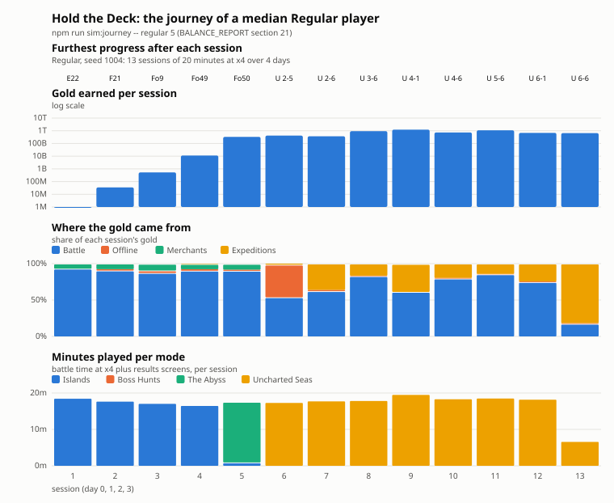

# Balance Report — Hold the Deck

Snapshot of the balance numbers in `src/config.js` (as of commit `dbfb012`),
plus an auto-play simulation of Skull Cove from a fresh save. No code was
changed for this report.

**How the numbers were made**

- Tables 1–3 come straight from `config.js` and the formulas in
  `Progress.js` / `WaveManager.js`, computed by script (not by hand).
- Section 4 runs the real battle code (waves, enemies, crew, abilities,
  Progress) headless through the existing `scripts/sim/` harness, with an
  extra instrumented driver kept outside the repo. The bot opens every chest it can
  afford, puts its best crew on the ship (Captain beside the strongest
  attacker, anti-air from wave 8), and keeps Auto abilities on. Five seeds
  (1000–1004) per policy:
  - **greedy**: spends all gold after every wave (deck first if crew are waiting).
  - **lazy**: only spends after a lost wave.
- "Crew DPS" is **sheet DPS**: damage × deck buffs × expected crit ÷ attack
  interval, single target. It leaves out splash, chain, pierce, poison and
  abilities, so the crew's real output is higher. Effective DPS is the
  "HP ÷ DPS" column compared with the wave's real length.

---

## 1. Enemies

### Wave scaling (all enemies)

| Formula | Value |
|---|---|
| Enemy count | `5 + (wave − 1) × 2.5`, boss waves × 0.5 |
| HP multiplier | `1 + 0.5n + 0.012n²`, n = wave − 1 (also shield HP, keg blast) |
| Damage multiplier | `1.08ⁿ` (also **armour**) |
| Kill-gold multiplier | `1.07ⁿ` |
| Spawn interval | `1400 − 20n` ms, min 700 (members of a formation 350 ms apart) |
| Elite chance | from wave 20: `8% + 0.4%/wave`, max 30%; Elites have 3× HP/shield, 3× gold |

| Wave | HP × | Damage × | Gold × | Enemies (non-boss) | Spawn interval | Elite chance |
|---:|---:|---:|---:|---:|---:|---:|
| 1 | 1.00 | 1.00 | 1.00 | 5 | 1400 | 0% |
| 5 | 3.19 | 1.36 | 1.31 | 15 | 1320 | 0% |
| 10 | 6.47 | 2.00 | 1.84 | 28 | 1220 | 0% |
| 20 | 14.83 | 4.32 | 3.62 | 53 | 1020 | 8% |
| 30 | 25.59 | 9.32 | 7.11 | 78 | 820 | 12% |
| 40 | 38.75 | 20.12 | 13.99 | 103 | 700 | 16% |
| 50 | 54.31 | 43.43 | 27.53 | 128 | 700 | 20% |
| 60 | 72.27 | 93.76 | 54.16 | 153 | 700 | 24% |

Note that damage overtakes HP growth at about wave 45, and by wave 60 it's 30% higher.

### Base stats

| Enemy | HP | Speed (px/s) | Dmg / hit | Attack interval (ms) | Base DPS on hull | Gold | First wave | Special |
|---|---:|---:|---:|---:|---:|---:|---:|---|
| Drowned Sailor | 20 | 22.5 | 5 | 1000 | 5.0 | 2 | 1 | — |
| Thief Monkey | 8 | 65 | 0 | — | 0 | 3 | 3 | Steals 5% of current gold at the ship, then leaves |
| Iron Crab | 60 | 12 | 8 | 1200 | 6.7 | 6 | 6 | Armour 4 (×damage mult), min 1 dmg per hit |
| Storm Harpy | 22 | 30 | 6 | 1100 | 5.5 | 5 | 8 | Flies: only anti-air (or a net) can hit it; dives at the top deck |
| Keg Runner | 12 | 55 | **30 once** | — | — | 4 | 10 | Explodes on hull; killed early, blasts enemies in r40 for 40 (×HP mult) |
| Barnacle Knight | 50 | 16 | 10 | 1100 | 9.1 | 8 | 14 | Shield 60 HP (×HP mult) blocks straight shots; lobs, poison and Ghost Pirate pass |
| Siren | 100 | 0 | 0 | — | 0 | 20 | 16 (every 3rd wave, not boss waves) | Every 6 s: stuns a random crewmate 1.5 s; 1.5× haste to enemies within 110 px for 4 s |
| The Kraken (boss) | 160 | 9 | 12 | 1500 | 8.0 | 50 | 10 (then 30, 50…) | Can't be hit while rising (2.5 s); stun/slow ×0.5 |
| The Ghost Galleon (boss) | 150 | 0 | 4 per ball | 4 balls / 5 s | 3.2 | 50 | 20 (then 40, 60…) | Can't be hit while rising (2.5 s); launches a Boarding Boat every 9 s; stun/slow ×0.5 |
| Boarding Boat (minion) | 30 | 18 | **15 once** | — | — | 3 | 20 | Boards for its damage, then gone; no bounty count |

### Scaled values at key waves

| Wave | Sailor HP / hit | Crab HP / armour | Harpy HP / hit | Keg HP / hull dmg | Knight HP + shield | Boss HP | Boss dmg |
|---:|---|---|---|---|---|---|---|
| 1 | 20 / 5 | — | — | — | — | — | — |
| 10 | 129 / 10 | 388 / 8 | 142 / 12 | 78 / 60 | — | **Kraken 1,036** | 24 / hit |
| 20 | 297 / 22 | 890 / 17 | 326 / 26 | 178 / 129 | 742 + 890 | **Galleon 2,225** | 17 / ball (+ boats 445 HP, 65 dmg) |
| 30 | 512 / 47 | 1,536 / 37 | 563 / 56 | 307 / 280 | 1,280 + 1,536 | **Kraken 4,095** | 112 / hit |
| 40 | 775 / 101 | 2,325 / 80 | 853 / 121 | 465 / 603 | 1,938 + 2,325 | **Galleon 5,813** | 81 / ball (+ boats 1,163 HP, 302 dmg) |
| 49 | 1,053 / 201 | 3,159 / 161 | 1,158 / 241 | 632 / **1,206** | 2,632 + 3,159 | — | — |
| 50 (finale) | 1,086 / 217 | 3,259 / 174 | 1,195 / 261 | 652 / 1,303 | 2,716 + 3,259 | **Galleon 5,703 + Kraken 6,083** (0.7× HP) | Galleon 174 / ball, Kraken 521 / hit; the survivor enrages (×1.6 speed) |

Elites triple the HP (and shield) shown here.

Finale (wave 50): Galleon at 1.5 s, Kraken 20 s later, plus a trickle of 0.3× the
normal enemy count, one group every 3.2 s from 5 s. Pays 60 Pearls + 1 free
Legendary chest.

---

## 2. Crew

### Scaling rules

- **Damage** = `base × (1 + 0.2 × (level − 1)) × (1 + starBonus)`;
  star bonus by stars 0–5: `0, +10%, +25%, +45%, +70%, +100%`.
  → Lv 10 = 2.8×, Lv 25 = 5.8×, 5★ = 2×. Levels are uncapped.
- **Ability durations / stun** × `min(2, 1 + 0.02 × (level − 1) + 0.1 × stars)`.
  Ability damage is a multiple of the hero's current damage, so it scales like damage.
- **The Captain** (aura): the other crewmate on his deck gets
  `+(50% + 4%/level) × (1 + starBonus)` damage and +30% attack speed.

### Stats and DPS

DPS = sheet DPS (crit expectation included; splash, chains, poison and abilities not included).

| Crewmate | Rarity | Dmg | Interval (ms) | Range | Targeting / special | DPS Lv1 0★ | Lv1 5★ | Lv10 0★ | Lv10 5★ | Lv25 0★ | Lv25 5★ |
|---|---|---:|---:|---:|---|---:|---:|---:|---:|---:|---:|
| Cabin Boy | Common | 5 | 450 | 350 | Nearest; anti-air | 11.1 | 22.2 | 31.1 | 62.2 | 64.4 | 129 |
| Ship's Cook | Common | 9 | 900 | 325 | Lob (over shields); 25% stun 1 s | 10.0 | 20.0 | 28.0 | 56.0 | 58.0 | 116 |
| Parrot Keeper | Common | 5 | 750 | 340 | Anti-air; 2.5× vs flyers (16.7 DPS vs flyers at Lv1) | 6.7 | 13.3 | 18.7 | 37.3 | 38.7 | 77.3 |
| Net Thrower | Rare | 6 | 2200 | 300 | Area r37.5; 50% slow 2.5 s; grounds flyers | 2.7 | 5.5 | 7.6 | 15.3 | 15.8 | 31.6 |
| Grog Brewer | Rare | 4 | 900 | 360 | Lob; poison 0.75× dmg/s for 4 s (ignores armour/shield); prefers unpoisoned | 4.4 | 8.9 | 12.4 | 24.9 | 25.8 | 51.6 |
| Harpooner | Rare | 8 | 1700 | 325 | Pierces up to 6 enemies over 150 px; anti-air | 4.7 | 9.4 | 13.2 | 26.4 | 27.3 | 54.6 |
| Ship's Doctor | Rare | 4 | 1000 | 320 | Nearest (support via ability) | 4.0 | 8.0 | 11.2 | 22.4 | 23.2 | 46.4 |
| Voodoo Priestess | Epic | 8 | 1100 | 325 | Curse +30% dmg taken 4 s; prefers uncursed; anti-air | 7.3 | 14.5 | 20.4 | 40.7 | 42.2 | 84.4 |
| Cannoneer | Epic | 24 | 3200 | 325 | Lob, area r47.5 | 7.5 | 15.0 | 21.0 | 42.0 | 43.5 | 87.0 |
| Sharpshooter | Epic | 26 | 2100 | **430** | Furthest enemy; ignores armour | 12.4 | 24.8 | 34.7 | 69.3 | 71.8 | 144 |
| Ghost Pirate | Epic | 13 | 1100 | 330 | Passes shields | 11.8 | 23.6 | 33.1 | 66.2 | 68.5 | 137 |
| **The Duelist** | Legendary | 40 | 1300 | 340 | 35% crit ×2.5; anti-air | **46.9** | **93.8** | **131** | **263** | **272** | **544** |
| The Captain | Legendary | 0 | — | — | Aura on deck-mate (damage bonus shown) | +50% | +100% | +86% | +172% | +146% | +292% |
| Storm Caller | Legendary | 20 | 1500 | 340 | Chain to 3 (80 px jumps, ×0.8 each; 2.4× total if 3 hit); anti-air | 13.3 | 26.7 | 37.3 | 74.7 | 77.3 | 155 |

### Abilities

Duration multiplier at Lv1/Lv10/Lv25: **1.00 / 1.18 / 1.48** at 0★, **1.50 / 1.68 / 1.98** at 5★ (cap 2.0).

| Crewmate | Ability | Cooldown | Numbers (base) | Scales with |
|---|---|---:|---|---|
| Cabin Boy | Rapid Fire | 15 s | 3× attack speed for 4 s | duration |
| Ship's Cook | Hot Stew | 18 s | Stun everything in r45 for 2 s (bosses 1 s) | stun |
| Net Thrower | Big Net | 20 s | 50% slow on every enemy (air too) for 5 s | duration |
| Grog Brewer | Grog Barrel | 18 s | 64 px puddle, 2.5× dmg/s for 6 s | dmg, duration |
| Harpooner | Whale Harpoon | 20 s | 5× dmg to every ground enemy | dmg |
| Voodoo Priestess | Hex | 25 s | +50% dmg taken, all enemies (air too), 6 s | duration |
| Cannoneer | Broadside | 25 s | 6 balls × 2× dmg, r40, spread along the lane | dmg |
| The Duelist | Lunge | 22 s | Next 5 hits on toughest enemy are guaranteed crits (12.5× base hit total) | dmg |
| The Captain | All Hands! | 30 s | Whole crew 1.5× attack speed 6 s | duration |
| Parrot Keeper | Flock | 16 s | 4× dmg to every flyer (needs a flyer) | dmg |
| Ship's Doctor | Patch Up | 24 s | Heal 15% max hull (needs damage) | — |
| Sharpshooter | Deadeye | 22 s | 1 s aim, then 10× dmg on toughest, ignores armour and shields | dmg |
| Ghost Pirate | Haunt | 24 s | Ground walkers flee backwards for 3 s | duration |
| Storm Caller | Tidal Wave | 28 s | Push ground walkers back 110 px, 2× dmg | dmg |

---

## 3. Economy

### Gold

| Source | Wave 1 | Wave 10 | Wave 25 | Wave 50 |
|---|---:|---:|---:|---:|
| Drowned Sailor kill | 2 | 4 | 10 | 55 |
| Thief Monkey kill | 3 | 6 | 15 | 83 |
| Iron Crab kill | 6 | 11 | 30 | 165 |
| Storm Harpy kill | 5 | 9 | 25 | 138 |
| Keg Runner kill | 4 | 7 | 20 | 110 |
| Barnacle Knight kill | 8 | 15 | 41 | 220 |
| Siren kill | 20 | 37 | 101 | 551 |
| Boss kill (Kraken / Galleon) | 50 | 92 | 254 | 1,376 |
| **Wave clear bonus** `10 + 4(w−1)` | 10 | 46 | 106 | 206 |

Elites pay 3×. Kill gold is kept on a lost wave. Thief Monkeys take 5% of
current gold each. Starting gold: 0.

### Pearls (spent on chests)

| Source | Amount | Simulated total by wave 50 |
|---|---|---:|
| Starting Pearls | 3 | 3 |
| Every wave clear | 1 | 50 |
| Every 5th wave clear (bonus) | +5 | 50 |
| First kill of a boss wave's boss | 5 | 25 |
| Finale (wave 50) | 60 + 1 free Legendary chest | 60 |
| Wanted bounties per enemy type | 10 / 100 / 500 defeats → 10 / 25 / 50 | **320** |
| Max-star duplicate refund | 1 per chest | 134 |

Bounties are 63% of all Pearls earned by wave 50 (all seeds agree within one Pearl).

### Chests

- Cost **3 Pearls**. Legendary pity: guaranteed within 30 chests.
- A new hero drops into the first free slot. Duplicates add a star (max 5), and after that they refund 1 Pearl.

| Rarity | Chance | Heroes | Per-hero chance |
|---|---:|---:|---:|
| Common | 45% | 3 (Cabin Boy, Cook, Parrot Keeper) | 15.0% |
| Rare | 30% | 4 (Net Thrower, Grog, Harpooner, Doctor) | 7.5% |
| Epic | 18% | 4 (Voodoo, Cannoneer, Sharpshooter, Ghost) | 4.5% |
| Legendary | 7% | 3 (Duelist, Captain, Storm Caller) | 2.3% |

The full roster at 5★ is 14 × 6 = 84 useful pulls.

### Upgrade costs (gold)

Formula: `round(baseCost × growth^L)`. Hull: base 20, ×1.25, +25 HP per level.
Crew level: base 15, ×1.22, +20% base damage per level. Decks: deck 2 = 100,
deck 3 = 300, +50 hull HP and +2 slots each.

| Level L | Hull: next level costs | Hull: total to reach L | Hull max HP at L (1 deck / 3 decks) | Crew: next level costs | Crew: total to reach L |
|---:|---:|---:|---:|---:|---:|
| 1 | 25 | 20 | 125 / 225 | 15 | 0 |
| 10 | 186 | 664 | 350 / 450 | 90 | 339 |
| 25 | 5,294 | 21,095 | 725 / 825 | 1,773 | 7,990 |
| 50 | 1,401,298 | 5,605,114 | 1,350 / 1,450 | 255,695 | 1,162,183 |

---

## 4. Simulation (fresh save, Skull Cove waves 1–50)

**Every checkpoint wave the brief asks for (10, 20, 30, 40, 50) is a boss
wave.** Boss waves bring half the normal escort, so they are much easier than
the waves around them. The tables also show the wave before each one
(9, 19, 29, 39, 49), which is the real difficulty at that point.

### Greedy bot (spends everything after each wave), average of 5 seeds

| Wave | Attempts (min–max) | Total attempts so far | Gold from the clearing attempt | Total gold earned so far | Crew sheet DPS (min–max) | Total enemy HP in wave | HP ÷ DPS (s) | Wave length (s) | Hull max HP | Sum of enemy hits* | Hull dmg taken (avg / max) |
|---:|---|---:|---:|---:|---|---:|---:|---:|---:|---:|---|
| 5 | 1–1 | 5 | 73 | 232 | 44 (26–74) | 884 | 20 | 18 | 150 | 88 | 0 / 0 |
| 9 | 1–1 | 9 | 174 | 768 | 93 (64–182) | 3,386 | 36 | 29 | 200 | 244 | 2 / 11 |
| **10** | 1–1 | 10 | 212 | 980 | 117 (75–215) | 2,459 | 21 | 19 | 210 | 334 | 67 / 168 |
| 19 | 1–1 | 19 | 808 | 5,326 | 480 (261–725) | 23,310 | 49 | 33 | 380 | 2,346 | 0 / 0 |
| **20** | 1–1 | 20 | 767 | 6,094 | 513 (277–789) | 22,669 | 44 | 27 | 400 | 1,416 | 24 / 35 |
| 29 | 1–1 | 30 | 2,418 | 23,022 | 1,323 (1,051–1,828) | 66,911 | 51 | 48 | 560 | 5,927 | 0 / 0 |
| **30** | 1–1 | 31 | 1,808 | 24,830 | 1,471 (1,158–1,838) | 40,393 | 27 | 30 | 575 | 3,811 | 0 / 0 |
| 39 | 1–1 | 40 | 6,446 | 68,223 | 2,127 (1,729–2,603) | 142,694 | 67 | 60 | 675 | 18,178 | 0 / 0 |
| **40** | 1–1 | 41 | 4,500 | 72,724 | 2,151 (1,734–2,678) | 87,657 | 41 | 31 | 700 | 14,141 | 64 / 80 |
| 49 | 1–2 | 50 | 18,688 | 190,522 | 3,003 (2,427–3,291) | 301,254 | 100 | 66 | 795 | 44,594 | 330 / 483 |
| **50** | 1–1 | 51 | 7,556 | 198,078 | 3,073 (2,468–3,419) | 70,007 | 23 | 62 | 795 | 15,200 | 0 / 0 |

\* Sum of every spawned enemy's damage per hit (a keg or boat counts its one blast). It shows how much damage could reach the hull if nothing were killed.

- All 5 greedy runs reached wave 51 (Skull Cove cleared). Total losses across the 5 runs:
  4 (wave 28 ×2 in two runs, 43 ×1, 49 ×1). That's about 36 minutes of battle at 1× speed per run.
- Final ship: hull level 23–25, 3 decks, crew around Lv 31–32. The crew is usually
  Duelist, Captain, Storm Caller, Sharpshooter, Ghost Pirate and Voodoo or Cannoneer, mostly at 5★.
- By wave 50 every run had opened about 214 chests and owned all 14 heroes,
  which it did between waves 21 and 40.
  134 of those chests were max-star duplicates.

### Lazy bot (spends only after a loss), average of 5 seeds

| Wave | Attempts (min–max) | Total attempts so far | Total gold earned so far | Crew sheet DPS | HP ÷ DPS (s) | Hull max HP | Hull dmg taken (avg / max) |
|---:|---|---:|---:|---:|---:|---:|---|
| 5 | 1–2 | 5 | 237 | 29 | 30 | 110 | 4 / 20 |
| 9 | 1–2 | 10 | 828 | 58 | 58 | 160 | 43 / 104 |
| 10 | 1–3 | 12 | 1,052 | 92 | 27 | 195 | 127 / 192 |
| 19 | 1–2 | 22 | 5,575 | 356 | 65 | 360 | 43 / 216 |
| 20 | 1–1 | 23 | 6,353 | 356 | 65 | 360 | 81 / 233 |
| 29 | 1–1 | 34 | 23,464 | 1,087 | 62 | 525 | 0 / 0 |
| 30 | 1–1 | 35 | 25,272 | 1,098 | 37 | 525 | 0 / 0 |
| 39 | 1–2 | 44 | 69,893 | 1,397 | 102 | 580 | 0 / 0 |
| 40 | 1–1 | 45 | 74,418 | 1,397 | 63 | 580 | 112 / 241 |
| 49 | **1–8** | 57 | 211,621 | 2,996 | 101 | 770 | 579 / 724 |
| 50 | 1–1 | 58 | 219,177 | 2,996 | 23 | 770 | 0 / 0 |

All 5 lazy runs also cleared wave 50, taking 56–65 attempts in total.

### Where it gets stuck

Hull damage on every lost attempt (both bots, 10 runs), grouped by what dealt it:

| Wave | Losses | Main cause of hull damage |
|---:|---:|---|
| 5–9 | 6 | Drowned Sailors / first Harpies (lazy bot with only 1 deck) |
| 10 | 5 | **Keg Runners** (760 of 850 dmg). The Kraken did only 90. |
| 13, 16, 19 | 4 | Keg Runners + Harpies |
| 18, 25, 27, 39 | 6 | **Storm Harpies** (incl. Elite Harpies) |
| 28 | 8 | **Keg Runners** (2,040), then Knights / Elite Sailors |
| 36, 43 | 6 | **Keg Runners** (2,975) |
| 49 | 12 | **Storm Harpies** (9,299 of 9,325); the wave has 18 Harpies + a Siren |

- Nearly every loss comes from **Keg Runners or Storm Harpies**. Losses also
  cluster on **Siren waves** (16, 19, 25, 28, 43 and 49 are all Siren waves).
- Bosses were never the main cause of a loss (the Kraken dealt 90 damage across all lost attempts). They die in seconds.
- Ships don't wear down over a wave. They take almost nothing, or one leak sinks them:
  greedy runs averaged 0 hull damage on 6 of the 11 checkpoint waves.
- **Past the finale (Endless, greedy, 3 seeds):** wave 51 is a sudden spike.
  It has 439k HP, 38 Keg Runners and 27 Elites, against 70k HP for the finale,
  and the bot needed 7–14 attempts. After that the hard wall is at **wave 77–79**
  (15 losses in a row). There, enemy damage is 347× while HP is only 108×.

---

## 5. The five biggest balance problems

### 1. Pearls are far too generous, mainly through bounties, so the gacha runs out by mid-game

- **Evidence:** 508 Pearls by wave 50, 320 of them from Wanted bounties.
  The bot opens about 214 chests. It owns every hero by wave 21–40 and has the
  whole roster at 5★ by wave 56–66. 134 chests (about 400 Pearls) were dead
  duplicates that each refunded 1 Pearl. Chests stop mattering long before the island ends.
- **Suggested fix:**
  - Cut bounties to about 3 / 8 / 15 Pearls, or raise the defeat thresholds to 25 / 250 / 1,000.
  - Raise chest cost to 5 Pearls. Optionally add a 10-chest price break.
  - Replace the max-star refund with something worth having, such as shards
    that convert into a chosen hero's star, or gold.
  - Target: the full roster around wave 40–50, and 5★ on everything well into Endless.

### 2. Enemy damage grows exponentially but the hull grows linearly, so hull upgrades are pointless and fights are pass/fail

- **Evidence:** Damage ×1.08 per wave (43× by wave 50), but the hull only gets
  +25 HP per level. That's about 795 HP at wave 50 after about 17k gold on hull upgrades.
  A single Keg Runner reaching the ship does 759 at wave 43 and 1,206 at wave 49,
  which is more than the whole hull. Bots that won took 0 hull damage on most
  waves, and the losses are sudden one-shots. Hull levels, the Doctor's Patch Up
  and the Siren's chip pressure barely matter.
- **Suggested fix:**
  - Lower `damageGrowth` to about 0.045 (7.9× at wave 50), or make hull HP per
    level a percentage (for example +8% compounding).
  - Make Keg Runner and Boarding Boat damage a share of max hull (about 20–25%)
    instead of a scaled flat number, so a leak hurts without being an instant loss.

### 3. Armour scales with the *damage* multiplier, so most of the crew deals 1 damage to Iron Crabs mid-game

- **Evidence:** Crab armour is `4 × 1.08ⁿ`: 37 at wave 30, 80 at 40, 161 at 49
  (Elite crabs have 9.5k HP). A Lv 31 5★ Cabin Boy, Parrot Keeper, Voodoo
  Priestess, Harpooner or Doctor hits for 56–112, so every hit becomes 1 damage.
  A Ghost Pirate does 21. Only the Sharpshooter (ignores armour), Duelist,
  Storm Caller and Cannoneer can hurt crabs. That quietly pushes players onto
  epics and legendaries, and keeps commons and rares off the ship.
- **Suggested fix:**
  - Make armour a percentage reduction (for example crabs take 50% less, with
    Sharpshooter and poison ignoring it).
  - Or scale armour with `sqrt(hpMultiplier)` instead of the damage multiplier.

### 4. Boss waves and the finale are the easiest waves, and the climax is an anticlimax

- **Evidence:** With `bossEscortFactor` 0.5, waves 10/20/30/40 have 60–70% of
  the HP of the wave before them (wave 39: 143k, wave 40: 88k). The finale
  (wave 50) has **70k HP against 301k on wave 49**. It was never lost in 10
  runs, and the hull took 0 damage. The bosses die in seconds:
  Kraken 6.1k HP at wave 50 against about 3k sheet DPS.
  Then wave 51 (439k HP) is the hardest wave so far.
- **Suggested fix:**
  - Raise `bossEscortFactor` to about 0.8.
  - Raise boss base HP about 3× (Kraken 160 → 500, Galleon 150 → 450) so a
    boss is a real share of its wave.
  - For the finale, raise `hpFactor` 0.7 → 2.0 and `trickle` 0.3 → 0.7, so wave 50 is the peak of the island.
  - Ease Endless back in, for example a short HP grace for waves 51–55.

### 5. Rarity power gap: the Duelist is 4× any other attacker; commons and rares have no late role

- **Evidence:** Sheet DPS at the same level and stars: Duelist 46.9, then
  Storm Caller 13.3, Sharpshooter 12.4, Ghost Pirate 11.8, Cabin Boy 11.1,
  down to Net Thrower 2.7 and Doctor 4.0. Every level and star multiplies these
  base gaps, so a 5★ Lv 25 Duelist (544 DPS) beats the next three attackers
  combined. Storm Caller, also Legendary, is barely above two epics. On top of
  problem 3, the endgame crew is always the same 6.
- **Suggested fix:**
  - Cut the Duelist to about 22 damage (26 DPS), or lower his crit to 25% ×2.
  - Raise Net Thrower to 10 dmg / 1,800 ms and Doctor to 7 dmg.
  - Give Storm Caller 26 damage.
  - Give commons a scaling niche, for example Cabin Boy getting +1% attack
    speed per level, or Parrot Keeper's flyer bonus at 4× (Harpies did nearly all the damage in the 12 losses on wave 49).

### Also worth a look

- **Wave clear gold** is linear (206 at wave 50) while kill gold grows 7% a
  wave, so the clear bonus falls from about a third of a wave's gold at wave 5 to about 1% at wave 49.
  Scaling it with `1.07ⁿ` would keep clearing a wave rewarding.
- **Thief Monkeys** barely matter for a player who spends gold every wave
  (0–511 gold stolen per greedy run).
- **Siren waves** are where the lazy bot stalls. The haste on Harpies and kegs
  is the danger, not the crew stun. That's fine as a mechanic, but worth
  keeping in mind when retuning problem 2.

---

## 6. Rebalance

I applied the requested changes, then tuned them with the sim for four rounds,
plus one run to confirm the final numbers. Every number lives in `src/config.js`.
"Before" and "after" are both measured the same way: the same 5 seeds
(1000–1004) × both bots, played to wave 60. The only bot change is that it uses
Buy 10 whenever it can afford it. "Before" was re-run on the old code, so its
figures differ slightly from section 4, which stopped at wave 50 and measured a
few things differently.

### Results against the targets

| Target | Before | After | Met? |
|---|---|---|---|
| Greedy: 8–15 losses on Skull Cove | 0, 2, 0, 0, 4 | 8, 16, 15, 3, and one run stuck at wave 49 (22 losses) | **Partly** (2 of 5 runs in range, 1 just over) |
| Greedy: never more than 4 attempts on a wave | max 1–3 | max 4, 8, 11, 3, and 15 on the stuck run | **No** (2 of 5 runs) |
| Lazy: clears in 70–100 attempts | 56–65 | 57–62 (4 runs); one stuck at wave 30 | **No** (too few attempts) |
| Typical waves 10–49: hull takes 10–40% | greedy median 0%, mean 3%; 3 of 36 waves in range | greedy median 9%, mean 16%; 11 of 36 waves in range (lazy: 8% / 18%, 9 of 36) | **Partly** |
| Each boss wave at least as hard as the wave before | Boss waves had 60–70% of the HP of the wave before; finale 70k vs 301k | Measured by greedy hull damage and attempts, waves 10, 20 and 30 are harder than the wave before and 40 is level. By total HP, 10, 20 and 50 are bigger, while 30 and 40 are 13–23% smaller | **Partly** |
| Finale in the top 3 hardest waves | #22 by HP, #50 by hull damage | **#1 by HP** (326k); #8 by hull damage (greedy), #4 (lazy); never needs a retry | **Partly** |
| Each boss takes 20–45 s to kill | Kraken 2–17 s, Galleon 1–10 s, finale 0–3 s | Kraken w10 21–32 s, Galleon w20 19–37 s, Kraken w30 19–25 s, Galleon w40 24–37 s; finale: Galleon 20–51 s, Kraken 14–31 s | **Mostly** (a few just outside) |
| Full roster around wave 40–55 | waves 15–40 (mostly 20–28) | greedy 39, 50, 41, 42, 39; lazy 43, 50, 18 (lucky pulls), and two runs at 13 of 14 by wave 60 | **Mostly** |
| No crewmate over 2× the next best (same level and stars) | 3.5× (Duelist 46.9 vs Storm Caller 13.3) | **1.35×** (Duelist 25.1 vs Storm Caller 18.7) at every level and star count | **Yes** |
| Endless 51–60: no wave needs more attempts than the finale | greedy max 8–15 (wave 51 a wall in 2 runs); lazy 3–15 | greedy 1 (every run); lazy 2, 2, 2, and 15 in one run (wave 52) | **Greedy yes, lazy no** |

### What couldn't hit its target, and why

- **Pearls vs the roster target.** With the requested Pearl numbers (bounties
  2 / 5 / 10, every-5th-wave +3, chests 5 Pearls) the bot had 3–11 heroes by
  wave 50. A full roster takes a median of **80 chests** (10% of players need
  47 or fewer, 10% need 140 or more), about 360 Pearls at the Buy 10 price, and
  those numbers pay about 120 Pearls by wave 47. I raised the bounty payouts
  back to **10 / 25 / 50** and kept your new thresholds (25 / 250 / 1,000),
  chest price, Buy 10 price, milestone and finale numbers. That puts the roster
  at about wave 40–50.
- **Lazy bot clears in too few attempts.** Under the new economy it matters
  little *when* gold is spent. A hull that compounds rewards saving up, and
  hull-share kegs don't punish a bot that hasn't bought hull. So the lazy bot
  loses about as often as the greedy one (7–12 losses). To get 70–100 attempts
  for lazy while keeping greedy at 8–15 losses, spending late would need to
  cost more, for example interest-free saving being weaker. None of the numbers
  in the brief control that.
- **Spikes still decide the losses.** Nearly every remaining loss comes from
  waves with many Storm Harpies (49: 18 Harpies and a Siren; 18, 21, 25) or
  Keg Runners sheltering behind Barnacle Knights (28, 30). The seeded wave
  line-ups make these the same waves on every retry, so a crew that lacks
  anti-air can take 8–15 tries. That's why the "max 4 attempts" and some
  "10–40% hull damage" targets miss: ordinary waves are still easy-ish while a
  few hard ones are very hard. Narrowing that gap needs formation weights or
  Harpy stats, which weren't on the list.
- **The finale has the most HP but isn't the most dangerous.** The bot usually
  meets it with 5★ legendaries, and both bosses come in front of the crew where
  every shot reaches them, so it never needed a retry. Raising `hpFactor`
  further pushes the Galleon's kill time past 45 s (it was 51–60 s at 1.8 with
  500 HP), so I stopped at 1.5.
- **Kraken waves are the hardest regular waves** (hull damage 81–85% for
  greedy), not just "at least as hard". The Kraken hits the hull for 12 ×
  damage multiplier every 1.5 s, and its hit damage wasn't on the list. Its HP is set so it dies in 20–30 s.
- **Endless wave 52** stopped one lazy run: it has an Elite Siren hasting 16
  Keg Runners even at the 55% grace count. Grace now spans 10 waves (51–60)
  instead of 5 and starts at 50%, which fixed the greedy bot's wave-51 wall
  but not this line-up.

### Final numbers (changed from before)

| Area | Setting | Before | After | Brief asked for |
|---|---|---|---|---|
| Pearls | Bounty thresholds | 10 / 100 / 500 | 25 / 250 / 1,000 | same |
| | Bounty payouts | 10 / 25 / 50 | **10 / 25 / 50** | 2 / 5 / 10 |
| | Every-5th-wave bonus | +5 | +3 | same |
| | Finale Pearls | 60 (+1 Legendary chest) | 40 (+1 Legendary chest) | same |
| | Chest cost | 3 | 5 | same |
| | Buy 10 | — | 45 | same |
| | Duplicates past 5★ | +1 Pearl | +1 Bonus Level (+5% damage, uncapped, "+N" on cards) | same |
| Damage vs hull | Enemy damage growth | 1.08ⁿ | **1.04ⁿ** | 1.045ⁿ |
| | Hull HP | 100 + 25/level | 120 × 1.07^level (+50 per deck) | same |
| | Hull cost growth | ×1.25 | **×1.15** | start ~×1.18, tune |
| | Keg Runner on the hull | 30 × damage mult | **12%** of max hull (Elite **22%**) | 20% (35%) |
| | Boarding Boat on the hull | 15 × damage mult | 15% of max hull (Elite 25%) | same |
| | Wave-clear gold | 10 + 4(w−1) | (10 + 4(w−1)) × 1.07ⁿ | same |
| Armour | Iron Crab | flat 4 × damage mult | 60% reduction, min 1; ignored by Sharpshooter, poison, curse bonus, Cannoneer, Broadside, Whale Harpoon | same |
| Bosses | Boss escort | 0.5 | **0.65** | 0.85 |
| | Kraken base HP | 160 | **400** | 600 |
| | Galleon base HP | 150 | **450** | 500 |
| | Finale `hpFactor` / trickle | 0.7 / 0.3 | **1.5 / 1.0** | 1.8 / 0.7 |
| | Endless grace | — | **10 waves**, 50% of the count (and Elite chance) rising to 100% | waves 51–55 |
| Crew | Duelist | 40 dmg, 35% ×2.5 | 24 dmg, 30% ×2.2 | same |
| | Captain aura | (50% + 4%/lv) × star bonus | 40% + 2%/lv + 5%/star, max +100% | same |
| | Storm Caller / Net Thrower / Doctor / Grog | 20 / 6 per 2.2 s / 4 / 4 | 28 / 10 per 1.8 s / 7 / 5 | same |
| | Parrot Keeper vs flyers | 2.5× | 4× | same |
| | Cabin Boy | — | +1% attack speed per level, max +50% | same |

Bold marks a number I tuned away from the brief. Tuning went:

1. Exactly as briefed: walls at the waves 10 and 30 Krakens and the finale, and 3–11 heroes by wave 50.
2. Bounty payouts 10 / 25 / 50, Kraken 450, finale 1.2.
3. Escort 0.65, Kraken 400, finale 1.5 and trickle 0.85, grace from 50%.
4. Keg Runner 12% / 22%, damage growth 0.04, hull cost ×1.15. This was the best round.
5. Escort 0.55, Galleon 450, trickle 1.0, hull cost ×1.17, grace 10 waves.
   Greedy runs stalled at waves 25–30 on Harpies, so I reverted escort and hull cost.

The final run is round 4 plus round 5's changes that only touch waves 20, 40, 50 and Endless.

### Crew sheet DPS after the change

Expected crits and the Cabin Boy's level speed are included; deck buffs are not.

| Crewmate | Lv1 0★ | Lv1 5★ | Lv10 0★ | Lv10 5★ | Lv25 0★ | Lv25 5★ |
|---|---:|---:|---:|---:|---:|---:|
| The Duelist | 25.1 | 50.2 | 70.3 | 140.6 | 145.6 | 291.2 |
| Storm Caller | 18.7 | 37.3 | 52.3 | 104.5 | 108.3 | 216.5 |
| Sharpshooter | 12.4 | 24.8 | 34.7 | 69.3 | 71.8 | 143.6 |
| Ghost Pirate | 11.8 | 23.6 | 33.1 | 66.2 | 68.5 | 137.1 |
| Cabin Boy | 11.1 | 22.2 | 33.9 | 67.8 | 79.9 | 159.8 |
| Ship's Cook | 10.0 | 20.0 | 28.0 | 56.0 | 58.0 | 116.0 |
| Cannoneer | 7.5 | 15.0 | 21.0 | 42.0 | 43.5 | 87.0 |
| Voodoo Priestess | 7.3 | 14.5 | 20.4 | 40.7 | 42.2 | 84.4 |
| Ship's Doctor | 7.0 | 14.0 | 19.6 | 39.2 | 40.6 | 81.2 |
| Parrot Keeper (×4 vs flyers) | 6.7 | 13.3 | 18.7 | 37.3 | 38.7 | 77.3 |
| Net Thrower | 5.6 | 11.1 | 15.6 | 31.1 | 32.2 | 64.4 |
| Grog Brewer (+poison) | 5.6 | 11.1 | 15.6 | 31.1 | 32.2 | 64.4 |
| Harpooner (pierces) | 4.7 | 9.4 | 13.2 | 26.4 | 27.3 | 54.6 |
| The Captain (aura) | +40% | +65% | +58% | +83% | +88% | +100% |

---

## 7. Frostbite Reef (Island 3), first look

Measured right after Frostbite Reef was added, **before any tuning**: every
Frostbite Reef number below is a first guess in `src/config.js`, and nothing
was rebalanced. Reproduce with `npm run sim:frost -- 5 3`
(`scripts/sim/frost.mjs`). Section 8 has the rebalance that followed (and
changed how the sim plays), so these numbers are out of date.

**How the numbers were made**

1. For each of 5 seeds (1000–1004), the greedy bot from section 4 sails the
   voyage from a fresh save through Skull Cove and Ember Isle (both finales).
   It may try each wave up to 100 times so every run gets through, and it
   stops as soon as it reaches Frostbite Reef. What it has then (crew,
   levels, stars, hull, decks) is the "crew like Ember Isle wave 50 would have".
2. That crew, **with no further upgrades or chests**, plays each listed
   Frostbite Reef wave 3 times with different luck: 15 attempts per wave.
   Auto abilities are on. The bot never taps frozen crewmates free, so every
   freeze runs its full length.
3. Boss time-to-kill runs from the moment the boss can first be hit (after the
   Wyrm's swoop, after the Giant's roar) to its death, and includes the Wyrm's
   3s in the air. "Wave beaten" counts the enemies dealt with (killed, or
   spent, like a penguin that rammed) out of the whole wave.

### Starting numbers

- **Scaling:** `waveOffset` 98, so Frostbite Reef's wave 1 scales like Ember
  Isle's wave 50 (the same rule as Ember Isle's 49 after Skull Cove). Enemy HP
  is ×165 at wave 1, ×224 at 20 and ×334 at 50; enemy damage ×47, ×98 and ×319.
- **Enemies** (relative to the Cinder Skeleton: 20 HP, speed 22.5, 5 damage):
  - Frozen Corsair: 1.0 HP, 1.0 speed.
  - Sled Penguin: 0.5 HP, 2.2 speed; rams once for 2× its 5 damage.
  - Yeti Raider: 2.2 HP, 0.6 speed; a snowball every 3s for 1.2× from x 300.
  - Ice Witch: 1.2 HP, 0.8 speed; every 5s from x 340, a shield worth 40% of
    the front enemy's max HP (2 witches on screen at most).
- **Bosses:**
  - Frost Wyrm: 450 HP; a breath for 15 every 4s, with a 2s freeze.
  - Frost Giant: 520 HP, speed 8.1; a smash for 18 every 2.5s, with a 1.5s
    freeze every 3rd smash.
  - Finale: both at 70% HP; the Giant's boulders hit for 0.6× its smash,
    every 6s.

| Wave | Wyrm HP / breath | Giant HP / smash | Corsair HP / hit | Snowball | Penguin ram |
|---:|---|---|---|---:|---:|
| 1 | 74,362 / 700 | 85,929 / 841 | 3,305 / 233 | 280 | 467 |
| 10 | 86,350 / 997 | – | 3,838 / 332 | 399 | 665 |
| 20 | – | 116,359 / 1,771 | 4,475 / 492 | 590 | 984 |
| 30 | 116,122 / 2,184 | – | 5,161 / 728 | 874 | 1,456 |
| 40 | – | 153,259 / 3,880 | 5,895 / 1,078 | 1,293 | 2,156 |
| 50 (finale, 70% HP) | 105,150 / 4,786 | 121,506 / 5,743 | 6,676 / 1,595 | 1,914 | 3,191 |

### Crews used

| Seed | Reached Frostbite Reef | Ember losses | Hull LV (max HP) | Decks | Crew (level, stars) |
|---:|---|---:|---|---:|---|
| 1000 | yes | 53 | 72 (15761) | 3 | Duelist 55 5★, Captain 55 1★, Storm 54 4★, Cannon 54 5★, Sharp 54 5★, Ghost 54 5★ |
| 1001 | yes | 9 | 68 (12048) | 3 | Storm 53 5★, Captain 53 2★, Duelist 53 4★, Sharp 53 5★, Cannon 53 5★, Ghost 52 5★ |
| 1002 | yes | 38 | 74 (18030) | 3 | Storm 56 5★, Captain 56 5★, Duelist 56 2★, Sharp 55 5★, Cannon 55 5★, Ghost 55 5★ |
| 1003 | yes | 108 | 77 (22065) | 3 | Storm 58 3★, Captain 57 3★, Duelist 57 3★, Sharp 57 5★, Cannon 57 5★, Ghost 57 5★ |
| 1004 | yes | 86 | 76 (20628) | 3 | Storm 57 3★, Captain 57 2★, Duelist 57 3★, Cannon 57 5★, Sharp 57 5★, Ghost 57 5★ |

All five end up with the same six: Duelist, Captain, Storm Caller,
Sharpshooter, Cannoneer and Ghost Pirate at level 52–58, with 3 decks and a
hull of 12,048–22,065 HP. The Epics are all 5★; the Legendaries are at 1–5★.

### Results (5 crews × 3 replays = 15 attempts per wave)

❄ = a blizzard wave. Blizzards come every 4th wave from 6, so the Wyrm's
waves 10 and 30 have one too. The finale has one the whole wave, without the
blizzard's freezes.

| Wave | Won | Clear time s (avg, range) | Ship HP left (avg, range) | Lost: sunk after s / wave beaten | Freezes per wave: blizzard / Wyrm / Giant | Boss time-to-kill s (avg, range) | Most hull damage from |
|---:|---|---|---|---|---|---|---|
| 1 | 15/15 | 10 (9–10) | 100% (100%–100%) | - | 0.0 / 0.0 / 0.0 | - | - |
| 2 | 15/15 | 11 (11–12) | 100% (100%–100%) | - | 0.0 / 0.0 / 0.0 | - | - |
| 3 | 15/15 | 12 (12–13) | 100% (100%–100%) | - | 0.0 / 0.0 / 0.0 | - | - |
| 4 | 15/15 | 22 (20–24) | 100% (100%–100%) | - | 0.0 / 0.0 / 0.0 | - | - |
| 5 | 15/15 | 23 (22–23) | 100% (100%–100%) | - | 0.0 / 0.0 / 0.0 | - | - |
| 6 ❄ | 15/15 | 21 (20–23) | 100% (100%–100%) | - | 3.0 / 0.0 / 0.0 | - | - |
| 7 | 15/15 | 30 (28–33) | 99% (96%–100%) | - | 0.0 / 0.0 / 0.0 | - | Frozen Corsair 100% |
| 8 | 15/15 | 25 (24–26) | 96% (92%–100%) | - | 0.0 / 0.0 / 0.0 | - | Sled Penguin 100% |
| 9 | 15/15 | 26 (25–26) | 100% (100%–100%) | - | 0.0 / 0.0 / 0.0 | - | - |
| 10 ❄ | 14/15 | 43 (38–48) | 29% (0%–46%) | 44 / 95% | 3.0 / 10.1 / 0.0 | Frost Wyrm: 38 (33–43); alive 1x with 3% HP left | Frost Wyrm 83%, Sled Penguin 17% |
| 18 ❄ | 15/15 | 52 (47–57) | 44% (20%–72%) | - | 3.0 / 0.0 / 0.0 | - | Yeti Raider 77%, Sled Penguin 23% |
| 19 | 15/15 | 46 (45–47) | 80% (71%–90%) | - | 0.0 / 0.0 / 0.0 | - | Sled Penguin 78%, Yeti Raider 22% |
| 20 | 15/15 | 70 (65–76) | 47% (28%–67%) | - | 0.0 / 0.0 / 0.0 | Frost Giant: 51 (41–58) | Yeti Raider 93%, Frost Giant 6% |
| 21 | 12/15 | 75 (69–83) | 17% (0%–37%) | 48 / 62% | 0.0 / 0.0 / 0.0 | - | Yeti Raider 70%, Frozen Corsair 30% |
| 22 ❄ | 12/15 | 57 (51–62) | 12% (0%–36%) | 48 / 86% | 3.0 / 0.0 / 0.0 | - | Yeti Raider 69%, Sled Penguin 31% |
| 28 | 0/15 | - (-) | 0% (0%–0%) | 45 / 59% | 0.0 / 0.0 / 0.0 | - | Frozen Corsair 59%, Sled Penguin 24% |
| 29 | 0/15 | - (-) | 0% (0%–0%) | 28 / 71% | 0.0 / 0.0 / 0.0 | - | Sled Penguin 66%, Yeti Raider 28% |
| 30 ❄ | 0/15 | - (-) | 0% (0%–0%) | 24 / 42% | 3.0 / 4.1 / 0.0 | Frost Wyrm: never killed; alive 15x with 87% HP left | Frost Wyrm 46%, Sled Penguin 22% |
| 31 | 0/15 | - (-) | 0% (0%–0%) | 27 / 58% | 0.0 / 0.0 / 0.0 | - | Yeti Raider 36%, Sled Penguin 32% |
| 32 | 0/15 | - (-) | 0% (0%–0%) | 45 / 45% | 0.0 / 0.0 / 0.0 | - | Yeti Raider 61%, Sled Penguin 38% |
| 38 ❄ | 0/15 | - (-) | 0% (0%–0%) | 27 / 66% | 3.0 / 0.0 / 0.0 | - | Sled Penguin 84%, Yeti Raider 15% |
| 39 | 0/15 | - (-) | 0% (0%–0%) | 38 / 47% | 0.0 / 0.0 / 0.0 | - | Frozen Corsair 62%, Yeti Raider 38% |
| 40 | 0/15 | - (-) | 0% (0%–0%) | 23 / 56% | 0.0 / 0.0 / 0.0 | Frost Giant: never killed; alive 15x with 98% HP left | Sled Penguin 81%, Yeti Raider 12% |
| 41 | 0/15 | - (-) | 0% (0%–0%) | 22 / 65% | 0.0 / 0.0 / 0.0 | - | Sled Penguin 68%, Yeti Raider 32% |
| 42 ❄ | 0/15 | - (-) | 0% (0%–0%) | 21 / 72% | 3.0 / 0.0 / 0.0 | - | Sled Penguin 77%, Frozen Corsair 16% |
| 48 | 0/15 | - (-) | 0% (0%–0%) | 25 / 69% | 0.0 / 0.0 / 0.0 | - | Yeti Raider 54%, Sled Penguin 36% |
| 49 | 0/15 | - (-) | 0% (0%–0%) | 18 / 77% | 0.0 / 0.0 / 0.0 | - | Sled Penguin 58%, Frozen Corsair 42% |
| 50 ❄ | 0/15 | - (-) | 0% (0%–0%) | 17 / 88% | 0.0 / 3.6 / 0.0 | Frost Wyrm: never killed; alive 15x with 57% HP left; Frost Giant: never killed; alive 15x with 100% HP left | Frost Wyrm 85%, Sled Penguin 15% |

### For context: the greedy bot carrying on

This is the same bot playing on into Frostbite Reef as usual: it spends its
gold after every wave and gets the normal 15 tries per wave. Only 1 of the 5
runs gets past Ember Isle that way, and it stalls on the Reef at wave 30.

| Seed | Stopped at | Losses on Frostbite Reef | Hull LV | Crew (level) |
|---:|---|---:|---:|---|
| 1000 | Skull Cove 49 (wall before Frostbite Reef) | 0 | 44 | Duelist 35, Captain 34, Storm 34, Cannon 34, Sharp 34, Ghost 34 |
| 1001 | Frostbite 30 (wall) | 19 | 81 | Storm 61, Captain 61, Duelist 61, Sharp 61, Cannon 60, Ghost 60 |
| 1002 | Ember Isle 50 (wall before Frostbite Reef) | 0 | 70 | Storm 53, Captain 53, Duelist 52, Sharp 52, Cannon 52, Ghost 52 |
| 1003 | Ember Isle 32 (wall before Frostbite Reef) | 0 | 58 | Storm 45, Captain 45, Duelist 45, Sharp 44, Cannon 44, Ghost 44 |
| 1004 | Skull Cove 30 (wall before Frostbite Reef) | 0 | 28 | Duelist 24, Cannon 24, Sharp 23, Ghost 23, Harpoon 23, Netter 23 |

### What stands out (not acted on yet)

- **The difficulty jumps around wave 20.** The end-of-Ember crew clears
  waves 1–9 in 10–33s and loses at most 8% of the hull. From wave 18 it
  struggles: it wins 12 of 15 on waves 21 and 22, and loses every attempt from
  28 on, lasting 17–45s. Waves 1–9 bring only 5–25 enemies at Ember-50
  strength, so they're easy. After that the wave size grows faster than a
  fixed crew can keep up with. The one bot run that keeps upgrading stalls at
  wave 30.
- **Freezes:**
  - A blizzard wave freezes exactly **3** crewmates (one every 3s for 10s,
    2s each). The blizzard arrived before the end of every wave that had one.
  - The Wyrm freezes the bow crewmate with every breath: about **10 per wave**
    on wave 10 (a fight of about 40s), and about 4 on waves 30 and 50, where
    the ship sinks first.
  - The Giant froze nobody in any attempt. On wave 20 it dies after one or two
    smashes at most (6% of that wave's hull damage). On waves 40 and 50 the
    ship sinks before it reaches the hull.
- **Frost Wyrm (wave 10):** it takes 38s to kill (33–43s), inside the
  20–45s target from section 6. But its breath does **83%** of the hull
  damage, 1 of 15 attempts is lost, and the ship ends that wave on 29% on
  average. On wave 30 it's never killed: it still has 87% HP when the ship
  sinks.
- **Frost Giant (wave 20):** it takes 51s to kill (41–58s), above the 45s
  target, but it does little harm in that time. The Yeti Raiders do 93% of
  the hull damage on that wave.
- **Yeti Raiders** are the main threat on waves 18–22, with 69–93% of the
  hull damage. They start throwing as soon as they reach x 300, long before
  the walkers reach the ship. **Sled Penguins** take over from wave 29, with
  58–84% on most later waves: they come in packs of 3–5 at speed 49.5, and
  each ram hits for twice a Corsair's hit.
- **The finale** sinks the ship in about 17s. The Wyrm deals **85%** of the
  damage (a 4,786 breath every 4s against a 12–22k hull) and still has 57%
  of its HP at the end. The Giant is never even hit (100% HP). Enemy damage
  is ×319 there (×1.04 per wave on top of the offset), so the Wyrm's breath
  would need looking at before its HP.
- **Ice Witches** barely show in the hull numbers because they deal no
  damage; their effect shows up as longer clear times instead. A shield is 40%
  of the front enemy's max HP: about 2,700 on a wave-50 Corsair.
- **A bug the sim caught along the way:** while building this, a name clash in
  the code stopped Ember Isle's lava bombs from hurting the ship. It's fixed,
  and `npm run sim -- 3 50 voyage` gives exactly the same Skull Cove and Ember
  Isle results as before Frostbite Reef was added.

---

## 8. Frostbite Reef rebalance

Based on section 7. Branch `frostbite-reef`. Every number lives in
`src/config.js`. Reproduce with `npm run sim:frost -- 5 3` (set
`FROST_CACHE=<file>` to reuse the end-of-Ember crews between runs).

### 8.1 A sim closer to a real player

I changed the sim before touching any numbers:

- **Tapping frozen crew:** the bot taps a frozen crewmate free 0.8s after it
  freezes, 60% of the time; otherwise the ice lasts its full time (`TAP` in
  `scripts/sim/simulate.mjs`). This applies to every sim run, but only
  Frostbite Reef freezes anyone, so other islands are unaffected.
- **Two profiles**, reported side by side from now on:
  - **No upgrades:** section 7's method. The end-of-Ember crew plays each
    listed wave on its own, 3 replays × 5 crews = 15 attempts per wave.
  - **Upgraded:** the same crew sails on through waves 1–50 in order. After
    every attempt it spends like the greedy bot: it opens chests with its
    Pearls, then with its gold builds a deck if one is left, then always buys
    the cheapest of hull and crew levels. A wave lost 5 times running is
    skipped. Each listed wave reports its first attempt, again 15 per wave.
  - In this game the Shipwright's upgrades (hull, crew levels) cost **gold**,
    not Pearls; Pearls only buy chests (stars and Bonus Levels). So the
    profile spends both, each on what it buys.

### 8.2 Section 7 rerun with both profiles, before any balance change

"Before" from here on means the section 7 numbers with the new sim (tapping
on). Summary by band:

| Waves | No upgrades | Upgraded |
|---|---|---|
| 1–9 | all 15/15 | all 15/15 |
| 10 (Wyrm) | 14/15 | 15/15 |
| 18–22 | 15, 15, 15, 12, 12 | all 15/15 |
| 28–32 | all 0/15 | 1, 3, 0, 0, 0 |
| 38–42 | all 0/15 | all 0/15 |
| 50 finale | 0/15 | 0/15 |

Freezes per wave: about 5 on blizzard waves (that average includes waves 10
and 30, where the Wyrm adds its own), 9–10 on Wyrm waves.

**How much was the sim, and how much the numbers?** Tapping changed little:
wave 10 still loses about 1 in 15. Upgrades changed little too: over 50 Reef
waves the upgraded crews gained only about 2 crew levels and 5 hull levels,
and skipped 19–25 of the 50 waves after losing them 5 times. At the old
damage curve they rarely win, so they earn little gold, and at level ~58 a
crew level costs 1.3–1.9M gold. **The problem was the numbers**: the damage
curve, more than the sim.

Full tables, before:

**No upgrades**

| Wave | Won | Clear time s (avg, range) | Ship HP left (avg, range) | Lost: sunk after s / wave beaten | Freezes: blizzard / Wyrm / Giant | Boss time-to-kill s (avg, range) | Most hull damage from |
|---:|---|---|---|---|---|---|---|
| 1 | 15/15 | 10 (9–10) | 100% (100%–100%) | - | 0.0 / 0.0 / 0.0 | - | - |
| 2 | 15/15 | 11 (11–12) | 100% (100%–100%) | - | 0.0 / 0.0 / 0.0 | - | - |
| 3 | 15/15 | 12 (12–13) | 100% (100%–100%) | - | 0.0 / 0.0 / 0.0 | - | - |
| 4 | 15/15 | 22 (20–24) | 100% (100%–100%) | - | 0.0 / 0.0 / 0.0 | - | - |
| 5 | 15/15 | 23 (22–23) | 100% (100%–100%) | - | 0.0 / 0.0 / 0.0 | - | - |
| 6 ❄ | 15/15 | 21 (20–23) | 100% (100%–100%) | - | 3.0 / 0.0 / 0.0 | - | - |
| 7 | 15/15 | 30 (28–33) | 99% (96%–100%) | - | 0.0 / 0.0 / 0.0 | - | Frozen Corsair 100% |
| 8 | 15/15 | 25 (24–26) | 96% (92%–100%) | - | 0.0 / 0.0 / 0.0 | - | Sled Penguin 100% |
| 9 | 15/15 | 26 (25–26) | 100% (100%–100%) | - | 0.0 / 0.0 / 0.0 | - | - |
| 10 ❄ | 14/15 | 43 (38–47) | 31% (0%–46%) | 44 / 95% | 3.0 / 8.8 / 0.0 | Frost Wyrm: 37 (33–42); alive 1x with 1% HP left | Frost Wyrm 84%, Sled Penguin 16% |
| 18 ❄ | 15/15 | 53 (48–57) | 45% (27%–74%) | - | 3.0 / 0.0 / 0.0 | - | Yeti Raider 77%, Sled Penguin 23% |
| 19 | 15/15 | 46 (45–47) | 80% (71%–90%) | - | 0.0 / 0.0 / 0.0 | - | Sled Penguin 78%, Yeti Raider 22% |
| 20 | 15/15 | 70 (65–76) | 47% (28%–67%) | - | 0.0 / 0.0 / 0.0 | Frost Giant: 51 (41–58) | Yeti Raider 93%, Frost Giant 6% |
| 21 | 12/15 | 75 (69–83) | 17% (0%–37%) | 48 / 62% | 0.0 / 0.0 / 0.0 | - | Yeti Raider 70%, Frozen Corsair 30% |
| 22 ❄ | 12/15 | 59 (52–64) | 16% (0%–42%) | 48 / 87% | 3.0 / 0.0 / 0.0 | - | Yeti Raider 70%, Sled Penguin 30% |
| 28 | 0/15 | - (-) | 0% (0%–0%) | 45 / 59% | 0.0 / 0.0 / 0.0 | - | Frozen Corsair 59%, Sled Penguin 24% |
| 29 | 0/15 | - (-) | 0% (0%–0%) | 28 / 71% | 0.0 / 0.0 / 0.0 | - | Sled Penguin 66%, Yeti Raider 28% |
| 30 ❄ | 0/15 | - (-) | 0% (0%–0%) | 24 / 43% | 3.0 / 3.8 / 0.0 | Frost Wyrm: never killed; alive 15x with 87% HP left | Frost Wyrm 47%, Frozen Corsair 23% |
| 31 | 0/15 | - (-) | 0% (0%–0%) | 27 / 58% | 0.0 / 0.0 / 0.0 | - | Yeti Raider 36%, Sled Penguin 32% |
| 32 | 0/15 | - (-) | 0% (0%–0%) | 45 / 45% | 0.0 / 0.0 / 0.0 | - | Yeti Raider 61%, Sled Penguin 38% |
| 38 ❄ | 0/15 | - (-) | 0% (0%–0%) | 27 / 67% | 3.0 / 0.0 / 0.0 | - | Sled Penguin 84%, Yeti Raider 16% |
| 39 | 0/15 | - (-) | 0% (0%–0%) | 38 / 47% | 0.0 / 0.0 / 0.0 | - | Frozen Corsair 62%, Yeti Raider 38% |
| 40 | 0/15 | - (-) | 0% (0%–0%) | 23 / 56% | 0.0 / 0.0 / 0.0 | Frost Giant: never killed; alive 15x with 98% HP left | Sled Penguin 81%, Yeti Raider 12% |
| 41 | 0/15 | - (-) | 0% (0%–0%) | 22 / 65% | 0.0 / 0.0 / 0.0 | - | Sled Penguin 68%, Yeti Raider 32% |
| 42 ❄ | 0/15 | - (-) | 0% (0%–0%) | 21 / 72% | 3.0 / 0.0 / 0.0 | - | Sled Penguin 76%, Frozen Corsair 16% |
| 48 | 0/15 | - (-) | 0% (0%–0%) | 25 / 69% | 0.0 / 0.0 / 0.0 | - | Yeti Raider 54%, Sled Penguin 36% |
| 49 | 0/15 | - (-) | 0% (0%–0%) | 18 / 77% | 0.0 / 0.0 / 0.0 | - | Sled Penguin 58%, Frozen Corsair 42% |
| 50 ❄ | 0/15 | - (-) | 0% (0%–0%) | 17 / 88% | 0.0 / 3.5 / 0.0 | Frost Wyrm: never killed; alive 15x with 57% HP left; Frost Giant: never killed; alive 15x with 100% HP left | Frost Wyrm 83%, Sled Penguin 17% |

**Upgraded**

| Wave | Won | Clear time s (avg, range) | Ship HP left (avg, range) | Lost: sunk after s / wave beaten | Freezes: blizzard / Wyrm / Giant | Boss time-to-kill s (avg, range) | Most hull damage from |
|---:|---|---|---|---|---|---|---|
| 1 | 15/15 | 10 (9–10) | 100% (100%–100%) | - | 0.0 / 0.0 / 0.0 | - | - |
| 2 | 15/15 | 11 (11–12) | 100% (100%–100%) | - | 0.0 / 0.0 / 0.0 | - | - |
| 3 | 15/15 | 12 (11–13) | 100% (100%–100%) | - | 0.0 / 0.0 / 0.0 | - | - |
| 4 | 15/15 | 22 (20–24) | 100% (100%–100%) | - | 0.0 / 0.0 / 0.0 | - | - |
| 5 | 15/15 | 23 (22–23) | 100% (100%–100%) | - | 0.0 / 0.0 / 0.0 | - | - |
| 6 ❄ | 15/15 | 21 (19–23) | 100% (100%–100%) | - | 3.0 / 0.0 / 0.0 | - | - |
| 7 | 15/15 | 30 (27–33) | 100% (98%–100%) | - | 0.0 / 0.0 / 0.0 | - | Frozen Corsair 100% |
| 8 | 15/15 | 25 (23–26) | 97% (96%–100%) | - | 0.0 / 0.0 / 0.0 | - | Sled Penguin 100% |
| 9 | 15/15 | 26 (24–27) | 100% (100%–100%) | - | 0.0 / 0.0 / 0.0 | - | - |
| 10 ❄ | 15/15 | 43 (39–47) | 38% (19%–47%) | - | 3.0 / 9.3 / 0.0 | Frost Wyrm: 38 (34–41) | Frost Wyrm 84%, Sled Penguin 16% |
| 18 ❄ | 15/15 | 50 (45–55) | 65% (47%–91%) | - | 3.0 / 0.0 / 0.0 | - | Yeti Raider 79%, Sled Penguin 21% |
| 19 | 15/15 | 45 (40–47) | 86% (74%–91%) | - | 0.0 / 0.0 / 0.0 | - | Sled Penguin 81%, Yeti Raider 19% |
| 20 | 15/15 | 67 (60–73) | 65% (54%–79%) | - | 0.0 / 0.0 / 0.0 | Frost Giant: 49 (41–56) | Yeti Raider 100% |
| 21 | 15/15 | 70 (61–82) | 45% (27%–76%) | - | 0.0 / 0.0 / 0.0 | - | Yeti Raider 77%, Frozen Corsair 23% |
| 22 ❄ | 15/15 | 55 (50–63) | 43% (17%–70%) | - | 3.0 / 0.0 / 0.0 | - | Yeti Raider 75%, Sled Penguin 25% |
| 28 | 1/15 | 69 (69–69) | 1% (0%–10%) | 46 / 63% | 0.0 / 0.0 / 0.0 | - | Frozen Corsair 53%, Yeti Raider 32% |
| 29 | 3/15 | 71 (69–72) | 10% (0%–70%) | 44 / 66% | 0.0 / 0.0 / 0.0 | - | Sled Penguin 46%, Yeti Raider 33% |
| 30 ❄ | 0/15 | - (-) | 0% (0%–0%) | 30 / 45% | 3.0 / 5.5 / 0.0 | Frost Wyrm: never killed; alive 15x with 70% HP left | Frost Wyrm 52%, Frozen Corsair 22% |
| 31 | 0/15 | - (-) | 0% (0%–0%) | 38 / 56% | 0.0 / 0.0 / 0.0 | - | Yeti Raider 51%, Frozen Corsair 29% |
| 32 | 0/15 | - (-) | 0% (0%–0%) | 46 / 50% | 0.0 / 0.0 / 0.0 | - | Yeti Raider 60%, Sled Penguin 37% |
| 38 ❄ | 0/15 | - (-) | 0% (0%–0%) | 44 / 54% | 3.0 / 0.0 / 0.0 | - | Sled Penguin 66%, Yeti Raider 33% |
| 39 | 0/15 | - (-) | 0% (0%–0%) | 46 / 42% | 0.0 / 0.0 / 0.0 | - | Yeti Raider 63%, Frozen Corsair 37% |
| 40 | 0/15 | - (-) | 0% (0%–0%) | 33 / 63% | 0.0 / 0.0 / 0.0 | Frost Giant: never killed; alive 15x with 88% HP left | Sled Penguin 71%, Frozen Corsair 17% |
| 41 | 0/15 | - (-) | 0% (0%–0%) | 31 / 58% | 0.0 / 0.0 / 0.0 | - | Sled Penguin 58%, Yeti Raider 42% |
| 42 ❄ | 0/15 | - (-) | 0% (0%–0%) | 22 / 73% | 3.0 / 0.0 / 0.0 | - | Sled Penguin 69%, Frozen Corsair 26% |
| 48 | 0/15 | - (-) | 0% (0%–0%) | 38 / 60% | 0.0 / 0.0 / 0.0 | - | Yeti Raider 64%, Sled Penguin 21% |
| 49 | 0/15 | - (-) | 0% (0%–0%) | 19 / 77% | 0.0 / 0.0 / 0.0 | - | Sled Penguin 50%, Frozen Corsair 50% |
| 50 ❄ | 0/15 | - (-) | 0% (0%–0%) | 21 / 88% | 0.0 / 4.1 / 0.0 | Frost Wyrm: never killed; alive 15x with 49% HP left; Frost Giant: never killed; alive 15x with 99% HP left | Frost Wyrm 83%, Sled Penguin 12% |

### 8.3 The damage curve

**Chosen:** up to effective wave 100, enemy damage grows ×1.04 per wave as
before. After that it grows **×1.03 per wave, capped at ×62**
(`WAVES.lateDamage = { from: 100, growth: 0.03, cap: 62 }`). Effective
wave means wave + island offset, so Frostbite Reef's wave n is 98 + n. HP
growth is unchanged.

| Reef wave | Effective wave | Damage before | Damage now |
|---:|---:|---:|---:|
| 1 | 99 | ×47 | ×47 |
| 2 | 100 | ×49 | ×49 |
| 5 | 103 | ×55 | ×53 |
| 10 | 108 | ×66 | ×62 |
| 20 | 118 | ×98 | ×62 |
| 30 | 128 | ×146 | ×62 |
| 40 | 138 | ×216 | ×62 |
| 50 | 148 | ×319 | ×62 |

It's a cap per island in effect: the Reef's damage rises for its first 10
waves and then holds, while HP keeps growing (×192 at wave 10, ×334 at 50)
and so does the wave size (5 + 2.5 per wave).

**Why this shape:** a plain softer exponent made early Frostbite Reef too easy
and late Frostbite Reef a wall at the same time, because the wall comes from
HP and enemy count as much as from damage. I tried, with the fixes below
applied:

| Curve after wave 100 | Wyrm breath | Finale HP | No upgrades 28–32 / 38–42 / 50 | Upgraded 28–32 / 38–42 / 50 |
|---|---:|---:|---|---|
| ×1.01 per wave, no cap | 15 | 0.7 | 15,15,0,0,0 / 0,2,0,0,0 / 0 | 15,15,6,15,14 / 10,15,14,15,5 / 15 |
| flat (×1.00) | 15 | 0.7 | 15,15,2,10,9 / 2,9,4,9,0 / 5 | 15,15,15,15,14 / 13,15,15,15,13 / 15 |
| ×1.03, cap ×72 | 10 | 0.85 | 11,15,0,0,0 / 0,2,0,0,0 / 0 | 15,15,11,11,10 / 9,14,13,14,4 / 13 |
| ×1.03, cap ×65 | 10 | 0.85 | 14,15,0,0,0 / 0,5,0,2,0 / 0 | 15,15,15,15,12 / 13,15,15,15,9 / 15 |
| ×1.04, cap ×70 | 10 | 0.85 | 11,15,0,0,0 / 0,2,0,0,0 / 0 | 15,15,11,15,11 / 13,15,15,15,4 / 15 |
| ×1.03, cap ×65 | 7 | 1.2 | 14,15,3,0,0 / 0,5,0,2,0 / 0 | 15,15,15,15,12 / 13,15,15,15,9 / 9 |
| **×1.03, cap ×62** | **7** | **1.2** | **15,15,3,1,0 / 0,6,0,2,0 / 0** | **15,15,15,15,12 / 14,15,15,15,11 / 10** |

The flat curve came closest for the no-upgrades crew, but it let the upgraded
crew win nearly everything, the finale included. The ×62 cap sits between
them: upgraded lands in its target bands, and no upgrades walls where a crew
that stops upgrading should.

Skull Cove and Ember Isle are untouched: their effective waves are 1–99.
`npm run sim -- 3 50 voyage` gives the same result for every Skull Cove and
Ember Isle wave as on `main` before Frostbite Reef. The one run that clears
Ember Isle now also clears Frostbite Reef.

### 8.4 The specific fixes

- **Yeti Raiders:** snowballs hit for 0.8× (was 1.2×), every 4s (was 3s),
  and at most **3 on screen** (more wait in the queue, like Ice Witches). The
  stop point stays at **x 300**, because every crewmate reaches it from every
  slot: the farthest pair is slot 5 (16,150) to a Yeti at (300,227), 294px,
  and the shortest range is 300 (Net Thrower). Their share of hull damage is now
  42–44% on wave 18 and 66–79% on wave 20 (was 77–100% on 18–20), on far less
  total damage: the ship ends waves 18–20 on 84–94% hull.
- **Frost Wyrm:** only **every 2nd breath** freezes, and a breath hits for
  **7** (was 15). Wave 10 now has 4.8 Wyrm freezes. Its share of the hull
  damage there is 67–68% (was 84%), 30–38% on wave 30 and 36–45% in the
  finale.
- **Blizzards skip boss waves** (`skipBossWaves`): waves 6, 14, 18, 22, 26,
  34, 38, 42 and 46. The finale keeps its permanent blizzard without freezes.
  Blizzard waves average **3.0** freezes, with tapping cutting their length.
- **Finale:** the Giant comes in behind the pines at 4.6s and steps out of the
  trees **5s** after the Wyrm lands (was 8s). He can be hit **as soon as he
  roars**, on every Giant wave, not just the finale. Both bosses now have
  **120%** of their usual HP for the wave (was 70%): with the cap the
  upgraded crew otherwise won the finale 14–15 times in 15. Both bosses take
  damage in every finale attempt, both profiles.

### 8.5 After

| Waves | Target: no upgrades | No upgrades | Target: upgraded | Upgraded |
|---|---|---|---|---|
| 1–9 | 15/15 | all 15/15 ✓ | 15/15 | all 15/15 ✓ |
| 10 (Wyrm) | 11–14 | 15/15 ✗ | 15/15 | 15/15 ✓ |
| 18–22 | 10–15; 21–22 end on 20–50% | all 15/15 ✓; 21–22 end on 61% / 73% ✗ | 15/15 | all 15/15 ✓ |
| 28–32 | 5–10 | 15, 15, 3, 1, 0 (6.8 a wave) | 13–15 | 15, 15, 15, 15, 12 (14.4 a wave) |
| 38–42 | 2–6 | 0, 6, 0, 2, 0 (1.6 a wave) | 11–14 | 14, 15, 15, 15, 11 (14.0 a wave) |
| 50 finale | 0–2 | 0/15 ✓ | 8–12, both bosses hurt | 10/15, both hurt in 15/15 ✓ |
| Freezes | blizzard 2–3, Wyrm 4–5 | blizzard 3.0 ✓; Wyrm 4.8 on wave 10, 5.7 on 30 | | blizzard 3.0 ✓; Wyrm 4.8 on wave 10, 7.3 on 30 |

**What still misses, and why:**

- **Wave 10 is too easy without upgrades** (15/15, target 11–14). The two
  Wyrm targets pull against each other. Losses on wave 10 came almost entirely
  from the breath, so cutting its share of hull damage toward 50% also
  removes the losses. Its escort (Corsairs and the first penguin packs) can't
  sink a 12–22k hull at that wave. Getting both would need a harder wave-10
  escort, or a longer Wyrm fight (more HP) at the same low breath.
- **Waves 21–22 without upgrades** end on 61% and 73% hull (target 20–50%).
  The capped curve is flat by then, and making those waves harder would also
  harden 28–42, which are already at or under target for that crew.
- **28–32 and 38–42 without upgrades** hit the band averages but not every
  wave. The crew is fixed, so it walls between 29 and 30, where the Wyrm and
  the two-Yeti formation arrive; after that only line-up luck gives wins (wave
  39: 6/15, 41: 2/15). A fixed crew can't show an even spread over 10 waves
  of growing HP.
- **Wyrm waves have 4.8 freezes on wave 10** (on target) but 5.7–7.3 on wave
  30. The fight there lasts 60–100s, so the breaths that freeze add up even at
  every 2nd breath.
- **Upgraded 38–42** comes to 14.0 a wave against 11–14, at the top of the band.

Full tables, after:

**No upgrades**

| Wave | Won | Clear time s (avg, range) | Ship HP left (avg, range) | Lost: sunk after s / wave beaten | Freezes: blizzard / Wyrm / Giant | Boss time-to-kill s (avg, range) | Most hull damage from |
|---:|---|---|---|---|---|---|---|
| 1 | 15/15 | 10 (9–10) | 100% (100%–100%) | - | 0.0 / 0.0 / 0.0 | - | - |
| 2 | 15/15 | 11 (11–12) | 100% (100%–100%) | - | 0.0 / 0.0 / 0.0 | - | - |
| 3 | 15/15 | 12 (12–13) | 100% (100%–100%) | - | 0.0 / 0.0 / 0.0 | - | - |
| 4 | 15/15 | 22 (20–24) | 100% (100%–100%) | - | 0.0 / 0.0 / 0.0 | - | - |
| 5 | 15/15 | 23 (22–23) | 100% (100%–100%) | - | 0.0 / 0.0 / 0.0 | - | - |
| 6 ❄ | 15/15 | 21 (20–23) | 100% (100%–100%) | - | 3.0 / 0.0 / 0.0 | - | - |
| 7 | 15/15 | 30 (28–33) | 99% (96%–100%) | - | 0.0 / 0.0 / 0.0 | - | Frozen Corsair 100% |
| 8 | 15/15 | 25 (24–26) | 97% (93%–100%) | - | 0.0 / 0.0 / 0.0 | - | Sled Penguin 100% |
| 9 | 15/15 | 26 (25–26) | 100% (100%–100%) | - | 0.0 / 0.0 / 0.0 | - | - |
| 10 | 15/15 | 43 (38–47) | 62% (49%–68%) | - | 0.0 / 4.8 / 0.0 | Frost Wyrm: 38 (33–42) | Frost Wyrm 67%, Sled Penguin 33% |
| 18 ❄ | 15/15 | 69 (64–73) | 84% (74%–92%) | - | 3.0 / 0.0 / 0.0 | - | Sled Penguin 52%, Yeti Raider 42% |
| 19 | 15/15 | 54 (48–63) | 89% (84%–93%) | - | 0.0 / 0.0 / 0.0 | - | Sled Penguin 99%, Yeti Raider 1% |
| 20 | 15/15 | 78 (69–86) | 90% (85%–96%) | - | 0.0 / 0.0 / 0.0 | Frost Giant: 54 (45–60) | Yeti Raider 66%, Frost Giant 25% |
| 21 | 15/15 | 85 (76–93) | 61% (41%–72%) | - | 0.0 / 0.0 / 0.0 | - | Frozen Corsair 79%, Yeti Raider 21% |
| 22 ❄ | 15/15 | 80 (70–89) | 73% (64%–85%) | - | 3.0 / 0.0 / 0.0 | - | Sled Penguin 60%, Yeti Raider 33% |
| 28 | 15/15 | 99 (91–118) | 22% (3%–40%) | - | 0.0 / 0.0 / 0.0 | - | Frozen Corsair 88%, Yeti Raider 12% |
| 29 | 15/15 | 91 (84–98) | 41% (21%–64%) | - | 0.0 / 0.0 / 0.0 | - | Sled Penguin 45%, Frozen Corsair 30% |
| 30 | 3/15 | 118 (118–118) | 3% (0%–16%) | 50 / 82% | 0.0 / 5.7 / 0.0 | Frost Wyrm: 67 (67–67); alive 12x with 39% HP left | Frozen Corsair 45%, Frost Wyrm 30% |
| 31 | 1/15 | 114 (114–114) | 0% (0%–1%) | 46 / 78% | 0.0 / 0.0 / 0.0 | - | Frozen Corsair 67%, Sled Penguin 21% |
| 32 | 0/15 | - (-) | 0% (0%–0%) | 47 / 73% | 0.0 / 0.0 / 0.0 | - | Frozen Corsair 71%, Sled Penguin 21% |
| 38 ❄ | 0/15 | - (-) | 0% (0%–0%) | 46 / 62% | 3.0 / 0.0 / 0.0 | - | Frozen Corsair 57%, Sled Penguin 37% |
| 39 | 6/15 | 161 (151–178) | 4% (0%–17%) | 74 / 79% | 0.0 / 0.0 / 0.0 | - | Frozen Corsair 63%, Sled Penguin 26% |
| 40 | 0/15 | - (-) | 0% (0%–0%) | 58 / 80% | 0.0 / 0.0 / 0.1 | Frost Giant: never killed; alive 15x with 59% HP left | Frozen Corsair 60%, Sled Penguin 29% |
| 41 | 2/15 | 173 (168–177) | 1% (0%–9%) | 58 / 76% | 0.0 / 0.0 / 0.0 | - | Frozen Corsair 43%, Sled Penguin 42% |
| 42 ❄ | 0/15 | - (-) | 0% (0%–0%) | 41 / 69% | 3.0 / 0.0 / 0.0 | - | Frozen Corsair 56%, Sled Penguin 41% |
| 48 | 0/15 | - (-) | 0% (0%–0%) | 47 / 75% | 0.0 / 0.0 / 0.0 | - | Frozen Corsair 50%, Sled Penguin 41% |
| 49 | 0/15 | - (-) | 0% (0%–0%) | 23 / 64% | 0.0 / 0.0 / 0.0 | - | Frozen Corsair 80%, Sled Penguin 20% |
| 50 ❄ | 0/15 | - (-) | 0% (0%–0%) | 75 / 79% | 0.0 / 8.9 / 0.0 | Frost Wyrm: never killed; alive 15x with 31% HP left; Frost Giant: never killed; alive 15x with 57% HP left | Frost Wyrm 45%, Frost Giant 34% |

**Upgraded**

| Wave | Won | Clear time s (avg, range) | Ship HP left (avg, range) | Lost: sunk after s / wave beaten | Freezes: blizzard / Wyrm / Giant | Boss time-to-kill s (avg, range) | Most hull damage from |
|---:|---|---|---|---|---|---|---|
| 1 | 15/15 | 10 (9–10) | 100% (100%–100%) | - | 0.0 / 0.0 / 0.0 | - | - |
| 2 | 15/15 | 11 (11–12) | 100% (100%–100%) | - | 0.0 / 0.0 / 0.0 | - | - |
| 3 | 15/15 | 12 (11–13) | 100% (100%–100%) | - | 0.0 / 0.0 / 0.0 | - | - |
| 4 | 15/15 | 22 (20–24) | 100% (100%–100%) | - | 0.0 / 0.0 / 0.0 | - | - |
| 5 | 15/15 | 23 (22–23) | 100% (100%–100%) | - | 0.0 / 0.0 / 0.0 | - | - |
| 6 ❄ | 15/15 | 21 (19–23) | 100% (100%–100%) | - | 3.0 / 0.0 / 0.0 | - | - |
| 7 | 15/15 | 30 (27–33) | 100% (98%–100%) | - | 0.0 / 0.0 / 0.0 | - | Frozen Corsair 100% |
| 8 | 15/15 | 25 (23–26) | 97% (96%–100%) | - | 0.0 / 0.0 / 0.0 | - | Sled Penguin 100% |
| 9 | 15/15 | 26 (24–27) | 100% (100%–100%) | - | 0.0 / 0.0 / 0.0 | - | - |
| 10 | 15/15 | 43 (38–46) | 67% (58%–72%) | - | 0.0 / 4.8 / 0.0 | Frost Wyrm: 38 (33–41) | Frost Wyrm 68%, Sled Penguin 32% |
| 18 ❄ | 15/15 | 65 (57–73) | 88% (76%–96%) | - | 3.0 / 0.0 / 0.0 | - | Sled Penguin 50%, Yeti Raider 44% |
| 19 | 15/15 | 51 (45–61) | 92% (89%–94%) | - | 0.0 / 0.0 / 0.0 | - | Sled Penguin 100% |
| 20 | 15/15 | 75 (67–89) | 94% (89%–97%) | - | 0.0 / 0.0 / 0.0 | Frost Giant: 51 (43–58) | Yeti Raider 79%, Frost Giant 11% |
| 21 | 15/15 | 77 (68–89) | 75% (67%–91%) | - | 0.0 / 0.0 / 0.0 | - | Frozen Corsair 78%, Yeti Raider 22% |
| 22 ❄ | 15/15 | 77 (67–89) | 84% (78%–90%) | - | 3.0 / 0.0 / 0.0 | - | Sled Penguin 57%, Yeti Raider 43% |
| 28 | 15/15 | 96 (89–119) | 58% (42%–85%) | - | 0.0 / 0.0 / 0.0 | - | Frozen Corsair 84%, Yeti Raider 16% |
| 29 | 15/15 | 79 (69–92) | 63% (39%–93%) | - | 0.0 / 0.0 / 0.0 | - | Sled Penguin 47%, Frozen Corsair 34% |
| 30 | 15/15 | 101 (91–120) | 31% (20%–48%) | - | 0.0 / 7.3 / 0.0 | Frost Wyrm: 59 (45–67) | Frozen Corsair 38%, Frost Wyrm 38% |
| 31 | 15/15 | 117 (104–133) | 29% (11%–58%) | - | 0.0 / 0.0 / 0.0 | - | Frozen Corsair 66%, Sled Penguin 18% |
| 32 | 12/15 | 109 (95–132) | 24% (0%–50%) | 48 / 74% | 0.0 / 0.0 / 0.0 | - | Frozen Corsair 76%, Sled Penguin 15% |
| 38 ❄ | 14/15 | 128 (115–144) | 26% (0%–43%) | 47 / 57% | 3.0 / 0.0 / 0.0 | - | Frozen Corsair 74%, Sled Penguin 17% |
| 39 | 15/15 | 145 (128–184) | 59% (9%–76%) | - | 0.0 / 0.0 / 0.0 | - | Frozen Corsair 48%, Sled Penguin 34% |
| 40 | 15/15 | 116 (97–133) | 39% (4%–57%) | - | 0.0 / 0.0 / 0.8 | Frost Giant: 73 (61–84) | Frozen Corsair 46%, Sled Penguin 23% |
| 41 | 15/15 | 172 (156–202) | 52% (12%–72%) | - | 0.0 / 0.0 / 0.0 | - | Frozen Corsair 46%, Sled Penguin 33% |
| 42 ❄ | 11/15 | 141 (133–155) | 9% (0%–38%) | 70 / 83% | 3.0 / 0.0 / 0.0 | - | Frozen Corsair 63%, Sled Penguin 31% |
| 48 | 14/15 | 182 (159–203) | 42% (0%–66%) | 69 / 76% | 0.0 / 0.0 / 0.0 | - | Frozen Corsair 51%, Sled Penguin 37% |
| 49 | 2/15 | 152 (151–154) | 3% (0%–19%) | 53 / 66% | 0.0 / 0.0 / 0.0 | - | Frozen Corsair 84%, Sled Penguin 14% |
| 50 ❄ | 10/15 | 183 (167–203) | 18% (0%–42%) | 141 / 88% | 0.0 / 13.9 / 1.2 | Frost Wyrm: 99 (51–144); alive 5x with 7% HP left; Frost Giant: 99 (81–119); alive 1x with 2% HP left | Frost Wyrm 36%, Frost Giant 35% |

Upgraded crews at the end of Frostbite Reef, after (before: hull LV 75–79,
crew level 57–60, 19–25 waves skipped):

| Seed | Run | Waves skipped (lost 5x) | Hull LV (max HP) | Crew (level, stars) |
|---:|---:|---:|---|---|
| 1000 | 1 | 0 | 87 (43309) | Storm 66 5★, Captain 66 4★, Duelist 66 5★, Cannon 66 5★, Sharp 66 5★, Ghost 65 5★ |
| 1000 | 2 | 2 | 87 (43309) | Duelist 66 5★, Captain 65 1★, Storm 65 5★, Cannon 65 5★, Sharp 65 5★, Ghost 65 5★ |
| 1000 | 3 | 0 | 87 (43309) | Storm 66 5★, Captain 66 1★, Duelist 66 5★, Cannon 66 5★, Sharp 66 5★, Ghost 65 5★ |
| 1001 | 1 | 2 | 86 (40482) | Storm 65 5★, Captain 65 2★, Duelist 65 5★, Sharp 65 5★, Cannon 65 5★, Ghost 65 5★ |
| 1001 | 2 | 2 | 86 (40482) | Storm 65 5★, Captain 65 4★, Duelist 65 5★, Sharp 65 5★, Cannon 65 5★, Ghost 65 5★ |
| 1001 | 3 | 2 | 86 (40482) | Storm 65 5★, Captain 65 4★, Duelist 65 5★, Sharp 65 5★, Cannon 65 5★, Ghost 65 5★ |
| 1002 | 1 | 0 | 87 (43309) | Storm 66 5★, Captain 66 5★, Duelist 66 2★, Cannon 66 5★, Sharp 66 5★, Ghost 66 5★ |
| 1002 | 2 | 2 | 87 (43309) | Storm 66 5★, Captain 66 5★, Duelist 65 2★, Sharp 65 5★, Cannon 65 5★, Ghost 65 5★ |
| 1002 | 3 | 2 | 87 (43309) | Storm 66 5★, Captain 66 5★, Duelist 65 4★, Sharp 65 5★, Cannon 65 5★, Ghost 65 5★ |
| 1003 | 1 | 2 | 87 (43309) | Storm 66 3★, Captain 65 4★, Duelist 65 3★, Sharp 65 5★, Cannon 65 5★, Ghost 65 5★ |
| 1003 | 2 | 2 | 87 (43309) | Storm 66 3★, Captain 66 5★, Duelist 66 3★, Sharp 66 5★, Cannon 65 5★, Ghost 65 5★ |
| 1003 | 3 | 2 | 87 (43309) | Storm 66 4★, Captain 66 3★, Duelist 66 5★, Sharp 66 5★, Cannon 65 5★, Ghost 65 5★ |
| 1004 | 1 | 2 | 87 (43309) | Storm 66 3★, Captain 65 2★, Duelist 65 3★, Cannon 65 5★, Sharp 65 5★, Ghost 65 5★ |
| 1004 | 2 | 2 | 87 (43309) | Storm 66 3★, Captain 65 2★, Duelist 65 3★, Cannon 65 5★, Sharp 65 5★, Ghost 65 5★ |
| 1004 | 3 | 8 | 85 (37840) | Duelist 64 4★, Captain 64 2★, Storm 64 3★, Cannon 63 5★, Sharp 63 5★, Ghost 63 5★ |

### 8.6 Final numbers

| What | Before | Now |
|---|---|---|
| Enemy damage past effective wave 100 | ×1.04 per wave (×319 at Reef 50) | ×1.03 per wave, capped at ×62 (reached at Reef 10) |
| Yeti Raider | snowball 1.2×, every 3s, no cap, stops at x 300 | snowball 0.8×, every 4s, at most 3 on screen, stops at x 300 |
| Frost Wyrm breath | 15 every 4s, every breath freezes (2s) | 7 every 4s, every 2nd breath freezes (2s) |
| Frost Wyrm HP | 450 | 450 |
| Frost Giant | 520 HP, smash 18 every 2.5s, hittable after its roar | 520 HP, smash 18 every 2.5s, hittable from its roar |
| Blizzards | every 4th wave from 6 | every 4th wave from 6, skipping boss waves |
| Finale | Giant out of the trees 8s after the Wyrm lands; bosses at 70% HP | 5s after; bosses at 120% HP |

Scaled at the waves they fight on:

| Reef wave | Wyrm HP / breath | Giant HP / smash | Snowball | Corsair hit |
|---:|---|---|---:|---:|
| 10 | 86,350 / 430 (was 997) | – | 246 | 307 |
| 20 | – | 116,359 / 1,116 (was 1,771) | 248 | 310 |
| 30 | 116,122 / 434 (was 2,184) | – | 248 | 310 |
| 40 | – | 153,259 / 1,116 (was 3,880) | 248 | 310 |
| 50 (finale, 120% HP) | 180,256 / 434 (was 4,786) | 208,296 / 1,116 (was 5,743) | 248 | 310 |

---

## 9. Frostbite Reef: early waves and the Frost Giant

From a playtest to wave 50: waves 1–15 were too easy, and the Frost Giant was
too slow to threaten anyone and was hard-countered by the Ghost Pirate. The
brief was to change waves 1–15 and the Giant, and nothing else that affects
waves 16–50. Branch `frostbite-reef`. Reproduce with `npm run sim:frost -- 5 3`.

### 9.1 Sim changes first

- **Per-attempt seeds** in the upgraded profile: each attempt (crew, run,
  wave, try) has its own seed. Before, one seed ran through the whole island,
  so any change to wave 3 reshuffled the luck of wave 45.
- **The Giant's fights are tracked:**
  - how long he can be hit;
  - the share of that time he's afraid (Haunt), pushed (Tidal Wave), stunned
    or slowed;
  - how far he's driven back;
  - whether he reaches the ship, and his smashes.
- **Waves 20 and 40 are also played without the Ghost Pirate**, with the same
  luck. He's swapped for the best benched crewmate (always the Voodoo
  Priestess), raised to the Ghost Pirate's level, stars and Bonus Levels, so
  only the kit differs.
- **The summary covers every wave 1–50**, with the upgraded profile's hull
  loss.

"Before" below is the section 8 numbers measured this way.

### 9.2 What the Ghost Pirate was doing to the Giant

It's his ability, **Haunt**, not his attack (the cutlass only passes Barnacle
Knight shields).
- **What Haunt does:** every walker on screen flees back toward the island.
  At the Ghost Pirate's level and stars it lasts 6s, halved to **3s** on the
  Giant by boss status resist. With Auto it fires as soon as it's ready, every
  24s.
- **Ground lost:** the Giant walked back at his own speed for those 3s, then
  had to walk the ground again at 8.1 px/s. While scared he doesn't smash.
- **On top of that,** the Storm Caller's Tidal Wave pushed him another 55px
  each time it landed.

Before, upgraded profile (15 fights each; "no Ghost" is the same attempts
with the swap):

| Wave | Team | Won | Reached the ship | Smashes | In reach s | Afraid | Pushed | Driven back px |
|---:|---|---|---|---:|---:|---|---|---:|
| 20 | with Ghost Pirate | 15/15 | 3/15 | 0.1 | 51 | 12% | 1% | 147 |
| 20 | no Ghost Pirate | 15/15 | 13/15 | 1.9 | 42 | 0% | 1% | 73 |
| 40 | with Ghost Pirate | 15/15 | 15/15 | 3.4 | 72 | 12% | 1% | 202 |
| 40 | no Ghost Pirate | 0/15 | 8/15 | 1.4 | 41 | 0% | 1% | 66 |

So on the Giant himself:
- **Afraid** about 12% of the time he could be hit.
- **Driven back** about 75px more per fight than without the Ghost Pirate
  (147 vs 73 on wave 20). That's about 9s of walking lost, on top of the
  Tidal Wave's share.
- **Reached the ship** in 3 of 15 fights on wave 20, against 13 of 15 without
  the Ghost Pirate.

But the bigger effect is on the **escort**: on wave 40, the team without the
Ghost Pirate lost all 15 times. It sank in about 41s to Corsairs (62%) and
Penguins (24%) while the Giant still had 46% HP. Haunt sends the whole wave
running every 24s, and that's what holds wave 40 together.

### 9.3 What changed

**Waves 1–15** (Frostbite Reef only):
- **Enemies arrive earlier:** Sled Penguins from wave 3 (was 8), Yeti
  Raiders from 6 (was 12), Ice Witches from 11 (was 15). The formation pool
  from wave 15 on is the same as before, so waves 16–50 meet the same line-ups.
- **`earlyBoost`:** wave 1 brings **2×** the usual number of enemies with
  **2.6×** their HP, fading evenly to ×1 at wave 16 (wave 8: ×1.53 and
  ×1.85; wave 15: ×1.07 and ×1.11), so there's no jump between 15 and 16.
- **Wave-10 Frost Wyrm** (`bossBoost[10]`): **1.35×** HP and **1.4×**
  breath damage. Wave 30 and the finale are unchanged.

**The Frost Giant:**
- **Speed** 11.3 (was 8.1, +40%). His walk animation now plays at
  speed ÷ 8.1, so his feet keep step, including when angry.
- **Boss resistance**, a generic `resist` on the enemy definition, only on
  the Giant for now:
  - **immovable:** Tidal Wave can't push him, and Haunt scares him in place.
    He stops, and stops smashing, for the halved time, but doesn't flee back.
  - **stuns and slows last half as long** (the existing `statusResist`).
  - **stun guard:** after a stun he can't be stunned again until 4s after
    it ends.
- **Angry at 50% HP:** a quick roar (0.6s), his tint flashing red and white,
  and a shake. Then he walks 25% faster (14.1) and smashes every **1.8s**
  (was 2.5s).
- **Boulders on every Giant wave:** every **8s** while walking he stops and
  throws an ice boulder (0.6× his smash) at the ship; every 6s in the finale,
  as before.
- **Per wave:**
  - **Wave 20:** his smash hits **1.2×** as hard.
  - **Wave 40:** **0.7×** HP and **0.5×** damage.
  - **Finale:** **0.9×** the finale's HP (the Wyrm keeps 1.2×) and **0.6×**
    damage.
  - Why per wave: his HP grows with the wave (×224 on 20, ×295 on 40) while
    damage is capped at ×62 for both. Before this change, wave 20 cost the
    upgraded crew only 6% of the hull but wave 40 already cost 60% (mostly to
    the escort). So one set of stats either left wave 20 easy or made wave 40
    unwinnable; I tried both.

**Tuning rounds** (upgraded profile, wins out of 15):

| Early boost (count / HP) | Wave-10 Wyrm (HP / damage) | Giant | Wave 10 | Wave 20 | Wave 40 | Finale |
|---|---|---|---:|---:|---:|---:|
| 1.6 / 1.6 | 1.6 / 2.0 | 520 HP, smash 18 | 3 | 15 | 0 | 0 |
| 2.0 / 1.8 | 1.3 / 1.5 | smash 12 | 15 | 15 | 5 | 3 |
| 2.2 / 2.0 | 1.4 / 1.3 | smash 10 | 11 | 15 | 5 | 8 |
| 2.0 / 2.6 | 1.35 / 1.4 | 380 HP, smash 24 | 12 | 15 | 0 | 3 |
| 2.0 / 2.6 | 1.35 / 1.4 | wave 20 ×1.6; wave 40 ×0.7 HP / ×0.5 damage; finale ×0.9 / ×0.6 | 12 | 7 | 11 | 13 |
| 2.0 / 2.6 | 1.35 / 1.4 | wave 20 ×1.25; rest the same | 12 | 11 | 10 | 14 |
| **2.0 / 2.6** | **1.35 / 1.4** | **wave 20 ×1.2; rest the same** | **12** | **14** | **10** | **14** |

### 9.4 After

**Targets (upgraded profile, 15 runs):**

| | Target | Before | After |
|---|---|---|---|
| Waves 1–9 | all won, 15–30% hull lost | all won; 0–3% lost | all won; 2, 27, 35, 22, 23, 15, 34, 20, 27% lost |
| Wave 10 | 12–14 won | 15 | **12** ✓ (81% lost) |
| Waves 11–15 | all won, 20–40% lost | all won; 1–3% lost | all won; 15, 33, 34, 57, 17% lost |
| Wave 20 | 12–14 won, he reaches the ship and smashes | 15; reached 3/15, 0.1 smashes | **14** ✓; reached **15/15**, 10.2 smashes |
| Wave 40 | 10–13 won | 15 | **10** ✓ |
| Wave 20, with vs without Ghost Pirate | within ~2 wins | 15 vs 15 | 14 vs 9 ✗ |
| Wave 40, with vs without Ghost Pirate | within ~2 wins | 15 vs 0 | 10 vs 0 ✗ |

The Giant's fights, after:

| Wave | Profile | Won | Reached the ship | Smashes | In reach s | Afraid (Haunt) | Pushed (Tidal Wave) | Stunned | Slowed | Driven back px |
|---:|---|---|---|---:|---:|---|---|---|---|---:|
| 20 | none | 3/15 | 15/15 | 10.1 | 49 | 12% | 0% | 0% | 0% | 0 |
| 20 | upgraded | 14/15 | 15/15 | 10.2 | 49 | 12% | 0% | 0% | 0% | 0 |
| 20 | noGhost | 9/15 | 15/15 | 8.9 | 40 | 0% | 0% | 0% | 0% | 0 |
| 40 | none | 0/15 | 15/15 | 3.0 | 33 | 9% | 0% | 0% | 0% | 0 |
| 40 | upgraded | 10/15 | 15/15 | 10.1 | 48 | 12% | 0% | 0% | 0% | 0 |
| 40 | noGhost | 0/15 | 15/15 | 6.6 | 36 | 0% | 0% | 0% | 0% | 0 |

(`noGhost` is the upgraded attempts without the Ghost Pirate.) Afraid is
still 12% of the fight, but he's driven back **0px**, reaches the ship every
time, and smashes about 10 times per fight. Hull damage on wave 20 is now
88% the Giant (was 16%), and wave 40's split is Corsairs 55%, Giant 22%.

**What still misses, and why:**

- **The Ghost Pirate gap.** On the Giant himself the counter is gone: same
  reach, same smashes with or without him. The gap left is Haunt on the
  **escort**:
  - On wave 40, the no-Ghost team sinks to Corsairs and Penguins whatever the
    Giant does (0/15 before the change too).
  - On wave 20, the gap of 5 (14 vs 9) is the same effect on a smaller escort.
  - Closing it means changing Haunt or the escort, and both affect waves
    16–50 beyond the Giant, so I left them. A boss can't be made to fear less
    than it does now without making Haunt useless on him.
- **Early-wave hull loss misses:**
  - **Wave 1** loses only 2% of the hull. Its 10 Corsairs die before they
    reach the ship; only a much bigger HP boost on wave 1 alone would change
    that.
  - **Waves 3 and 7** come out at 35% and 34%, when the new Penguin and Yeti
    formations arrive.
  - **Waves 11, 13 and 15** come out at 15%, 34% and 17%: the boost has
    faded to ×1.07–1.33 enemies there.
  - **Wave 14** is a blizzard wave with an Ice Witch and loses 57%.
  - Raising the boost brings 11–15 up but pushes 3, 7 and 14 higher, and
    wave 10 drops to 11 wins.
- **Wyrm freezes** rose to 6.5–7.5 per Wyrm wave (was 5.3–6.1), because the
  boosted wave-10 Wyrm lives longer (60s, was 37s).

### 9.5 Waves 16–50: what moved

The brief allowed only the Giant's waves and the finale to change.

- **No upgrades:** every wave outside 1–15 and 20, 40 is **identical** to
  before (wave 20: 15 → 3 with the new Giant; wave 40 stays 0). This crew
  plays each wave on its own from the same end-of-Ember save, so only the
  wave itself matters.
- **Upgraded:** this crew plays on through the island, so everything it earned
  on waves 1–15, 20 and 40 carries into the later waves. Changes outside 20,
  40 and 50:

  | Wave | Before | After |
  |---:|---:|---:|
  | 32 | 14 | 13 |
  | 42 | 11 | **14** |
  | 44 | 14 | 15 |
  | 46 | 13 | **15** |
  | 47 | 14 | 15 |
  | 48 | 14 | 15 |
  | 49 | 2 | 1 |

  Wave 42 moved by **3** and 46 by 2, both easier. The finale went from 12 to
  14. I haven't changed anything to counter these; see the note to the user.

- **Skull Cove and Ember Isle:** `npm run sim -- 3 50 voyage` matches `main`
  before Frostbite Reef wave for wave.

### 9.6 Summary tables

Wins out of 15 per wave; the last column is the upgraded profile's average
hull lost.

**Before**

| Waves | No upgrades | Upgraded | Upgraded hull lost (avg) |
|---|---|---|---|
| 1–9 | 1: 15, 2: 15, 3: 15, 4: 15, 5: 15, 6: 15, 7: 15, 8: 15, 9: 15 | 1: 15, 2: 15, 3: 15, 4: 15, 5: 15, 6: 15, 7: 15, 8: 15, 9: 15 | 0%, 0%, 0%, 0%, 0%, 0%, 1%, 3%, 0% |
| 10 | 10: 15 | 10: 15 | 33% |
| 11–15 | 11: 15, 12: 15, 13: 15, 14: 15, 15: 15 | 11: 15, 12: 15, 13: 15, 14: 15, 15: 15 | 3%, 1%, 1%, 2%, 2% |
| 16–19 | 16: 15, 17: 15, 18: 15, 19: 15 | 16: 15, 17: 15, 18: 15, 19: 15 | 3%, 7%, 11%, 8% |
| 20 | 20: 15 | 20: 15 | 6% |
| 21–29 | 21: 15, 22: 15, 23: 12, 24: 15, 25: 15, 26: 2, 27: 15, 28: 15, 29: 15 | 21: 15, 22: 15, 23: 15, 24: 15, 25: 15, 26: 15, 27: 15, 28: 15, 29: 15 | 26%, 17%, 61%, 12%, 43%, 81%, 16%, 45%, 39% |
| 30 | 30: 3 | 30: 15 | 68% |
| 31–39 | 31: 1, 32: 0, 33: 5, 34: 15, 35: 3, 36: 14, 37: 1, 38: 0, 39: 6 | 31: 15, 32: 14, 33: 15, 34: 15, 35: 14, 36: 15, 37: 15, 38: 15, 39: 15 | 73%, 78%, 64%, 31%, 68%, 33%, 62%, 75%, 37% |
| 40 | 40: 0 | 40: 15 | 60% |
| 41–49 | 41: 2, 42: 0, 43: 0, 44: 0, 45: 0, 46: 0, 47: 0, 48: 0, 49: 0 | 41: 15, 42: 11, 43: 15, 44: 14, 45: 0, 46: 13, 47: 14, 48: 14, 49: 2 | 49%, 89%, 61%, 62%, 100%, 70%, 52%, 60%, 99% |
| 50 | 50: 0 | 50: 12 | 85% |

**After**

| Waves | No upgrades | Upgraded | Upgraded hull lost (avg) |
|---|---|---|---|
| 1–9 | 1: 15, 2: 15, 3: 15, 4: 15, 5: 15, 6: 15, 7: 15, 8: 15, 9: 15 | 1: 15, 2: 15, 3: 15, 4: 15, 5: 15, 6: 15, 7: 15, 8: 15, 9: 15 | 2%, 27%, 35%, 22%, 23%, 15%, 34%, 20%, 27% |
| 10 | 10: 12 | 10: 12 | 81% |
| 11–15 | 11: 15, 12: 15, 13: 15, 14: 13, 15: 15 | 11: 15, 12: 15, 13: 15, 14: 15, 15: 15 | 15%, 33%, 34%, 57%, 17% |
| 16–19 | 16: 15, 17: 15, 18: 15, 19: 15 | 16: 15, 17: 15, 18: 15, 19: 15 | 2%, 7%, 10%, 9% |
| 20 | 20: 3 | 20: 14 | 82% |
| 21–29 | 21: 15, 22: 15, 23: 12, 24: 15, 25: 15, 26: 2, 27: 15, 28: 15, 29: 15 | 21: 15, 22: 15, 23: 15, 24: 15, 25: 15, 26: 15, 27: 15, 28: 15, 29: 15 | 24%, 16%, 59%, 12%, 42%, 77%, 15%, 42%, 37% |
| 30 | 30: 3 | 30: 15 | 71% |
| 31–39 | 31: 1, 32: 0, 33: 5, 34: 15, 35: 3, 36: 14, 37: 1, 38: 0, 39: 6 | 31: 15, 32: 13, 33: 15, 34: 15, 35: 14, 36: 15, 37: 15, 38: 15, 39: 15 | 70%, 76%, 62%, 29%, 60%, 33%, 59%, 73%, 36% |
| 40 | 40: 0 | 40: 10 | 90% |
| 41–49 | 41: 2, 42: 0, 43: 0, 44: 0, 45: 0, 46: 0, 47: 0, 48: 0, 49: 0 | 41: 15, 42: 14, 43: 15, 44: 15, 45: 0, 46: 15, 47: 15, 48: 15, 49: 1 | 47%, 84%, 56%, 59%, 100%, 68%, 47%, 55%, 99% |
| 50 | 50: 0 | 50: 14 | 85% |

### 9.7 Final numbers

| What | Before | Now |
|---|---|---|
| Sled Penguins / Yeti Raiders / Ice Witches from wave | 8 / 12 / 15 | 3 / 6 / 11 |
| Waves 1–15 | as waves 16+ | ×2 enemies and ×2.6 HP on wave 1, fading evenly to ×1 by wave 16 |
| Wave-10 Frost Wyrm | 450 HP, breath 7 | ×1.35 HP, ×1.4 breath (wave 30 and the finale unchanged) |
| Frost Giant speed | 8.1 | 11.3 (14.1 angry), walk animation in step |
| Frost Giant smash | 18 every 2.5s | 18 every 2.5s, every 1.8s below 50% HP |
| Frost Giant boulders | finale only, every 6s | every 8s on his own waves, every 6s in the finale; 0.6× smash |
| Frost Giant resistance | half-length stuns, slows, fear and push | half-length stuns and slows; immovable (Haunt scares him in place, Tidal Wave can't push him); 4s stun guard after each stun |
| Frost Giant per wave | – | wave 20: ×1.2 damage; wave 40: ×0.7 HP, ×0.5 damage; finale: ×0.9 HP (of the base, the Wyrm keeps ×1.2), ×0.6 damage |

Scaled at the waves he fights on:

| Wave | Giant HP | Smash | Boulder |
|---:|---:|---:|---:|
| 20 | 116,359 | 1,339 | 803 |
| 40 | 107,281 | 558 | 335 |
| 50 (finale) | 156,222 | 670 | 402 |

## 10. Fogbound Isle (Island 4)

The last island, on branch `fogbound-isle`. Reproduce with
`npm run sim:fog -- 5 3` (`scripts/sim/fog.mjs`; set `FROST_CACHE` to reuse
`sim:frost`'s end-of-Ember crews and `FOG_CACHE` to keep the end-of-Frostbite
crews between runs).

### 10.1 How it's measured

- **The crews:** for each of seeds 1000–1004, the greedy bot sails Skull Cove
  and Ember Isle (as `sim:frost` does), then plays Frostbite Reef waves 1–50
  like `sim:frost`'s upgraded profile (its first replay, with the same seeds,
  so the end state matches the "Upgraded runs at the end of Frostbite Reef"
  table row for row). All five won the Frostbite finale.

  | Seed | Frostbite waves skipped | Hull LV (max HP) | Crew (level, stars) |
  |---:|---:|---|---|
  | 1000 | 0 | 87 (43,309) | Storm 66 5★, Captain 66 5★, Duelist 66 5★, Cannon 66 5★, Sharp 66 5★, Ghost 65 5★ |
  | 1001 | 3 | 86 (40,482) | Storm 65 5★, Captain 65 3★, Duelist 65 5★, Sharp 65 5★, Cannon 65 5★, Ghost 65 5★ |
  | 1002 | 2 | 87 (43,309) | Storm 66 5★, Captain 66 5★, Duelist 65 4★, Cannon 65 5★, Sharp 65 5★, Ghost 65 5★ |
  | 1003 | 3 | 87 (43,309) | Storm 66 3★, Captain 66 5★, Duelist 66 3★, Sharp 65 5★, Cannon 65 5★, Ghost 65 5★ |
  | 1004 | 3 | 87 (43,309) | Storm 66 4★, Captain 66 4★, Duelist 65 4★, Sharp 65 5★, Cannon 65 5★, Ghost 65 5★ |

- **Profiles**, 5 crews × 3 replays = 15 attempts per wave, as in section 8:
  - **No upgrades:** that crew plays each wave on its own.
  - **Upgraded:** it sails on through waves 1–50, spending after every
    attempt; a wave lost 5 times running is skipped.
- **Tapping:** both profiles tap frozen *and charmed* crew free 0.8s after it
  happens, 60% of the time (`TAP` in `simulate.mjs`).
- **Hull damage by source** splits charmed crew from the Siren Queen's
  waves, and Blackbones' slashes from his flintlock.

### 10.2 The damage curve

Same rule as Frostbite Reef past effective wave 100 (×1.03 a wave), with
the island's own cap (`damageCap` on its `ISLANDS` entry; the other islands
still use `WAVES.lateDamage.cap`, ×62). Fogbound starts at effective wave
148, where the uncapped curve is already ×201, so its cap applies from wave 1:
**×68** for the whole island. (Frostbite levels off at ×62 from its wave 10.)

### 10.3 Tuning rounds

Wins out of 15 (no upgrades / upgraded). Round 0 is the spec's numbers with
only a cap set.

| Round | Cap | Early boost (until / count / HP) | Wave-10 Siren (HP / dmg) | Wave-20 Blackbones (HP / dmg) | Finale trickle | 1–9 hull lost, no upgrades | 10 | 20 | 28–42 upgraded | 50 |
|---|---:|---|---|---|---:|---|---|---|---|---|
| 0 | 80 | – | – | – | 0.6 | 0–12% | 15 / 15 | 0 / 14 | 10–15 | 0 / 9 |
| 1 | 80 | 16 / 2.0 / 2.6 | – | 0.65 / 1.2 | 0.6 | 29–100% (waves 3–9 lost) | 6 / 14 | 6 / 15 | 9–15 | 0 / 9 |
| 2 | 80 | 12 / 1.5 / 1.6 | 1.6 / 1.5 | 0.5 / 1.9 | 0.6 | 4–24% | 8 / 15 | 6 / 15 | – | 0 / 9 |
| 3 | 80 | 16 / 1.6 / 1.9 | 1.5 / 1.3 | 0.4 / 3.0 | 0.6 | 6–66% | 3 / 13 | 9 / 15 | 10–15 | 0 / 10 |
| 4 | 80 | 12 / 1.8 / 2.1 | 1.4 / 1.3 | 0.4 / 3.0 | 0.6 | 13–50% | 12 / 15 | 9 / 15 | 9–15 | 0 / 10 |
| 6 | 68 | 11 / 1.75 / 2.0 | 1.5 / 1.4 | 0.4 / 3.3 | 0.6 | 10–36% | 15 / 15 | 9 / 15 | 11–15 | 0 / 11 |
| 7 | 68 | 12 / 1.75 / 2.0 | 1.6 / 1.4 | 0.4 / 3.3 | 0.6 | 10–38% | 12 / 15 | 9 / 15 | 12–15 | 0 / 12 |
| **final** | **68** | **12 / 1.75 / 2.0** | **1.6 / 1.4** | **0.4 / 3.3** | **0.8** | **10–38%** | **12 / 15** | **9 / 15** | **12–15** | **0 / 11** |

What moved what:
- **Early waves have a cliff:** ×1.5 enemies with ×1.6 HP loses 5% of the
  hull on wave 3; ×1.9 with ×2.4 loses 75% and waves start being lost. The
  boost has to fade by wave 12, or waves 7–9 (where Cursed Cannoneers join)
  overshoot.
- **The cap barely moves waves 1–9** (few enemies reach the ship there), but
  it decides the upgraded profile's waves 33–49, which are lost to Bone
  Deckhands and Fog Wraiths walking in.
- **Upgraded results downstream are sensitive to everything before them:** a
  harder wave 10 (round 7) made the upgraded finale *easier* (11 → 12),
  through the gold and levels earned on the way. A bigger finale trickle
  (0.6 → 0.8 of a wave's count) brought it back to 11.

### 10.4 Results against the targets

| Waves | Target, no upgrades | No upgrades | Target, upgraded | Upgraded |
|---|---|---|---|---|
| 1–9 | 15/15 won, losing 15–30% hull | **all 15/15**; hull lost 10, 25, 23, 38, 20, 29, 37, 21, 16% | 15/15 | **all 15/15** ✓ |
| 10 (Siren) | 10–14 | **12** ✓ | 13–15 | **15** ✓ |
| 20 (Blackbones) | 8–13 | **9** ✓ | 12–14 | **15** ✗ |
| 28–42 | falls off | **6, 6, 0, 8, 6, then 0 from wave 33** ✓ | 11–15 | **12–15** ✓ |
| 50 finale | 0–2 | **0** ✓ | 7–11, both bosses take damage | **11** ✓; both hurt in 15/15 |

Full summary (wins out of 15 per wave):

| Waves | No upgrades | Upgraded | No upgrades hull lost (avg) | Upgraded hull lost (avg) |
|---|---|---|---|---|
| 1–9 | 1: 15, 2: 15, 3: 15, 4: 15, 5: 15, 6: 15, 7: 15, 8: 15, 9: 15 | 1: 15, 2: 15, 3: 15, 4: 15, 5: 15, 6: 15, 7: 15, 8: 15, 9: 15 | 10%, 25%, 23%, 38%, 20%, 29%, 37%, 21%, 16% | 10%, 24%, 19%, 32%, 14%, 23%, 27%, 15%, 11% |
| 10 | 10: 12 | 10: 15 | 88% | 61% |
| 11–19 | 11: 15, 12: 15, 13: 15, 14: 15, 15: 15, 16: 15, 17: 15, 18: 15, 19: 15 | 11: 15, 12: 15, 13: 15, 14: 15, 15: 15, 16: 15, 17: 15, 18: 15, 19: 15 | 7%, 14%, 17%, 39%, 32%, 29%, 39%, 35%, 51% | 4%, 7%, 9%, 19%, 15%, 13%, 15%, 13%, 22% |
| 20 | 20: 9 | 20: 15 | 86% | 41% |
| 21–27 | 21: 9, 22: 9, 23: 12, 24: 9, 25: 6, 26: 6, 27: 9 | 21: 15, 22: 15, 23: 15, 24: 15, 25: 15, 26: 15, 27: 15 | 75%, 76%, 60%, 84%, 89%, 88%, 74% | 30%, 30%, 20%, 32%, 36%, 36%, 19% |
| 28–42 | 28: 6, 29: 6, 30: 0, 31: 8, 32: 6, 33–42: 0 | 28: 15, 29: 15, 30: 15, 31: 15, 32: 15, 33: 14, 34: 15, 35: 15, 36: 12, 37: 15, 38: 15, 39: 15, 40: 14, 41: 14, 42: 14 | 90%, 98%, 100%, 87%, 85%, then 100% | 37%, 38%, 52%, 24%, 26%, 57%, 40%, 49%, 69%, 41%, 57%, 40%, 68%, 64%, 66% |
| 43–49 | all 0 | 43: 14, 44: 14, 45: 15, 46: 14, 47: 14, 48: 14, 49: 14 | 100% | 51%, 71%, 28%, 57%, 53%, 73%, 40% |
| 50 | 50: 0 | 50: 11 | 100% | 75% |

**What misses, and why:**
- **Wave 20, upgraded: 15/15 (target 12–14).** I couldn't pull the two
  profiles close enough here. By wave 20 the upgraded crew has spent 19 waves
  of Fogbound gold (×1.07 per effective wave, so a lot) and has about twice
  the hull. Every Blackbones that let the un-upgraded crew win 8 or more
  times (×0.4–0.65 HP, ×1.2–3.3 damage) still lost to the upgraded crew every
  time, and making him beat the upgraded crew sends the un-upgraded one back
  to 0–6 wins. I kept the un-upgraded target. The upgraded crew still loses
  41% of its hull there on average, and 67% at worst.
- **Early hull loss:** waves 4 (38%) and 7 (37%) are over 30%: wave 4 is the
  first with Fog Wraiths, and wave 7 has two pairs of them. Wave 1 (10%) is
  under, like Frostbite's wave 1: its enemies die before most of them reach
  the ship. The other six are 16–29%.
- **Waves 21–27, no upgrades,** win 6–12 times out of 15: they climb steeply
  after wave 20, but haven't fallen off yet. The target only covered 28–42.

### 10.5 Boss fights

Time-to-kill counts from when the boss can first be hit (after the Siren
Queen's rise, and after Blackbones steps out of the fog) to its death.

| Wave | Profile | Won | Time-to-kill s (avg, range) | Charms | Hull damage by source |
|---:|---|---|---|---:|---|
| 10 | none | 12/15 | Siren Queen: 86 (77–98); alive 3× with 9% HP left | 14.0 | Siren Queen (waves) 42%, charmed crew 39%, Cursed Cannoneer 10%, Bone Deckhand 9% |
| 10 | upgraded | 15/15 | Siren Queen: 83 (71–95) | 13.4 | Siren Queen (waves) 43%, charmed crew 40%, Cursed Cannoneer 10%, Bone Deckhand 8% |
| 20 | none | 9/15 | Blackbones: 29 (27–34); alive 4× with 7% HP left | 0 | Blackbones (slash) 60%, Bone Deckhand 17%, Blackbones (flintlock) 10%, Fog Wraith 9%, Cursed Cannoneer 4% |
| 20 | upgraded | 15/15 | Blackbones: 29 (25–35) | 0 | Blackbones (slash) 53%, Bone Deckhand 21%, Fog Wraith 12%, Blackbones (flintlock) 10%, Cursed Cannoneer 4% |
| 30 | none | 0/15 | Siren Queen: never killed; 66% HP left | 5.3 | Bone Deckhand 54%, charmed crew 14%, Fog Wraith 12%, Siren Queen (waves) 11%, Cursed Cannoneer 9% |
| 30 | upgraded | 15/15 | Siren Queen: 75 (62–90) | 11.9 | Bone Deckhand 37%, charmed crew 25%, Siren Queen (waves) 16%, Fog Wraith 15%, Cursed Cannoneer 8% |
| 40 | none | 0/15 | Blackbones: never killed; 69% HP left | 0 | Bone Deckhand 44%, Blackbones (slash) 25%, Fog Wraith 21%, Cursed Cannoneer 8%, Blackbones (flintlock) 3% |
| 40 | upgraded | 14/15 | Blackbones: 83 (74–102) | 0 | Bone Deckhand 52%, Blackbones (slash) 25%, Fog Wraith 17%, Cursed Cannoneer 6%, Blackbones (flintlock) 1% |
| 50 | none | 0/15 | neither killed; Siren Queen 72%, Blackbones 64% HP left | 7.8 | Blackbones (slash) 35%, Bone Deckhand 28%, charmed crew 18%, Siren Queen (waves) 16%, Blackbones (flintlock) 3% |
| 50 | upgraded | 11/15 | Siren Queen: 168 (143–211), alive 3× with 18% left; Blackbones: 118 (97–149), alive 1× with 4% left | 27.8 | Bone Deckhand 40%, Blackbones (slash) 24%, charmed crew 23%, Siren Queen (waves) 13%, Blackbones (flintlock) 1% |

- **The Siren Queen** is a long fight (75–90s on her own waves). She sits off
  the lane and takes full damage, but a charmed crewmate both stops hitting
  her and hits the hull. On her own waves, **charmed crew do about as much
  hull damage as her tidal waves** (39–40% against 42–43% on wave 10).
- **Blackbones on wave 20** is short and sharp: at ×0.4 HP he dies in about
  29s, but his ×3.3 slash does 53–60% of the hull damage. On wave 40 (base
  numbers) he's a long fight for the upgraded crew, and the deckhands he
  raises are part of the 52% Bone Deckhand share.
- **The finale:** both bosses took damage in all 30 attempts. The upgraded
  crew usually kills Blackbones first (118s, against 168s for the Queen). Her
  song comes every 5s below half HP, which adds up to 28 charms a wave.

### 10.6 Charms per wave

| | No upgrades | Upgraded |
|---|---:|---:|
| Siren Queen waves (10, 30) | 9.6 | 12.7 |
| Finale (50) | 7.8 | 27.8 |

The un-upgraded crew sees fewer because it sinks sooner.

### 10.7 Ship damage by source, whole island

- **No upgrades:** Bone Deckhand 65%, Fog Wraith 19%, Cursed Cannoneer 8%,
  Blackbones (slash) 3%, charmed crew 2%, Siren Queen (waves) 2%,
  Blackbones (flintlock) under 1%.
- **Upgraded:** Bone Deckhand 60%, Fog Wraith 25%, Cursed Cannoneer 7%,
  Blackbones (slash) 4%, charmed crew 3%, Siren Queen (waves) 2%,
  Blackbones (flintlock) under 1%.

Deckhands do most of the damage: they're most of every wave, Lantern Ghouls
and Blackbones raise more of them, and they're the finale's whole trickle.
Wraiths do more than their numbers suggest, because they're out of reach
for 1.5s of every 5s.

### 10.8 The other islands

- `npm run sim:frost -- 5 3` gives **byte-identical** output before and after.
- `npm run sim -- 3 50 voyage` matches wave for wave on Skull Cove, Ember
  Isle and Frostbite Reef. The one difference: greedy run 2, which clears
  Frostbite Reef, now sails on to Fogbound Isle instead of stopping at
  Frostbite wave 51. It wins all 50 Fogbound waves first try, ending with
  hull LV 116 and crew level 85–86.

### 10.9 Final numbers

| What | Value |
|---|---|
| Wave offset | 147 (Fogbound wave 1 = Frostbite wave 50) |
| Damage cap | ×68, from wave 1 |
| Early boost | ×1.75 enemies and ×2.0 HP on wave 1, fading evenly to ×1 by wave 12 |
| Bone Deckhand / Fog Wraith / Cursed Cannoneer / Lantern Ghoul | 20 / 18 / 36 / 28 HP; speed 22.5 / 20.25 / 15.75 / 13.5; damage 5 (the ghoul 0) |
| Fog bank | waves 6, 14, 18, 22, 26, 34, 38, 42, 46: 8s in, for 10s, crew range ×0.7; the whole finale at ×0.85 |
| Siren Queen | 450 HP, tidal wave 10 damage every 5s; song every 7s (5s below half HP), charm 3s; wave 10: ×1.6 HP, ×1.4 damage |
| Captain Blackbones | 520 HP, speed 22.5; slash 16 every 2s, flintlock 0.5× every 6s; fog step every 10s; 3 deckhands raised at 66% and 33% HP; wave 20: ×0.4 HP, ×3.3 damage |
| Finale | both bosses at ×1.2 HP; the Queen 3.5s in, Blackbones 6s later; deckhand trickle 0.8 of a wave's count; 100 Pearls and 3 Legendary chests |

Scaled at the waves they fight on:

| Wave | Boss | HP | Hit |
|---:|---|---:|---:|
| 10 | Siren Queen | 267,143 | tidal wave 952 |
| 20 | Captain Blackbones | 86,252 | slash 3,590, flintlock 1,795 |
| 30 | Siren Queen | 207,320 | tidal wave 680 |
| 40 | Captain Blackbones | 264,759 | slash 1,088, flintlock 544 |
| 50 | Siren Queen / Blackbones | 302,396 / 349,435 | 680 / 1,088 |

A Bone Deckhand has 6,676 HP on wave 1 (13,352 with the early boost) and
8,748 on wave 25, and hits for 340.

## 11. Ship parts and Boss Hunts

Reproduce with `npm run sim:parts -- 3 3` (`scripts/sim/parts.mjs`; set
`PARTS_CACHE` to a file to keep the crews between runs). With no part
equipped nothing changes: `npm run sim -- 3 50 voyage` gives the same
results as before parts, wave for wave (win, battle time and hull left to six
decimals, 794 waves).

### 11.1 How it's measured

- **Crews:** for seeds 1000–1002 the greedy bot sails all four islands from
  a fresh save, spending after every attempt; a wave lost 30 times running
  is skipped (all three cleared every finale). It never makes a part. Its
  save is kept before the first attempt of every boss wave.
- **Configs:** each boss wave (10, 20, 30, 40 and the finale, 50) is played
  with no part, then with each part made from that island's bosses'
  materials at level 1 and at level 5, 3 replays per crew (9 per cell).
- **Two crews per wave:** *on pace* is the crew as it was at that wave;
  *behind* is the crew from 10 waves earlier (wave 1's for wave 10)
  fighting it, so wins aren't a given.
- **Boss TTK:** from when the first boss can be hit to the last one's death,
  over the wins. **Hull lost:** a loss counts as 100%.

### 11.2 Each part against no part

All five of its island's boss waves, both crews (90 attempts per row):

| Part | Level | Wins (none → part) | Boss TTK change | Hull lost (none → part) |
|---|---:|---|---:|---|
| Kraken Figurehead | 1 | 43/90 → 45/90 | +0% | 74% → 72% |
| Kraken Figurehead | 5 | 43/90 → 48/90 | 0% | 74% → 70% |
| Siren Figurehead | 1 | 90/90 → 90/90 | -4% | 44% → 40% |
| Siren Figurehead | 5 | 90/90 → 90/90 | -9% | 44% → 38% |
| Ghostweave Sails | 1 | 43/90 → 45/90 | -3% | 74% → 70% |
| Ghostweave Sails | 5 | 43/90 → 51/90 | -13% | 74% → 65% |
| Frostwing Sails | 1 | 59/90 → 64/90 | -1% | 77% → 74% |
| Frostwing Sails | 5 | 59/90 → 76/90 | +1% | 77% → 61% |
| Magma Cannons | 1 | 57/90 → 62/90 | -2% | 66% → 63% |
| Magma Cannons | 5 | 57/90 → 65/90 | -20% | 66% → 55% |
| Heartwood Cannons | 1 | 59/90 → 61/90 | -2% | 77% → 73% |
| Heartwood Cannons | 5 | 59/90 → 69/90 | -10% | 77% → 65% |
| Blackbones' Lantern | 1 | 90/90 → 90/90 | +0% | 44% → 44% |
| Blackbones' Lantern | 5 | 90/90 → 90/90 | +0% | 44% → 44% |

Per wave (wins out of 9; TTK and hull lost averaged):

| Part | Wave | Crew | Wins: none / L1 / L5 | Boss TTK: none / L1 / L5 | Hull lost: none / L1 / L5 |
|---|---:|---|---|---|---|
| Kraken Figurehead | 10 | on pace | 6/9 / 6/9 / 6/9 | 25.0s / 25.9s / 25.9s | 74% / 77% / 75% |
| Kraken Figurehead | 10 | behind | 0/9 / 0/9 / 0/9 | - / - / - | 100% / 100% / 100% |
| Kraken Figurehead | 20 | on pace | 9/9 / 9/9 / 9/9 | 26.3s / 26.6s / 26.4s | 33% / 32% / 33% |
| Kraken Figurehead | 20 | behind | 0/9 / 0/9 / 0/9 | - / - / - | 100% / 100% / 100% |
| Kraken Figurehead | 30 | on pace | 8/9 / 9/9 / 9/9 | 21.2s / 21.5s / 21.5s | 60% / 52% / 49% |
| Kraken Figurehead | 30 | behind | 3/9 / 3/9 / 3/9 | 33.5s / 33.1s / 33.0s | 91% / 87% / 87% |
| Kraken Figurehead | 40 | on pace | 9/9 / 9/9 / 9/9 | 30.5s / 29.1s / 27.1s | 38% / 28% / 24% |
| Kraken Figurehead | 40 | behind | 3/9 / 3/9 / 3/9 | 39.4s / 37.6s / 38.1s | 74% / 71% / 71% |
| Kraken Figurehead | 50 | on pace | 5/9 / 6/9 / 9/9 | 41.3s / 43.4s / 44.6s | 75% / 70% / 62% |
| Kraken Figurehead | 50 | behind | 0/9 / 0/9 / 0/9 | - / - / - | 100% / 100% / 100% |
| Ghostweave Sails | 10 | on pace | 6/9 / 6/9 / 6/9 | 25.0s / 23.3s / 21.1s | 74% / 58% / 46% |
| Ghostweave Sails | 10 | behind | 0/9 / 0/9 / 0/9 | - / - / - | 100% / 100% / 100% |
| Ghostweave Sails | 20 | on pace | 9/9 / 9/9 / 9/9 | 26.3s / 26.0s / 24.5s | 33% / 28% / 27% |
| Ghostweave Sails | 20 | behind | 0/9 / 0/9 / 0/9 | - / - / - | 100% / 100% / 100% |
| Ghostweave Sails | 30 | on pace | 8/9 / 9/9 / 9/9 | 21.2s / 21.2s / 18.7s | 60% / 53% / 64% |
| Ghostweave Sails | 30 | behind | 3/9 / 3/9 / 3/9 | 33.5s / 32.9s / 29.8s | 91% / 88% / 86% |
| Ghostweave Sails | 40 | on pace | 9/9 / 9/9 / 9/9 | 30.5s / 27.5s / 23.8s | 38% / 29% / 23% |
| Ghostweave Sails | 40 | behind | 3/9 / 3/9 / 6/9 | 39.4s / 38.0s / 33.5s | 74% / 74% / 66% |
| Ghostweave Sails | 50 | on pace | 5/9 / 6/9 / 9/9 | 41.3s / 41.8s / 37.3s | 75% / 71% / 40% |
| Ghostweave Sails | 50 | behind | 0/9 / 0/9 / 0/9 | - / - / - | 100% / 100% / 100% |
| Magma Cannons | 10 | on pace | 9/9 / 9/9 / 9/9 | 28.4s / 27.3s / 24.6s | 21% / 20% / 17% |
| Magma Cannons | 10 | behind | 9/9 / 9/9 / 9/9 | 29.2s / 28.0s / 25.0s | 28% / 26% / 23% |
| Magma Cannons | 20 | on pace | 9/9 / 9/9 / 9/9 | 31.8s / 30.5s / 26.6s | 39% / 42% / 36% |
| Magma Cannons | 20 | behind | 5/9 / 8/9 / 8/9 | 33.0s / 38.6s / 29.9s | 82% / 75% / 70% |
| Magma Cannons | 30 | on pace | 9/9 / 9/9 / 9/9 | 32.0s / 32.3s / 26.4s | 40% / 34% / 23% |
| Magma Cannons | 30 | behind | 6/9 / 6/9 / 9/9 | 40.0s / 39.1s / 30.4s | 88% / 83% / 53% |
| Magma Cannons | 40 | on pace | 8/9 / 9/9 / 9/9 | 45.4s / 44.6s / 38.3s | 61% / 56% / 46% |
| Magma Cannons | 40 | behind | 2/9 / 3/9 / 3/9 | 46.7s / 38.3s / 24.0s | 99% / 91% / 81% |
| Magma Cannons | 50 | on pace | 0/9 / 0/9 / 0/9 | - / - / - | 100% / 100% / 100% |
| Magma Cannons | 50 | behind | 0/9 / 0/9 / 0/9 | - / - / - | 100% / 100% / 100% |
| Frostwing Sails | 10 | on pace | 6/9 / 6/9 / 9/9 | 48.7s / 48.7s / 57.4s | 86% / 84% / 74% |
| Frostwing Sails | 10 | behind | 6/9 / 6/9 / 6/9 | 50.5s / 50.4s / 50.1s | 90% / 88% / 81% |
| Frostwing Sails | 20 | on pace | 6/9 / 6/9 / 7/9 | 40.7s / 40.8s / 40.9s | 81% / 79% / 70% |
| Frostwing Sails | 20 | behind | 3/9 / 6/9 / 6/9 | 45.3s / 42.3s / 42.2s | 96% / 94% / 83% |
| Frostwing Sails | 30 | on pace | 6/9 / 6/9 / 9/9 | 46.8s / 46.0s / 55.1s | 59% / 58% / 40% |
| Frostwing Sails | 30 | behind | 6/9 / 6/9 / 6/9 | 48.3s / 48.5s / 48.7s | 72% / 70% / 59% |
| Frostwing Sails | 40 | on pace | 6/9 / 7/9 / 9/9 | 40.8s / 40.9s / 40.6s | 80% / 75% / 45% |
| Frostwing Sails | 40 | behind | 3/9 / 3/9 / 6/9 | 45.7s / 45.5s / 43.2s | 96% / 94% / 80% |
| Frostwing Sails | 50 | on pace | 9/9 / 9/9 / 9/9 | 76.0s / 76.2s / 75.4s | 39% / 33% / 26% |
| Frostwing Sails | 50 | behind | 8/9 / 9/9 / 9/9 | 96.3s / 93.6s / 88.4s | 76% / 69% / 49% |
| Heartwood Cannons | 10 | on pace | 6/9 / 6/9 / 6/9 | 48.7s / 48.4s / 44.2s | 86% / 80% / 78% |
| Heartwood Cannons | 10 | behind | 6/9 / 6/9 / 6/9 | 50.5s / 49.7s / 45.4s | 90% / 86% / 83% |
| Heartwood Cannons | 20 | on pace | 6/9 / 6/9 / 6/9 | 40.7s / 40.3s / 37.1s | 81% / 77% / 68% |
| Heartwood Cannons | 20 | behind | 3/9 / 6/9 / 6/9 | 45.3s / 41.9s / 39.2s | 96% / 89% / 82% |
| Heartwood Cannons | 30 | on pace | 6/9 / 6/9 / 9/9 | 46.8s / 44.5s / 43.0s | 59% / 57% / 46% |
| Heartwood Cannons | 30 | behind | 6/9 / 6/9 / 6/9 | 48.3s / 46.9s / 44.2s | 72% / 68% / 61% |
| Heartwood Cannons | 40 | on pace | 6/9 / 6/9 / 9/9 | 40.8s / 39.6s / 37.6s | 80% / 73% / 63% |
| Heartwood Cannons | 40 | behind | 3/9 / 3/9 / 3/9 | 45.7s / 44.9s / 43.2s | 96% / 91% / 91% |
| Heartwood Cannons | 50 | on pace | 9/9 / 9/9 / 9/9 | 76.0s / 78.0s / 68.8s | 39% / 35% / 25% |
| Heartwood Cannons | 50 | behind | 8/9 / 7/9 / 9/9 | 96.3s / 96.1s / 76.9s | 76% / 73% / 51% |
| Siren Figurehead | 10 | on pace | 9/9 / 9/9 / 9/9 | 60.9s / 59.0s / 56.7s | 35% / 35% / 34% |
| Siren Figurehead | 10 | behind | 9/9 / 9/9 / 9/9 | 63.1s / 60.6s / 58.4s | 42% / 43% / 40% |
| Siren Figurehead | 20 | on pace | 9/9 / 9/9 / 9/9 | 23.7s / 22.4s / 21.3s | 25% / 19% / 17% |
| Siren Figurehead | 20 | behind | 9/9 / 9/9 / 9/9 | 24.3s / 23.4s / 22.0s | 34% / 31% / 26% |
| Siren Figurehead | 30 | on pace | 9/9 / 9/9 / 9/9 | 62.8s / 62.6s / 59.1s | 36% / 32% / 32% |
| Siren Figurehead | 30 | behind | 9/9 / 9/9 / 9/9 | 66.1s / 66.1s / 63.1s | 55% / 47% / 47% |
| Siren Figurehead | 40 | on pace | 9/9 / 9/9 / 9/9 | 66.0s / 62.4s / 57.6s | 43% / 41% / 40% |
| Siren Figurehead | 40 | behind | 9/9 / 9/9 / 9/9 | 69.8s / 67.6s / 62.2s | 70% / 67% / 62% |
| Siren Figurehead | 50 | on pace | 9/9 / 9/9 / 9/9 | 114.6s / 109.3s / 104.0s | 35% / 31% / 29% |
| Siren Figurehead | 50 | behind | 9/9 / 9/9 / 9/9 | 129.1s / 116.6s / 113.4s | 62% / 51% / 47% |
| Blackbones' Lantern | 10 | on pace | 9/9 / 9/9 / 9/9 | 60.9s / 60.9s / 60.9s | 35% / 35% / 35% |
| Blackbones' Lantern | 10 | behind | 9/9 / 9/9 / 9/9 | 63.1s / 63.1s / 63.1s | 42% / 42% / 42% |
| Blackbones' Lantern | 20 | on pace | 9/9 / 9/9 / 9/9 | 23.7s / 23.7s / 23.7s | 25% / 25% / 25% |
| Blackbones' Lantern | 20 | behind | 9/9 / 9/9 / 9/9 | 24.3s / 24.3s / 24.3s | 34% / 34% / 34% |
| Blackbones' Lantern | 30 | on pace | 9/9 / 9/9 / 9/9 | 62.8s / 62.8s / 62.8s | 36% / 36% / 36% |
| Blackbones' Lantern | 30 | behind | 9/9 / 9/9 / 9/9 | 66.1s / 66.1s / 66.1s | 55% / 55% / 55% |
| Blackbones' Lantern | 40 | on pace | 9/9 / 9/9 / 9/9 | 66.0s / 66.0s / 66.0s | 43% / 43% / 43% |
| Blackbones' Lantern | 40 | behind | 9/9 / 9/9 / 9/9 | 69.8s / 69.8s / 69.8s | 70% / 70% / 70% |
| Blackbones' Lantern | 50 | on pace | 9/9 / 9/9 / 9/9 | 114.6s / 114.9s / 114.9s | 35% / 34% / 34% |
| Blackbones' Lantern | 50 | behind | 9/9 / 9/9 / 9/9 | 129.1s / 129.2s / 129.2s | 62% / 62% / 62% |

### 11.3 Flags

- **No must-have.** No part turns a wall into a sure win on its own. The
  biggest swing is **Frostwing Sails at level 5** on Frostbite Reef: wins
  59 → 76 of 90, hull lost 77% → 61%, and the on-pace crew wins waves 10,
  30 and 40 every time (6/9 without). That's the closest to a must-have,
  and it's local: the slow only covers the last 120 px, where Frostbite's
  big hitters (Yetis, the Giant) do their damage. Worth watching if the
  island is retuned.
- **Kraken Figurehead: almost nothing on its own island.** Boss kill time is
  unchanged at both levels (0%), hull lost 74% → 70% at level 5, and the
  one real gain is the Skull Cove finale for the on-pace crew (5/9 → 9/9 at
  level 5). Its stun lands on whatever is nearest the ship, usually trash
  the crew would kill anyway, and bosses halve it. If it should matter: aim
  it at the biggest threat (an Elite, a Keg Runner, a boss without stun
  guard) rather than the frontmost, or give the slap some damage.
- **Blackbones' Lantern: nothing in boss fights, by design.** Fog banks
  skip boss waves, and in the finale's fog (×0.85 range) halving the
  penalty to ×0.925 changed nothing measurable. Its worth is the +25% gold
  at level 5 and Fogbound Isle's 9 fog-bank waves (×0.7 → ×0.85 range),
  which this test doesn't play. Fine as an economy part, but it shouldn't
  be presented as a combat one.
- **The rest are solid without being required:** Magma Cannons level 5 cut
  Ember boss kills by 20% and hull lost 66% → 55% (and turn the behind
  crew's wave 30 from 6/9 to 9/9); Ghostweave Sails 13% faster and +8
  wins; Heartwood Cannons 10% and +10 wins; the Siren Figurehead 9% and
  44% → 38% hull (Fogbound's boss waves were already all won).
- **Level 1 is a taste, level 5 is the part:** at level 1 every part is
  within a few points of no part. That follows from the spec's numbers
  (level 1 costs 5 material, level 5 another 63), but a freshly made part
  feels flat. Raising the level-1 values and flattening the per-level
  growth would fix that if it shows in play.

### 11.4 Boss Hunts: how many to max a part

A part needs **68** material (5 + 8 + 12 + 18 + 25). A hunt win at level L
drops 2 + floor(L / 3), doubled for the first 3 wins over that boss each
day. From nothing, all won:

| | Hunts to 68 material |
|---|---:|
| No doubles | 16 |
| The day's 3 doubles first, the rest the same day | 15 |
| Every hunt doubled (3 a day, over 4 days) | 10 |

How far each crew gets: the crew each seed has when it reaches the next
island's wave 1 (the end of the voyage for Fogbound Isle) hunts each of the
island's bosses from level 1 until it loses 3 times in a row at one level
(all on one day: the first 3 wins doubled). Each cell lists the three
seeds; "Material from its waves" is what the voyage's boss waves dropped
(3 per kill, 5 the first, once per wave); "Hunts to max a part" counts
hunt material only:

| Island | Boss | Material from its waves | Best hunt level won | Hunts played | Hunts to max a part |
|---|---|---|---|---|---|
| Skull Cove | The Kraken | 11 / 11 / 11 | 19 / 20 / 19 | 22 / 23 / 22 | 15 / 15 / 15 |
| Skull Cove | The Ghost Galleon | 11 / 11 / 11 | 13 / 13 / 14 | 16 / 16 / 17 | - / - / - |
| Ember Isle | Molten Leviathan | 14 / 17 / 17 | 13 / 15 / 13 | 16 / 18 / 16 | - / 15 / - |
| Frostbite Reef | Frost Wyrm | 8 / 11 / 11 | 8 / 5 / 5 | 11 / 8 / 8 | - / - / - |
| Frostbite Reef | Frost Giant | 8 / 11 / 11 | 7 / 5 / 5 | 10 / 8 / 8 | - / - / - |
| Fogbound Isle | Siren Queen | 11 / 11 / 11 | 11 / 11 / 11 | 14 / 14 / 15 | - / - / - |
| Fogbound Isle | Captain Blackbones | 11 / 11 / 11 | 9 / 7 / 8 | 12 / 10 / 11 | - / - / - |

- **Only Skull Cove's Kraken is maxed by hunting straight after its
  island** (15 hunts, up to hunt level 19–20; the Leviathan once). Every
  other boss stalls first: the Galleon and the Leviathan at levels 13–15,
  the Siren Queen at 11, Blackbones at 7–9 and **Frostbite Reef's two at
  5–8**. Counting the wave drops as well (a stall at level 13 has
  gathered 59 from hunts), the Galleon's and the Leviathan's parts also
  reach level 5 by the time the crew sails on; the Siren Queen's and
  Blackbones' end at level 3–4 and Frostbite Reef's at 3 (4 for one Wyrm
  crew).
- That's the rising difficulty doing its job, but the pace differs a lot
  between islands. Frostbite's hunts start from its hardest point: wave
  10's bossBoost (×1.35 HP, ×1.4 damage) and early boost (×1.6 HP on the
  trickle), which even the on-pace crew wins only 6 times in 9 at hunt
  level 1. With a later crew (each island is about 49 waves of scaling
  ahead) they get much easier, so Frostbite's parts are a Fogbound-era goal.
  If they should come sooner, hunts could leave out `earlyBoost` and
  `bossBoost`, or grow by less than 15% a level.
- **Wave drops matter less than hunts:** 8–17 material per boss over a whole
  island, enough to craft (5) and maybe reach level 2 (13 total).

### 11.5 Gold costs

Each level costs 3 / 5 / 8 / 12 / 18 waves of gold (kills and clear bonus)
of the wave where the part's boss first appears, 46 of those waves for all
five. Against the bot's average gold per wave won over the whole island:

| Part | L1 | L2 | L3 | L4 | L5 | Bot gold per wave on its island | All 5 levels in waves of gold |
|---|---:|---:|---:|---:|---:|---:|---:|
| Kraken Figurehead | 807 | 1,344 | 2,151 | 3,226 | 4,839 | 5,326 | 2.3 |
| Siren Figurehead | 87,574,008 | 145,956,680 | 233,530,687 | 350,296,031 | 525,444,046 | 197,374,867 | 6.8 |
| Ghostweave Sails | 3,363 | 5,606 | 8,969 | 13,453 | 20,180 | 5,326 | 9.7 |
| Frostwing Sails | 2,491,333 | 4,152,222 | 6,643,555 | 9,965,332 | 14,947,998 | 5,089,794 | 7.5 |
| Magma Cannons | 55,268 | 92,114 | 147,382 | 221,073 | 331,609 | 211,633 | 4.0 |
| Heartwood Cannons | 5,657,333 | 9,428,888 | 15,086,221 | 22,629,332 | 33,943,998 | 5,089,794 | 17.0 |
| Blackbones' Lantern | 190,607,699 | 317,679,499 | 508,287,198 | 762,430,796 | 1,143,646,195 | 197,374,867 | 14.8 |

So maxing a part costs about 2–17 average waves of its island's gold;
material, not gold, is what holds parts back. Pricing in wave-clear
bonuses (the first version) made it 4–80 waves, because kill gold is a far
bigger share of a wave on some islands than on others; whole-wave gold
evens that out. Second bosses' parts (Ghostweave, Heartwood, the Lantern)
cost more than first bosses' because their first wave is 10 waves later.

### 11.6 Final numbers

| What | Value |
|---|---|
| Material per level | 5 / 8 / 12 / 18 / 25 (68 to max) |
| Gold per level | 3 / 5 / 8 / 12 / 18 waves of gold at the boss's first wave |
| Boss drops in waves | 3, 5 on the first kill ever; once per boss per wave |
| Expedition find | 15% chance of 1–2 of one of the island's beaten bosses' material |
| Hunt | the boss's first wave, boss 1.5s in, trickle 0.6 of the wave's count from 4s, a group every 3s; ×1.15 HP and damage per level |
| Hunt win | 2 + floor(level / 3) material, ×2 for the first 3 wins per boss per day; 2 wave-clear bonuses of gold |
| Kraken Figurehead | every 8s, stun 1.5s + 0.25s per level |
| Siren Figurehead | every 12s, charm 3s + 0.5s per level; a charmed enemy's hits are its damage × its HP scaling |
| Ghostweave Sails | crew attack speed +4% per level |
| Frostwing Sails | −6% pace per level within 120 px (bosses half) |
| Magma Cannons | every 6s, 40% per level of the best DMG, plus a 3s puddle burning at 25% of that per second |
| Heartwood Cannons | every 5s, 25% per level of the best DMG to 3 enemies, ×0.7 pace for 2s |
| Blackbones' Lantern | +5% gold per level, fog range penalty ×0.5 |

## 12. The Abyss

Reproduce with `npm run sim:abyss -- 5 3` (`scripts/sim/abyss.mjs`; set
`ABYSS_CACHE` to a file to keep the crews between runs, `seed=N` replays one
dive per crew with a line per depth, `from=20` starts at a checkpoint,
`parts=` changes the parted set, `profile=` runs one profile). The other
islands are unchanged: `npm run sim -- 3 50 voyage` gives the same output as
before the Abyss, wave for wave.

### 12.1 How it's measured

- **Crews:** for seeds 1000–1004 the greedy bot sails all four islands from
  a fresh save, spending after every attempt; a wave lost 30 times running
  is skipped (a skipped finale counts as cleared). No parts. Its save at the
  end of Fogbound Isle dives.
- **Dives:** each crew dives 3 times, each dive its own seed (its own types,
  line-ups, Elites and currents), so **15 seeds per profile**:
  - **none:** spends nothing between depths;
  - **upgraded:** spends all its gold between depths like the greedy bot;
  - **parted:** upgraded, with three parts at level 5: the Kraken
    Figurehead, Frostwing Sails and Magma Cannons.
- Frozen and charmed crew are tapped free like a player (60% of the time,
  0.8s after). "Depth reached" is the depth the ship sank on.

### 12.2 Tuning rounds

| Round | Change | none | upgraded | parted |
|---|---|---:|---:|---:|
| 1 | as specified (every type's group counted by its members, all weights 1) | – | ~13 (5 seeds) | – |
| 2 | groups count by a `size` (golem 6, crabs and knights 3…) | 12.3 | 14.3 | 23.9 |
| 3 | Keg Runners weight 0.2, Harpies and Ash Bats 0.5 | – | 17.7 | 24.1 |
| 4 | round 3 with damage growth 2% instead of 3% (not kept) | – | 18.1 | 26.2 |
| 5 | hull-share hits (kegs, boats) x0.5 in the Abyss | 15.6 | 18.6 | 26.7 |
| 6 | bigger sizes for the dangerous groups (keg pair 8, harpy pair 5, bats 6, knight 5, golem 9, crabs 4); weights keg 0.5, flyers 0.7 | 21.3 | **26.6** | 38.5 (Kraken + Ghostweave + Magma) |

Parted with round 6's numbers, by part set (average depth): Kraken Figurehead +
Ghostweave Sails + Heartwood Cannons 37.3; Siren Figurehead + Ghostweave +
Magma Cannons 39.5; Kraken + Ghostweave + Blackbones' Lantern 35.2; **Kraken +
Frostwing Sails + Magma Cannons 45.9** (the set reported below: the Frostwing
Sails' slow near the ship is worth most against the Abyss's mixed swarms).

What moved it: round 1's deaths came in two kinds. **Two-type depths** of
nothing but Keg Runners and Harpies (or golems, whose split crabs make each
one three armoured enemies) sank every crew at depth 4–5, because the pool
filled the whole count with them; weights can't help there (they're only
relative within the depth), so groups now count toward the depth's enemy
count by how much they're worth. And **share-of-hull hits** (Keg Runners at
12% / 22%, boarding boats 15%) are the same at every power level, so
upgrades and parts couldn't move the depth reached (upgraded matched none,
seed for seed). Halving them in the Abyss lets the crew's strength decide.
Slowing the damage growth barely mattered (round 4), so it stays at 3%.

### 12.3 Results (final numbers)

#### Depth reached (5 crews x 3 dives = 15 seeds each)

Parted: kraken_figurehead 5, frostwing_sails 5, magma_cannons 5.

| Profile | Average | Median | Range | Ended on a boss depth | Reached 100 |
|---|---:|---:|---|---:|---:|
| none | 21.3 | 18 | 15–35 | 1/15 | 0 |
| upgraded | 26.6 | 26 | 15–37 | 2/15 | 0 |
| parted | 45.9 | 45 | 29–76 | 0/15 | 0 |

#### Where dives end

| Profile | Depths reached (sorted) | Bosses that ended dives | Currents at the end (most common combos) |
|---|---|---|---|
| none | 15 15 16 16 16 16 18 18 19 24 25 27 29 30 35 | Molten Leviathan 1 | Armoured + Frenzied 2, Risen Dead + Volcanic 2, Armoured + Blizzard 2, Shielded + Siren's Call 1 |
| upgraded | 15 16 16 19 20 20 21 26 33 34 35 35 36 36 37 | The Ghost Galleon 2 | Armoured + Frenzied 3, Frenzied + Shielded + Volcanic 2, Armoured + Risen Dead + Shielded 2, Fogbound + Risen Dead + Siren's Call 1 |
| parted | 29 33 35 38 38 41 43 45 46 49 51 52 55 57 76 | - | Frenzied + Risen Dead + Volcanic 2, Armoured + Frenzied + Volcanic 2, Armoured + Shielded + Volcanic 1, Armoured + Frenzied + Siren's Call 1 |

#### What sinks the ship (hull damage in the depths that ended dives)

- none: Storm Harpy 20%, Bone Deckhand 16%, Keg Runner 12%, Barnacle Knight 12%, Ash Bat 9%, Cinder Skeleton 8%
- upgraded: Storm Harpy 27%, Keg Runner 17%, Barnacle Knight 15%, Bone Deckhand 8%, Cinder Skeleton 6%, Boarding Boat 6%
- parted: Storm Harpy 38%, Keg Runner 17%, Ash Bat 9%, Lava Bomb 7%, Fog Wraith 7%, Bone Deckhand 6%

#### Currents that end dives

| Current | none: at the end / depths met (per 100) | upgraded: at the end / depths met (per 100) | parted: at the end / depths met (per 100) |
|---|---|---|---|
| Frenzied | 6 / 25 (24.0) | 7 / 51 (13.7) | 9 / 190 (4.7) |
| Armoured | 6 / 51 (11.8) | 8 / 69 (11.6) | 10 / 154 (6.5) |
| Shielded | 5 / 63 (7.9) | 7 / 114 (6.1) | 5 / 250 (2.0) |
| Volcanic | 3 / 63 (4.8) | 3 / 85 (3.5) | 8 / 185 (4.3) |
| Blizzard | 2 / 40 (5.0) | 2 / 59 (3.4) | 5 / 149 (3.4) |
| Fogbound | 2 / 71 (2.8) | 1 / 75 (1.3) | 2 / 108 (1.9) |
| Siren's Call | 4 / 32 (12.5) | 4 / 59 (6.8) | 1 / 147 (0.7) |
| Risen Dead | 4 / 30 (13.3) | 5 / 59 (8.5) | 4 / 176 (2.3) |

#### Depth time and hull

| Profile | Depths 1-10 avg s | 11-20 | 21-30 | 31-40 | 41-60 | Hull left on won depths (avg) |
|---|---:|---:|---:|---:|---:|---:|
| none | 90 | 137 | 184 | 218 | - | 79% |
| upgraded | 89 | 133 | 158 | 203 | - | 78% |
| parted | 74 | 113 | 138 | 167 | 196 | 83% |

#### Crews used

| Seed | Waves skipped | Hull LV (max HP) | Crew (level, stars) |
|---:|---:|---|---|
| 1000 | 28 | 117 (329,015) | Storm 86 5★, Captain 86 5★, Duelist 86 5★, Sharp 86 5★, Ghost 86 5★, Voodoo 86 5★ |
| 1001 | 1 | 116 (307,497) | Storm 86 5★, Captain 86 5★, Duelist 86 5★, Sharp 86 5★, Cannon 86 5★, Voodoo 85 5★ |
| 1002 | 0 | 116 (307,497) | Storm 86 5★, Captain 86 5★, Duelist 86 5★, Sharp 86 5★, Cannon 86 5★, Ghost 85 5★ |
| 1003 | 0 | 115 (287,387) | Storm 86 5★, Captain 86 5★, Duelist 86 5★, Cannon 86 5★, Ghost 86 5★, Voodoo 85 5★ |
| 1004 | 3 | 116 (307,497) | Storm 86 5★, Captain 86 5★, Duelist 86 5★, Cannon 86 5★, Sharp 86 5★, Ghost 85 5★ |

### 12.4 Against the targets

- **A fresh end-of-Fogbound upgraded crew reaches depth 20–30:** upgraded
  averages **26.6** (median 26, 15–37). With no upgrades it's 21.3.
- **A fully parted crew reaches depth 40–60:** **45.9** (median 45, 29–76)
  with the Kraken Figurehead, Frostwing Sails and Magma Cannons at level 5;
  35–40 with weaker sets.
- **Nothing reaches depth 100:** the deepest of the 45 dives is 76.
- **Where dives end:** rarely on a boss depth (3 of 45); bosses are beaten
  and the escort that comes after them isn't the problem. Dives end on
  ordinary depths whose two to six types are flyers (Storm Harpies are the
  biggest single killer in every profile, then Keg Runners and Barnacle
  Knights) under the currents of the time.
- **Which currents kill most:** per 100 depths met, **Frenzied** (24 / 14 / 5
  for none / upgraded / parted) and **Armoured** (12 / 12 / 7) are the
  deadliest, then Siren's Call and Risen Dead for weaker crews. Fogbound
  (-20% range) is the mildest. Combos at the end are mostly Armoured +
  Frenzied, and from depth 30 those with Volcanic.

### 12.5 Final numbers

| What | Value |
|---|---|
| Depth 1 | Fogbound Isle wave 40 (count 103, effective wave 187, damage x68) |
| Each depth | one wave on; damage x1.03 per depth, no cap |
| Types | 2, +1 every 5 depths, up to 6, from 16 |
| Group sizes | golem 9, keg pair 8, Ash Bat three 6, Harpy pair 5, Barnacle Knight 5, Iron / Magma Crab 4, Lantern Ghoul group 4, Yeti / Witch / Cursed Cannoneer 2, others their heads |
| Weights | keg 0.5, Harpy / Ash Bat 0.7, Ice Witch / Lantern Ghoul 0.5, others 1 |
| Hull-share hits | x0.5 (lava bombs excepted) |
| Elites | from depth 10: 10% → 25% at depth 60; x3 HP, x1.5 damage, x3 gold |
| Bosses | every 10; pairs from 80; double material |
| Currents | 1 from depth 5, 2 from 15, 3 from 30; swap the oldest every 5 |

## 13. Tuning pass (parts, hunts, the Abyss, Siren charms)

Reproduce with `npm run sim:parts -- 3 3` (`only=kraken_figurehead` tests
one part, `hunts` just the hunts), `npm run sim:fog -- 5 3` and
`npm run sim:abyss -- 5 3`. "Before" is sections 10–12.

**Changes:** the Kraken Figurehead grabs the most dangerous enemy within
160 px (Elites, then Keg Runners, then flyers, then the frontmost) and hits
it for up to 150% of the best DMG; every combat part grows as
base × (1 + 0.5 × (level − 1)) with level 5 unchanged; the Blackbones'
Lantern is tagged ECONOMY; Frostwing Sails cover 90 px instead of 120;
hunts drop `earlyBoost` and `bossBoost` and grow ×1.08 a level instead of
×1.15; the Siren Queen sings every 6 s below half HP (was 5 s) and a
crewmate can't be charmed for 3 s after a charm ends; in the Abyss, the
Tide (+2% crew damage per depth cleared in a dive), Skip the shallows,
Storm Harpy weight 0.5, enemy HP ×1.03 per depth and gold ×8.

### 13.1 Parts (11.2 summary rows; all five boss waves, both crews, 90 attempts)

| Part | Level | Wins before | Wins after | TTK before → after | Hull lost before → after |
|---|---:|---|---|---|---|
| Kraken Figurehead | 1 | 43 → 45 | 43 → 47 | +0% → −3% | 74% → 72% / 74% → 68% |
| Kraken Figurehead | 5 | 43 → 48 | 43 → **54** | 0% → −7% | 74% → 70% / 74% → 64% |
| Siren Figurehead | 1 | 90 → 90 | 90 → 90 | −4% → −3% | 44% → 40% / 42% → 38% |
| Siren Figurehead | 5 | 90 → 90 | 90 → 90 | −9% → −8% | 44% → 38% / 42% → 36% |
| Ghostweave Sails | 1 | 43 → 45 | 43 → 47 | −3% → −3% | 74% → 70% / 74% → 69% |
| Ghostweave Sails | 5 | 43 → 51 | 43 → 51 | −13% → −13% | 74% → 65% / 74% → 65% |
| Frostwing Sails | 1 | 59 → 64 | 59 → 64 | −1% → −1% | 77% → 74% / 77% → 73% |
| Frostwing Sails | 5 | 59 → 76 | 59 → **69** | +1% → +1% | 77% → 61% / 77% → 63% |
| Magma Cannons | 1 | 57 → 62 | 57 → 62 | −2% → −6% | 66% → 63% / 66% → 61% |
| Magma Cannons | 5 | 57 → 65 | 57 → 65 | −20% → −20% | 66% → 55% / 66% → 55% |
| Heartwood Cannons | 1 | 59 → 61 | 59 → 62 | −2% → −4% | 77% → 73% / 77% → 71% |
| Heartwood Cannons | 5 | 59 → 69 | 59 → 69 | −10% → −10% | 77% → 65% / 77% → 65% |
| Blackbones' Lantern | 1, 5 | 90 → 90 | 90 → 90 | +0% | unchanged |

- **Kraken Figurehead L5: +11 wins** (was +5), boss TTK −7% (was 0%). That
  is past the +5–8 target. Its damage hardly matters (54/90 with 100%, 120%
  and 150% of the best DMG; 54/90 with a 130 px reach too): the targeting
  is what wins, stunning the Keg Runners and Elites that would have
  reached the hull. +11 against +8 is inside the noise of 90 attempts, so
  the specified numbers are kept.
- **Level 1 is a third of level 5 now:** level 1 rows gained 0–2 wins and
  1–4 points of hull; level 5 is unchanged (same values), apart from the
  two parts changed on purpose.
- **Frostwing Sails** at 90 px: +10 wins at L5 instead of +17, in line
  with Heartwood (+10) and Magma (+8).

### 13.2 Hunts (11.4 table: best hunt level won / hunts to max a part, three crews)

| Island | Boss | Before | After (×1.08, no boosts) |
|---|---|---|---|
| Skull Cove | The Kraken | 19–20 / 15 | 34–36 / 15 |
| Skull Cove | The Ghost Galleon | 13–14 / – | 25–26 / 15 |
| Ember Isle | Molten Leviathan | 13–15 / – (15 once) | 24–25 / 15 |
| Frostbite Reef | Frost Wyrm | 5–8 / – | 15–19 / 15 |
| Frostbite Reef | Frost Giant | 5–7 / – | 9–13 / – |
| Fogbound Isle | Siren Queen | 11 / – | 21 / 15 |
| Fogbound Isle | Captain Blackbones | 7–9 / – | 13 / – |

Every island's end crew can now max at least one of its parts by hunting
(the Kraken's or Galleon's, the Leviathan's, the Wyrm's, the Queen's), all
three crews each time. The requested ×1.12 wasn't enough: with the boosts
gone, Frostbite still stalled at Wyrm level 11 (no part maxed) and Fogbound
at Queen level 13; ×1.10 maxed Fogbound but Frostbite for one crew in
three. ×1.08 is the value that meets the target on every island.

### 13.3 The Abyss (15 seeds each)

| Profile | Before (12.3) | After | Target | Dive time (at ×1) |
|---|---:|---:|---:|---:|
| none | 21.3 | **17.9** (12–28) | ~18 | 38 min |
| upgraded | 26.6 | **29.7** (20–38) | ~28 | 75 min |
| parted (Kraken + Frostwing + Heartwood) | 45.9* | **39.9** (33–50) | ~45 | 108 min |

\* Before, the parted set was Kraken + Frostwing + Magma.

Parted sets (average depth):

| Set (all level 5) | Before | After |
|---|---:|---:|
| Kraken + Frostwing + Magma | 45.9 | 41.2 |
| Kraken + Ghostweave + Magma | 38.5 | 40.1 |
| Kraken + Frostwing + Heartwood | – | 39.9 |
| Siren + Ghostweave + Magma | 39.5 | 39.6 |
| Kraken + Ghostweave + Heartwood | 37.3 | 38.5 |
| Kraken + Ghostweave + Lantern | 35.2 | 34.3 |

- **Sets are in line:** the best four are within 1.6 depths of each other
  (Frostwing led by 6.4 before). The Lantern set trails, as an economy part
  should.
- **How the profiles were placed:** the Tide alone lifted none to 31.4,
  so enemy HP grows ×1.03 per depth (none back to 17.9). Upgrades still
  meant little (upgraded 20.8, parted 33.5), so Abyss gold is ×8: only crews
  that spend gain from it. ×3 gave upgraded 24.8 / parted 37.2, ×6 26.6 /
  40.0, ×10 31.3 / 43.1, ×8 29.7 / 39.9.
- **Parted falls short of 45:** gold lifts upgraded and parted together,
  and the parts' own edge is about 10 depths, so any multiplier that
  puts parted at 45 puts upgraded past 31. ×8 keeps upgraded on target and
  parted at 40–41. Getting parted to 45 would need the parts to matter more
  in the Abyss specifically (not tried).
- **Skip the shallows** saves depths 1–5, about 8 minutes at ×1 (95 s a
  depth). The sim's crews start with no best depth, so it isn't in these
  numbers.
- What sinks the ship now: Keg Runners lead for the upgraded (22%) and
  parted (39%) crews; Storm Harpies, the top killer before, are 12–14%.
  Frenzied remains the deadliest current per depth met.

### 13.4 Siren charms (Fogbound Isle, `sim:fog -- 5 3`)

| | Before | After |
|---|---:|---:|
| Finale charms, upgraded | 27.8 | 25.0 |
| Finale wins, upgraded | 11/15 | 10/15 |
| Finale charms, no upgrades | 7.8 | 7.5 |
| Siren Queen waves (10, 30) charms, upgraded / none | 12.7 / 9.6 | 11.8 / 9.1 |

A modest cut: a 6 s song and 3 s of immunity still leave a charm every few
seconds in a long finale, since the Queen picks among the crewmates not
immune.

### 13.5 Islands unchanged

`npm run sim -- 3 50 voyage` matches the baseline wave for wave (every
wave, win and loss); the one difference is greedy run 2's total battle
time, 287 → 288 min, from Fogbound Isle's Siren Queen waves (the charm
change). In `sim:fog`, the no-upgrades profile, which plays each wave on its
own, is identical on every wave except the Queen's (10, 30, 50).

## 14. Packs and the pack crew

Reproduce with `npm run sim -- 10 50 voyage` (before: `main` at `8d42595`,
the same seeds) and `npm run sim:packs -- 3`.

**What changed:** chests come from three packs (Sea Dog: the 11 Skull Cove
crew plus Anchor Bosun and Powder Monkey; Fire & Ice, from reaching Ember
Isle: Sharpshooter, Ship's Doctor, Storm Caller (moved to Sea Dog in 14.3),
Fire Breather, Blacksmith, Whaler, Aurora Seer; Cursed, from reaching Fogbound Isle: Banshee, Bone
Caller, Ghost Pirate, Voodoo Priestess), each rolling only its own crew. The
bot opens every chest from the unlocked pack with the most crew it hasn't
found or can still star up. Eight new crewmates; the Sharpshooter, Ship's
Doctor and Storm Caller now arrive only after Skull Cove.

### 14.1 The voyage, before and after (10 runs each)

Runs that cleared each island (out of 10):

| | Skull Cove | Ember Isle | Frostbite Reef | Fogbound Isle |
|---|---:|---:|---:|---:|
| Greedy, before | 4 | 1 | 1 | 1 |
| Greedy, after | 5 | 4 | 4 | 4 |
| Greedy, Storm Caller in Sea Dog (14.3) | 9 | 8 | 8 | 8 |
| Lazy, before | 7 | 0 | 0 | 0 |
| Lazy, after | 6 | 6 | 6 | 6 |
| Lazy, Storm Caller in Sea Dog (14.3) | 9 | 8 | 8 | 8 |

First-try wins by band (before → after → Storm Caller in Sea Dog, 14.3):

| Waves | Greedy | Lazy |
|---|---|---|
| Skull 1–10 | 92% → 97% → 97% | 77% → 78% → 78% |
| Skull 11–20 | 99% → 98% → 98% | 90% → 89% → 89% |
| Skull 21–30 | 93% → 97% → 96% | 85% → 79% → 83% |
| Skull 31–40 | 95% → 98% → 99% | 91% → 90% → 89% |
| Skull 41–50 | 79% → 84% → 93% | 78% → 72% → 86% |
| Ember 1–10 | 100% → 100% → 100% | 100% → 98% → 99% |
| Ember 11–20 | 98% → 94% → 100% | 90% → 92% → 91% |
| Ember 21–30 | 95% → 94% → 98% | 83% → 95% → 92% |
| Ember 31–40 | 88% → 96% → 98% | 67% → 83% → 84% |
| Ember 41–50 | 90% → 92% → 98% | 75% → 90% → 87% |
| Frostbite 1–50 | 100% (1 run) → 100% (4) → 100% (8) | none got there → 92–100% (6) → 91–100% (8) |
| Fogbound 1–50 | 100% (1 run) → 100% (4) → 100% (8) | none got there → 92–100% (6) → 93–99% (8) |

**Skull Cove** clears about as often as before (greedy 4 → 5, lazy 7 → 6),
but where it stops has moved: before, the runs that didn't clear it walled
at waves 30 (The Kraken, twice), 43, 49 and 50 (twice); now **every one walls
at wave 48–49** (18 Storm Harpies and a Siren), 5 greedy and 4 lazy runs,
all with the same crew (Duelist, Captain, Cannoneer, Ghost Pirate, Voodoo
Priestess, Anchor Bosun at level 34–36). That crew has two anti-air
crewmates (Duelist, Voodoo); before, the Storm Caller (chain lightning,
anti-air) was in it from mid-island. The Kraken waves got easier (no wall at
30 now): the Anchor Bosun and Powder Monkey come early and the pool is
smaller, so stars come faster.

**Ember Isle and on** got clearly **easier**: the runs that leave Skull Cove
open the Fire & Ice Chest straight away (Storm Caller, Aurora Seer, the
Sharpshooter, all at once) and later the Cursed Chest's Bone Caller, and
every one of them then clears all three islands. Before, 1 greedy and no
lazy run got past Ember Isle.

The fix chosen was moving the Storm Caller to the Sea Dog Chest (14.3).

### 14.2 Each new crewmate against an existing one (`sim:packs -- 3`)

The same six-crew line-up (Captain, Duelist, Storm Caller, Sharpshooter,
Cannoneer, Ghost Pirate at 3 stars) with the crewmate under test beside The
Captain, in place of the one it's compared with (or the Ghost Pirate); crew
level by wave like the greedy bot's (`LEVELS` in `packs.mjs`). Waves 5–45
every 5 on the pack's island, 3 seeds (27 waves, 12 of them boss waves).
First numbers, then after the tuning below:

| New (rarity) | vs | Island | Wins first → final (rival) | Damage share first → final (rival) | Boss TTK final (rival) |
|---|---|---|---|---|---|
| Powder Monkey (C) | Ship's Cook | Skull Cove | 27 → 27 (27) | 18% → 18% (11%) | 16.5 s (15.8) |
| Anchor Bosun (R) | Harpooner | Skull Cove | 27 → 27 (27) | 14% → 16% (39%) | 13.1 s (14.8) |
| Fire Breather (R) | Grog Brewer | Ember Isle | 9 → 14 (15) | 23% → 34% (44%) | 29.0 s (35.9) |
| Whaler (R) | Harpooner | Ember Isle | 12 → 15 (15) | 21% → 27% (36%) | 34.9 s (35.9) |
| Blacksmith (E) | Sharpshooter | Ember Isle | 24 → 24 (16) | 14% → 15% (28%) | 30.5 s (36.6) |
| Aurora Seer (L) | Storm Caller | Ember Isle | 12 → 21 (27) | 21% → 39% (52%) | 33.2 s (41.1) |
| Banshee (R) | Harpooner | Fogbound Isle | 6 → 7 (7) | 16% → 21% (36%) | 61.9 s (64.8) |
| Bone Caller (L) | The Duelist | Fogbound Isle | 21 → 19 (12) | 23% → 22% (24%) | 93.6 s (74.9) |

**Tuning made** (all in `HEROES` / `ABILITIES` / `ALLIES`):
- Anchor Bosun 22 → 30 damage, every 2.6 → 2.4 s.
- Fire Breather 6 → 9 damage, splash 14 → 20 px, burn 50% → 60%.
- Whaler 12 → 16 damage.
- Aurora Seer 22 → 26 damage, every 1.2 → 1.1 s, and a 24 px burst.
- Banshee 9 → 12 damage.
- Temper Steel +30% for 8 s → +25% for 7 s.
- Skeleton HP 8x → 5x the Bone Caller's damage.

**Flags:**
- **Bone Caller: stronger** than The Duelist at keeping the ship alive
  (19 vs 12 wins) though slower on bosses. It's all the skeletons: with Raise
  the Crew off he wins 9. Skeleton HP is a steep dial (6x: 21 wins, 5x: 19,
  4x: 11), left at 5x.
- **Blacksmith: wins more** than the Sharpshooter (24 vs 16) with half the
  damage share, and still 22 with Temper Steel off: a hammer through armour
  at the front of the line holds Ember Isle better than the Sharpshooter's
  shots at the furthest enemy. Not a damage outlier, but a stronger pick.
- **Aurora Seer: weaker** than the Storm Caller (21 vs 27 wins) even after
  the buff; the Storm Caller is the strongest crewmate in these line-ups.
- **The Harpooner** out-damages every Rare (36–39% shares): the Rare pack
  crew match it on wins but not damage. The Harpooner is the outlier more
  than they are.
- Powder Monkey out-damages the Ship's Cook (18% vs 11%); both win everything
  at Skull Cove's levels here.

### 14.3 The Storm Caller moved to the Sea Dog Chest

The Sea Dog Chest now has 14 crew (the Storm Caller its third Legendary,
beside The Captain and The Duelist); the Fire & Ice Chest has 6, its one
Legendary the Aurora Seer. Same 10 seeds, same sim.

- **Skull Cove's wave-49 wall is gone:** 9 of 10 runs clear it, greedy and
  lazy alike (4 and 7 before packs). The one that doesn't (run 4, the same
  seed both ways) still stalls at 49 with no Storm Caller pulled by then
  (greedy) or him at level 35 among no other anti-air but the Duelist and
  Voodoo Priestess (lazy). Skull 41–50 first tries: greedy 79% before packs
  → 93%, lazy 78% → 86%.
- **Everything after is easier still:** 8 of 10 runs clear every island
  (1 greedy and no lazy run did before packs). The two that don't wall at
  Ember Isle wave 28 (greedy) and the Eruption (lazy).
- So against the game before packs, **the voyage is now clearly easier
  from Skull Cove's late waves on.** The causes: two new Legendaries (Aurora
  Seer, Bone Caller) the late crews all field; the smaller pools getting
  crew to stars sooner; and the Storm Caller back from the start. If the
  old difficulty is the target, the later islands want retuning (their
  `sim:frost` / `sim:fog` / `sim:abyss` runs), or the pack crew want
  trimming, Bone Caller's skeletons first (14.2). Not done here.

The head-to-head numbers (14.2) don't depend on packs and are unchanged.

## 15. Trimming the packs back toward the old difficulty

Reproduce with `npm run sim -- 10 50 voyage`, `npm run sim:packs -- 3`
(`-- 3 blacksmith` for one pair) and `npm run sim:stars -- 2000` (here and
on `main` at `8d42595` for "before packs"). Islands are untouched; only
the pack crew and the chest price changed.

**Changes:**
- Bone Caller's skeletons: HP 5x → **4x** his damage.
- Aurora Seer: Aurora Veil's freeze 2 → **2.5 s**; damage 26 → **30** and
  burst 24 → **40 px** (damage alone didn't move her, see 15.2).
- Chests: **8 Pearls** (was 5), Buy 10 **72** (was 45).
- Blacksmith: unchanged, see 15.2.
- Star pacing: unchanged, see 15.3.

### 15.1 The voyage (10 runs each, same seeds)

Runs that cleared each island (out of 10). Target: Skull Cove 5–8 and
Fogbound Isle 3–6, for greedy and lazy alike.

| | Skull Cove | Ember Isle | Frostbite Reef | Fogbound Isle |
|---|---:|---:|---:|---:|
| Greedy, before packs | 4 | 1 | 1 | 1 |
| Greedy, section 14.3 | 9 | 8 | 8 | 8 |
| Greedy, section 15 (crew changes, chests still 5) | 9 | 7 | 7 | 7 |
| **Greedy, section 15** | **5** | **5** | **4** | **4** |
| Lazy, before packs | 7 | 0 | 0 | 0 |
| Lazy, section 14.3 | 9 | 8 | 8 | 8 |
| Lazy, section 15 (crew changes, chests still 5) | 9 | 7 | 7 | 7 |
| **Lazy, section 15** | **6** | **5** | **3** | **3** |

The crew changes alone took one Fogbound clear off each bot. The chest
price did the rest. Prices tried (Skull / Fogbound clears, greedy; lazy):

| Chest (Buy 10) | Greedy | Lazy |
|---|---|---|
| 5 (45) | 9 / 7 | 9 / 7 |
| 6 (54) | 6 / 4 | 7 / 7 |
| 7 (63) | 6 / 5 | 3 / 2 |
| **8 (72)** | **5 / 4** | **6 / 3** |

Only 8 meets all four targets; 7's lazy row shows how noisy 10 runs are
(about ±2 clears). First tries at 8 Pearls, greedy / lazy: Skull 1–10 90% /
72%, 21–30 90% / 84%, 41–50 94% / 84%; Ember 31–40 94% / 79%. Where runs stop
now: Skull Cove 30 (the Kraken; 3 runs), 34, 49–50 (4), wave 10 once (lazy);
Ember 32 once; and **Frostbite Reef wave 10** (the Frost Wyrm, 3
runs). Slower chests mean
weaker crews everywhere, not just late on, so the early walls (Kraken 30,
Wyrm F10) are back too.

### 15.2 Head-to-heads (`sim:packs -- 3`)

| New | vs | 14.2 wins | Now | Rival |
|---|---|---:|---:|---:|
| Powder Monkey | Ship's Cook | 27 | 27 | 27 |
| Anchor Bosun | Harpooner | 27 | 27 | 27 |
| Fire Breather | Grog Brewer | 14 | 14 | 15 |
| Whaler | Harpooner | 15 | 15 | 15 |
| Blacksmith | Sharpshooter | 24 | 24 | 16 |
| Blacksmith | **Ghost Pirate** (new row) | – | 9 | 21 |
| Aurora Seer | Storm Caller | 21 | **25** | 27 |
| Banshee | Harpooner | 7 | 7 | 7 |
| Bone Caller | The Duelist | 19 | **11** | 12 |

All within 3 of their rival except the Blacksmith, both ways. (The chest
price doesn't touch these; the crews are set directly.)

**Aurora Seer:** with the 2.5 s veil she stayed at 21 wins at 26, 30, 34
and 38 damage. Every loss was Ember Isle waves 40 and 45 (the Leviathan
wave and a big crowd wave, all three seeds), which the Storm Caller's chain
lightning and Tidal Wave handle. A wider burst is what helps: 40 px alone
gives 22, 30 damage with 40 px **25**.

**Blacksmith, what makes him "good at the front":** nothing about his
hammer. With Temper Steel off he wins 22 against the Sharpshooter's 16,
and each change below leaves him at 20–22:

| Blacksmith change (Temper Steel off) | Wins |
|---|---:|
| none | 22 |
| no armour piercing | 22 |
| aims at the furthest enemy, like the Sharpshooter | 20 |
| hammer at 150 px/s | 22 |
| the Sharpshooter's hit rate (26 damage every 2.1 s) | 22 |
| (Temper Steel on) damage 14 → 11 / 9 / 7 | 24 / 23 / 24 |

The difference is the Sharpshooter's. Aimed at the nearest enemy instead
of the furthest, he wins **22** too. And with the same six crewmates, the
crew wins 16 with the Sharpshooter beside The Captain but 21 with the Ghost
Pirate there and the Sharpshooter on the top deck. In slot 1, his
furthest-enemy shots spend The Captain's deck buff on enemies nowhere near
the hull. Against the Ghost Pirate (an Epic that hits the front of the line,
with the Sharpshooter kept in the crew) the Blacksmith wins **9 to 21**,
weaker, not stronger. Halving his damage didn't change his wins, so no
Blacksmith number can close this gap without making him useless. Left
unchanged. If the Sharpshooter row should read level, that's the
Sharpshooter's targeting (or the bot's seating) to change, not the
Blacksmith.

### 15.3 Star pacing (`sim:stars -- 2000`)

Chests only: from a fresh save with every pack open, chests opened one at
a time (from the pack the greedy bot picks) until the main six (the six the
bot fields once it has everyone) are all at 3 stars, then 5 stars. Median
over 2,000 saves (10th–90th percentile):

| | Main six | 3 stars | 5 stars |
|---|---|---:|---:|
| Before packs | Captain, Storm Caller, Duelist, Sharpshooter, Cannoneer, Ghost Pirate | 212 (154–301) | 300 (227–407) |
| With packs, the same six | the same | 260 (183–373) | 356 (278–468) |
| With packs, its own main six | Captain, Aurora Seer, Storm Caller, Duelist, Bone Caller, Sharpshooter | 385 (296–497) | 403 (319–516) |

Stars come **slower** with packs, not faster: +23% chests to 3 stars and
+19% to 5 for the same six (+82% / +34% for the new main six of five
Legendaries). The pools aren't smaller where it counts: the Sea Dog Chest
alone holds 14 crew, as many as the single chest did, and the bot spreads
its chests over three packs. So no change to stars per duplicate. (These
counts are in chests, so they don't depend on the price; at 8 Pearls each
chest costs 60% more, which is the slowdown the voyage in 15.1 shows.)
A voyage can't measure this directly: no run, before or after, gets all six
to 3 stars in the ~85 chests it opens.

## 16. Meals (the Galley)

Reproduce with `npm run sim -- 5 50 voyage`, `npm run sim -- 5 50 voyage
meal=snapper_curry` and `npm run sim -- 5 50 voyage meal=puffer_sashimi`
(`meal=` keeps that meal active for every wave of every run; it never runs
out). Five seeds (1000-1004) for each of greedy and lazy, so **10 runs** a
row. Without `meal=` the sim matches `main` before the Galley wave for wave
(the 3-run voyage was diffed: identical).

**Rule:** a meal may add at most **1 full clear in 10 runs** (a run that wins
Fogbound Isle's finale) over no meal; past that its damage bonus comes down
and the run is repeated (at most 3 rounds). In the game a meal lasts 10
waves (15 with a Caretaker) and needs fish caught first, so "always on from
wave 1" is the worst case.

**Changes:**
- Puffer Sashimi: crew damage **+25% → +18%** (max hull still -15%).
- Snapper Curry: unchanged (+12%).

### 16.1 The voyage, 10 runs each

Runs that cleared each island (out of 10, greedy + lazy):

| | Skull Cove | Ember Isle | Frostbite Reef | Fogbound Isle (full clear) |
|---|---:|---:|---:|---:|
| No meal | 5 | 4 | 3 | **3** |
| Snapper Curry (+12% damage) | 7 | 4 | 4 | **4** (+1) |
| Puffer Sashimi, +25% damage / -15% hull | 7 | 6 | 6 | **6** (+3, over) |
| **Puffer Sashimi, +18% damage / -15% hull** | 3 | 3 | 3 | **3** (+0) |

By bot (full clears, greedy / lazy): no meal 2 / 1, Curry 3 / 1, Sashimi
+25% 3 / 3, Sashimi +18% 2 / 1.

Where runs stop: with no meal at Skull Cove 30 (the Kraken, both bots),
49-50, wave 10 (lazy), Ember 32 and Frostbite 10 (the Wyrm). The Curry
gets one more greedy run home (seed 1000, which had walled at 30) and
pushes the lazy walls a little later (34 instead of 30, 18 instead of 10).

**Sashimi:** at +25% it was the strongest thing in the table, taking every
lazy run that reached Ember Isle all the way. One round at **+18%** puts it
back level with no meal for full clears. It now trades: more damage, but
the -15% hull shows at Skull Cove's finale, where five of its runs (three
greedy, two lazy) wall at waves 49-50 (Skull 41-50 first tries: 81% greedy
/ 68% lazy, against 95% / 83% with no meal), so fewer runs leave Skull Cove
than with no meal (3 against 5). That is the meal's intended shape (a glass-cannon meal
for crews that kill fast), so it stays.

**Noise:** 10 runs move by about ±2 clears from seed luck alone (section
15.1), so "+1 in 10" is inside the noise; the Curry's +1 and the Sashimi's
+0 both read as "about level with no meal on full clears", the Curry
helping early (Skull Cove 7/10 vs 5/10) without changing who finishes.

### 16.2 Merchants and the rest

The merchant ships aren't simulated (the bot doesn't tap). On paper a ship
every ~100 s of battle worth 1.05 G on average (G = 10 s of income) is
**+10.5% gold** if every one is tapped; ignored ships cost nothing. The
other meals weren't simulated: their effects are gold or hazard-specific
(lava, blizzard, charms, fog, the Abyss). Besides these two, crew damage
only comes from the Golden Koi Feast (+10% damage and +10% attack speed,
from a 1% Legendary catch), the Swordfish Steak (+20%, against bosses only)
and the Ember Eel Skewers (+5%).

## 17. Offline earnings (While you were away)

Playtest: a night away paid too much. The old rule, idleRate x 15% for up
to 8 hours, paid a Frostbite Reef wave-25 save (idle rate about 40K gold
per second, a wave worth about 3.0M in about 75 s of battle) about 171M
for a full night: 58 waves of income for doing nothing.

New rule (`MOBILE.offline`, `src/systems/Offline.js`):

    payout = min(idleRate x 0.10 x min(away, 4 h), 8 x waveGold)

`waveGold` is one wave's gold (kills and clear bonus) at the furthest
island and wave reached, or the Abyss depth under way. The same save now
gets:

| Away   | Old              | New                                  |
|--------|------------------|--------------------------------------|
| 30 min | 10.7M (3.6 waves)| 7.1M (2.4 waves)                     |
| 2 h    | 42.7M (14.4)     | 23.7M (8.0, the hold is full)        |
| 8 h    | 171.0M (57.8)    | 23.7M (8.0, the hold is full)        |

The hold fills after about 1 h 40 m at this pace, so a full night pays 8
waves at most; the 4-hour time cap only binds for a save whose idle rate is
low next to its wave gold (one that hasn't battled much lately). It doesn't
change how hard any wave is, so the balance sim is unchanged.

## 18. The Uncharted Seas and Crew Awakening

Reproduce with `npm run sim:uncharted -- 5 1` (`scripts/sim/uncharted.mjs`;
`ABYSS_CACHE` shares `sim:abyss`'s crews; `sea=`, `crown=` and `build=`
narrow it, `SIM_CONFIG` tries numbers) and `npm run sim:awaken-pace`
(`scripts/sim/awaken_pace.mjs`). The islands are unchanged: `npm run sim --
3 50 voyage` prints the same output before and after, wave for wave.

### 18.1 How it's measured

- **Crews:** seeds 1000–1004, the greedy bot's crew at the end of Fogbound
  Isle (as `sim:abyss` makes them): six crew at levels 82–86, mostly 5★
  (Aurora Seer, The Captain, Storm Caller, The Duelist, Cannoneer, and the
  Ghost Pirate or Bone Caller), hull level 116–117. That sets
  **AWAKEN_LEVEL = 80** (the 85–86 of the main crew, rounded down to 10).
- **Builds:** (a) that crew as it is; (b) the same with its first four on
  the ship awakened; (c) every crewmate it owns awakened and 20 levels
  higher. Awakened crew get their ability upgrades in the sim too.
- **Each try:** one stage at one crown, the earlier stages cleared, the
  build mustering its best crew the rules allow (someone anti-air if the
  stage has flyers; otherwise the bot's usual order), auto abilities on,
  frozen and charmed crew tapped free as in `simulate.mjs`. A stage still
  going after 10 minutes of game time counts as lost. 5 crews x 1 try =
  **5 seeds** a cell, so a cell moves in steps of 20% and a sea row in
  steps of about 3%.

### 18.2 Before (the specified numbers)

Depths 15 / 30 / 45 / 60 / 75 / 90, crowns x1 / x1.6 / x2.5, waves of
18 + 2 per wave.

| Sea | a ♛ | a ♛♛ | a ♛♛♛ | b ♛ | b ♛♛ | b ♛♛♛ | c ♛ | c ♛♛ | c ♛♛♛ |
|---|---:|---:|---:|---:|---:|---:|---:|---:|---:|
| 1 Shipwreck Shallows | 97% | 50% | 37% | 100% | 77% | 57% | 100% | 100% | 73% |
| 2 Cinder Straits | 50% | 30% | 0% | 73% | 50% | 27% | 87% | 50% | 43% |
| 3 Glacier Graveyard | 50% | 7% | 0% | 77% | 10% | 3% | 93% | 23% | 0% |
| 4 Siren's Maze | 10% | 0% | 0% | 17% | 0% | 0% | 37% | 10% | 0% |
| 5 Storm Crown | 0% | 0% | 0% | 0% | 0% | 0% | 7% | 0% | 0% |
| 6 The Drowned Throne | 0% | 0% | 0% | 0% | 0% | 0% | 0% | 0% | 0% |

Sea 1 is fine for (a), and Seas 2–3 are close to their targets. Seas 4–6
are out of reach even for (c) (37%, 7%, 0%), and x2.5 at 3 crowns leaves
almost nothing past Sea 2 clearable. Stages also ran long: up to 7–8
minutes when (a) wins (1-5 451 s, 3-4 442 s, 4-3 481 s).

### 18.3 Tuning rounds

Before round 1, one change for length, not difficulty: each wave holds
**14 + 2 per wave** enemies (it was 18 + 2), toward the 2–3 minutes a
stage should take. Then three rounds of the two knobs, the sea depths and
the crown multipliers:

| Round | Depths (seas 1–6) | Crowns | What it showed |
|---|---|---|---|
| 1 | 15 / 33 / 46 / 50 / 55 / 60 | x1 / x1.5 / x2 | Sea 4 in range; Sea 5 too hard for (c) (40%); Sea 6 0% for everyone; Sea 1 at 3 crowns 93% for (c) |
| 2 | 15 / 36 / 49 / 50 / 50 / 45 | x1 / x1.3 / x1.7 | Seas 2–4 in range; Sea 5 (c) 50%; Sea 6 still 0%: its stages ran out of time (golems and armoured crabs pushed back out of reach by Haunt, Tidal Wave and knockbacks) |
| 3 | 15 / 36 / **52** / **48** / **46** / **34** | x1 / **x1.25** / **x1.5** | kept (below) |

Round 1:

| Sea | a ♛ | a ♛♛ | a ♛♛♛ | b ♛ | b ♛♛ | b ♛♛♛ | c ♛ | c ♛♛ | c ♛♛♛ |
|---|---:|---:|---:|---:|---:|---:|---:|---:|---:|
| 1 Shipwreck Shallows | 93% | 60% | 53% | 100% | 83% | 77% | 100% | 97% | 93% |
| 2 Cinder Straits | 50% | 30% | 23% | 80% | 50% | 43% | 83% | 50% | 47% |
| 3 Glacier Graveyard | 57% | 3% | 3% | 83% | 10% | 0% | 93% | 50% | 10% |
| 4 Siren's Maze | 20% | 10% | 0% | 53% | 10% | 7% | 60% | 27% | 10% |
| 5 Storm Crown | 10% | 0% | 0% | 33% | 7% | 0% | 40% | 3% | 3% |
| 6 The Drowned Throne | 0% | 0% | 0% | 0% | 0% | 0% | 0% | 0% | 0% |

Round 2:

| Sea | a ♛ | a ♛♛ | a ♛♛♛ | b ♛ | b ♛♛ | b ♛♛♛ | c ♛ | c ♛♛ | c ♛♛♛ |
|---|---:|---:|---:|---:|---:|---:|---:|---:|---:|
| 1 Shipwreck Shallows | 93% | 77% | 60% | 100% | 90% | 90% | 100% | 100% | 100% |
| 2 Cinder Straits | 43% | 33% | 33% | 73% | 50% | 43% | 80% | 50% | 50% |
| 3 Glacier Graveyard | 50% | 0% | 0% | 80% | 23% | 10% | 83% | 47% | 10% |
| 4 Siren's Maze | 20% | 7% | 0% | 53% | 17% | 10% | 60% | 30% | 20% |
| 5 Storm Crown | 13% | 0% | 0% | 33% | 33% | 7% | 50% | 40% | 13% |
| 6 The Drowned Throne | 0% | 0% | 0% | 0% | 0% | 0% | 0% | 10% | 0% |

### 18.4 After (round 3, the final numbers)

| Sea | a ♛ | a ♛♛ | a ♛♛♛ | b ♛ | b ♛♛ | b ♛♛♛ | c ♛ | c ♛♛ | c ♛♛♛ |
|---|---:|---:|---:|---:|---:|---:|---:|---:|---:|
| 1 Shipwreck Shallows | 93% | 77% | 70% | 100% | 93% | 97% | 100% | 100% | 100% |
| 2 Cinder Straits | 43% | 37% | 27% | 73% | 50% | 47% | 80% | 50% | 50% |
| 3 Glacier Graveyard | 43% | 7% | 3% | 73% | 13% | 10% | 83% | 40% | 13% |
| 4 Siren's Maze | 27% | 7% | 10% | 60% | 27% | 17% | 60% | 40% | 27% |
| 5 Storm Crown | 27% | 7% | 0% | 50% | 30% | 30% | 53% | 43% | 33% |
| 6 The Drowned Throne | 0% | 0% | 0% | 3% | 17% | 0% | 20% | 17% | 17% |

| Stage | a ♛ | a ♛♛ | a ♛♛♛ | b ♛ | b ♛♛ | b ♛♛♛ | c ♛ | c ♛♛ | c ♛♛♛ | Time (a, 1 crown, won) |
|---|---:|---:|---:|---:|---:|---:|---:|---:|---:|---:|
| 1-1 Low Tide | 100% | 100% | 100% | 100% | 100% | 100% | 100% | 100% | 100% | 172s |
| 1-2 Monkey Business | 100% | 100% | 100% | 100% | 100% | 100% | 100% | 100% | 100% | 42s |
| 1-3 Barnacle Bay | 100% | 100% | 100% | 100% | 100% | 100% | 100% | 100% | 100% | 222s |
| 1-4 Harpy Squall | 100% | 60% | 60% | 100% | 100% | 100% | 100% | 100% | 100% | 87s |
| 1-5 Skeleton Crew | 100% | 100% | 60% | 100% | 100% | 100% | 100% | 100% | 100% | 411s |
| 1-6 Kraken's Nest | 60% | 0% | 0% | 100% | 60% | 80% | 100% | 100% | 100% | 219s |
| 2-1 Ashfall | 100% | 100% | 60% | 100% | 100% | 80% | 100% | 100% | 100% | 141s |
| 2-2 Obsidian March | 0% | 0% | 0% | 40% | 0% | 0% | 80% | 0% | 0% | - |
| 2-3 Firefly Night | 100% | 100% | 100% | 100% | 100% | 100% | 100% | 100% | 100% | 90s |
| 2-4 Powder Keg Run | 60% | 20% | 0% | 100% | 100% | 100% | 100% | 100% | 100% | 99s |
| 2-5 The Forge | 0% | 0% | 0% | 0% | 0% | 0% | 0% | 0% | 0% | - |
| 2-6 Twin Flames | 0% | 0% | 0% | 100% | 0% | 0% | 100% | 0% | 0% | - |
| 3-1 Frozen Watch | 60% | 40% | 20% | 100% | 60% | 60% | 100% | 100% | 80% | 202s |
| 3-2 Penguin Stampede | 100% | 0% | 0% | 100% | 0% | 0% | 100% | 60% | 0% | 93s |
| 3-3 Witch Light | 0% | 0% | 0% | 60% | 0% | 0% | 100% | 0% | 0% | - |
| 3-4 Yeti Pass | 100% | 0% | 0% | 100% | 0% | 0% | 100% | 0% | 0% | 516s |
| 3-5 Mystic Frost | 0% | 0% | 0% | 80% | 20% | 0% | 100% | 80% | 0% | - |
| 3-6 Wyrm and Bones | 0% | 0% | 0% | 0% | 0% | 0% | 0% | 0% | 0% | - |
| 4-1 Fog Bank | 60% | 0% | 0% | 100% | 0% | 0% | 100% | 0% | 0% | 317s |
| 4-2 Siren Song | 0% | 0% | 0% | 60% | 0% | 0% | 60% | 60% | 0% | - |
| 4-3 Graveyard Shift | 100% | 40% | 60% | 100% | 100% | 80% | 100% | 100% | 100% | 295s |
| 4-4 Grapeshot Alley | 0% | 0% | 0% | 100% | 60% | 20% | 100% | 80% | 60% | - |
| 4-5 Lost Crew | 0% | 0% | 0% | 0% | 0% | 0% | 0% | 0% | 0% | - |
| 4-6 The Siren Court | 0% | 0% | 0% | 0% | 0% | 0% | 0% | 0% | 0% | - |
| 5-1 Thunderhead | 80% | 0% | 0% | 100% | 100% | 100% | 100% | 100% | 100% | 148s |
| 5-2 Broadside | 80% | 40% | 0% | 100% | 80% | 80% | 100% | 100% | 100% | 284s |
| 5-3 Giant's Wake | 0% | 0% | 0% | 0% | 0% | 0% | 0% | 0% | 0% | - |
| 5-4 Elite Squadron | 0% | 0% | 0% | 100% | 0% | 0% | 100% | 60% | 0% | - |
| 5-5 Dead Calm | 0% | 0% | 0% | 0% | 0% | 0% | 20% | 0% | 0% | - |
| 5-6 Eye of the Storm | 0% | 0% | 0% | 0% | 0% | 0% | 0% | 0% | 0% | - |
| 6-1 Sunken Steps | 0% | 0% | 0% | 0% | 100% | 0% | 40% | 100% | 100% | - |
| 6-2 Pressure | 0% | 0% | 0% | 0% | 0% | 0% | 40% | 0% | 0% | - |
| 6-3 Black Water | 0% | 0% | 0% | 20% | 0% | 0% | 40% | 0% | 0% | - |
| 6-4 The Gauntlet | 0% | 0% | 0% | 0% | 0% | 0% | 0% | 0% | 0% | - |
| 6-5 Last Watch | 0% | 0% | 0% | 0% | 0% | 0% | 0% | 0% | 0% | - |
| 6-6 The Drowned Throne | 0% | 0% | 0% | 0% | 0% | 0% | 0% | 0% | 0% | - |

#### Against the targets

| Target | Result |
|---|---|
| Sea 1, 1 crown: (a) ≥ 80% | **93%** |
| Seas 2–3, 1 crown: (a) mostly fails, (b) ≥ 60% | (a) **43% / 43%**, (b) **73% / 73%** |
| Seas 4–6, 1 crown: (b) mixed, (c) ≥ 60% | (b) 60% / 50% / 3%; (c) **60%**, 53%, **20%**: Sea 4 meets it, Sea 5 nearly does, Sea 6 doesn't |
| Any 3-crown stage, (c): 20–50% | Seas 2, 4 and 5: **50%, 27%, 33%**; Sea 1 100% (too easy), Seas 3 and 6 13% and 17% (too hard) |

One crown multiplier for every sea can't put Sea 1 and Sea 6 in the
20–50% band at once: (c) is several times stronger than Sea 1's depth,
so any multiplier that keeps Sea 6's 3 crowns winnable leaves Sea 1's
trivial. x1.5 puts the middle seas in the band.

The depths are no longer in order (52, 48, 46, 34 for Seas 3–6). They
are only each sea's enemy strength: Seas 5 and 6 bring harder lineups,
Elite Hunt, the storm and the Abyss's currents, so the same felt
difficulty needs a lower number there.

### 18.5 Stages no build clears

These stay at 0% (or near it) for every build at 1 crown, because of what
is in them rather than their sea's depth. Traced with build (c), three
crews, sharing out the hull damage:

| Stage | What sinks the ship |
|---|---|
| 2-5 The Forge (Fighters Only) | Obsidian Golems, 90–92%: the fighters (Cannoneer, The Duelist, The Captain, Anchor Bosun) can't get through them in time |
| 3-6 Wyrm and Bones | Captain Blackbones 61–67%, the Frost Wyrm 23–26% |
| 4-6 The Siren Court | Bone Deckhands, the Ghost Galleon's boarding boats and volleys |
| 5-6 Eye of the Storm | the Galleon's boarding boats (53–61%) and volleys |
| 6-6 The Drowned Throne | the boss pairs at full HP (Frost Giant 31–37%, then The Kraken and the Wyrm) |
| 5-3, 5-5, 6-4, 6-5 | 0% for every build too (not traced) |
| 4-5 Lost Crew (Skeleton Crew) | wins 3 of 3 with build (c)'s ship crew cut to three; the sim's own Muster picks a weaker three |

**3-6 blocks progress:** a sea opens once the sea before's boss stage is
cleared at 1 crown, so with these numbers no build gets past Sea 3. The
fix belongs in the stage data, not in the two knobs this pass was allowed
to turn: an HP (and damage) factor for bosses in stages, like the
finales' `hpFactor`, or lighter boss stages. Done in 18.8.

Stage times when (a) wins at 1 crown, after: most take 1.5–4 minutes
(1-1 172 s, 2-1 141 s, 3-1 202 s, 5-1 148 s); the ones the crew only just
wins still run 5–8 minutes (1-5 411 s, 3-4 516 s, 4-1 317 s).

### 18.6 Time to the first awakening

`sim:awaken-pace` (4,000 trials) uses build (a)'s Sea 1 clear rates from
round 3 (93% / 77% / 70% per crown; the boss stage 60% at 1 crown and 0%
at 2 and 3) with the game's Grog rules (full to start, 1 back per 5 min,
half back on a loss, all back on a first clear). The player sweeps Sea 1
at every crown it can win, then farms what's missing: the boss stage for
Hearts, otherwise the stage that gives the most of the glass still needed
per Grog. It's limited by Grog: 4 visits a day collect about 120 (the bar
fills in 2.5 h).

The Hearts are what take time. (a) can't win the boss stage at 2 or 3
crowns, so the Hearts certain on those first clears are out of reach and
the rest come from the 1-crown roll.

| Heart chance (1 / 2 / 3 crowns) | First Legendary (25 own / 8 gold / 3 Hearts), median (10%–90%) |
|---|---|
| 15 / 30 / 50% (specified) | **0.8 days** (0.5–1.3) |
| **5 / 10 / 20% (kept)** | **2.1 days** (0.9–4.5); an Epic (18 / 6 / 2) 1.25 days; at 2 visits a day 4.3 days |
| 4 / 8 / 16% | 2.75 days (1.1–5.7) |
| 3 / 6 / 12% | 3.7 days (1.4–7.6) |

Hearts drop at **5% / 10% / 20%**. The first 2- and 3-crown clears of a
boss stage still give one for certain, and the Drowned Throne always
does. A first Legendary then takes about 2 days, and an Epic a little
over 1, for a player who tops up Grog a few times a day: about 320 Grog
net and 110 stage tries for the Legendary.

### 18.7 Final numbers

| What | Value |
|---|---|
| Sea depths | 15 / 36 / 52 / 48 / 46 / 34 |
| Crowns (enemy HP and damage) | x1 / x1.25 / x1.5 |
| Wave size | 14 + 2 per wave (a boss wave half that, as escort) |
| Boss factors (18.8) | 3-6 x0.7, 4-6 x0.4, 5-3 x0.5, 5-6 x0.5, 6-6 x0.4 (HP and damage) |
| Hourglass (18.8) | 2:00; 3-4 5:30, 5-3 4:00, 6-4 5:00 |
| Grog | 30 cap, 1 per 5 min; cost 4 / 5 / 6 / 6 / 7 / 8, +1 / +2 at 2 / 3 crowns |
| Drops | a normal stage's colours at 70% (100% at 3 crowns), x2 at 2–3 crowns; a boss stage 3 random glass and a Heart at 5 / 10 / 20%; first clears +3 of each colour |
| Awakening | level 80; +40% damage; Common 12/4/1, Rare and Epic 18/6/2, Legendary 25/8/3 |

### 18.8 Boss stages and the Hourglass

18.5's walls, the follow-up to the tuning above. Two changes outside the
depth and crown knobs:

- **A boss factor** (`UNCHARTED.bosses`, stage id -> { hp, damage }): a
  boss stage's bosses have that share of their HP and damage, and so do
  what they bring (the Galleon's boarding boats and volleys, Blackbones'
  raised deckhands, which are made at their boss's strength). Tried at
  x0.7, x0.5, x0.35 and x0.25 on the boss stages (1 crown, 5 seeds each)
  and set per stage so that Sea 3's boss asks for build (b) and Seas 4–6's
  for build (c):

  | Stage | Factor | (a) / (b) / (c) at 1 crown |
  |---|---:|---|
  | 3-6 Wyrm and Bones | x0.7 | 0% / 60% / 100% (was 0 / 0 / 0) |
  | 4-6 The Siren Court | x0.4 | 0% / 60% / 80% (was 0 / 0 / 0) |
  | 5-3 Giant's Wake | x0.5 | 0% / 0% / 100% (was 0 / 0 / 0) |
  | 5-6 Eye of the Storm | x0.5 | 0% / 0% / 100% (was 0 / 0 / 0) |
  | 6-6 The Drowned Throne | x0.4 | 0% / 20% / 100% (was 0 / 0 / 0) |

  1-6 and 2-6 keep x1 (60% for (a) and 100% for (b) already). So the
  path through all six seas is open: 3-6 for an awakened crew, 4-6 on for
  a fully awakened one. At 2 and 3 crowns the boss stages past Sea 2 stay
  out of reach even for (c).
- **The Hourglass:** 5-3 and 6-4 have it at 1 crown and lost every try
  for every build, because they take longer to play than 120 s whoever
  plays them: with no limit even (c) needed 517 s on 5-3 and 273 s on 6-4.
  Two lineups were slow because Yeti Raiders and Cursed Cannoneers come at
  most 3 on screen, so their waves trickled in: **Giant's Wake** now has
  Frozen Corsairs and Sled Penguins with its Yetis (205 s for (c), 277 s
  for (b)) and **Yeti Pass** Frozen Corsairs with its Yetis and Cannoneers
  (at 2 crowns 294 s for (c), 391 s for (b)). Those stages also get their
  own limit (`UNCHARTED.rules.hourglass.stages`): **3-4 5:30, 5-3 4:00,
  6-4 5:00**, the rest 2:00, shown in the stage list ("HOURGLASS: WIN
  WITHIN 4:00") and counting down on the enemies bar. Each limit is
  between the time of the build the sea is aimed at and the next build
  down.

After (`npm run sim:uncharted -- 5 1`, 5 seeds):

| Sea | a ♛ | a ♛♛ | a ♛♛♛ | b ♛ | b ♛♛ | b ♛♛♛ | c ♛ | c ♛♛ | c ♛♛♛ |
|---|---:|---:|---:|---:|---:|---:|---:|---:|---:|
| 1 Shipwreck Shallows | 93% | 77% | 70% | 100% | 93% | 97% | 100% | 100% | 100% |
| 2 Cinder Straits | 43% | 37% | 27% | 73% | 50% | 47% | 80% | 50% | 50% |
| 3 Glacier Graveyard | 37% | 7% | 3% | 83% | 13% | 10% | 100% | 57% | 13% |
| 4 Siren's Maze | 27% | 7% | 10% | 70% | 27% | 17% | 73% | 40% | 27% |
| 5 Storm Crown | 27% | 7% | 0% | 50% | 30% | 30% | 87% | 43% | 33% |
| 6 The Drowned Throne | 0% | 0% | 0% | 10% | 17% | 17% | 47% | 27% | 33% |

| Stage | a ♛ | a ♛♛ | a ♛♛♛ | b ♛ | b ♛♛ | b ♛♛♛ | c ♛ | c ♛♛ | c ♛♛♛ | Time (a, 1 crown, won) |
|---|---:|---:|---:|---:|---:|---:|---:|---:|---:|---:|
| 1-1 Low Tide | 100% | 100% | 100% | 100% | 100% | 100% | 100% | 100% | 100% | 172s |
| 1-2 Monkey Business | 100% | 100% | 100% | 100% | 100% | 100% | 100% | 100% | 100% | 42s |
| 1-3 Barnacle Bay | 100% | 100% | 100% | 100% | 100% | 100% | 100% | 100% | 100% | 222s |
| 1-4 Harpy Squall | 100% | 60% | 60% | 100% | 100% | 100% | 100% | 100% | 100% | 87s |
| 1-5 Skeleton Crew | 100% | 100% | 60% | 100% | 100% | 100% | 100% | 100% | 100% | 411s |
| 1-6 Kraken's Nest | 60% | 0% | 0% | 100% | 60% | 80% | 100% | 100% | 100% | 219s |
| 2-1 Ashfall | 100% | 100% | 60% | 100% | 100% | 80% | 100% | 100% | 100% | 141s |
| 2-2 Obsidian March | 0% | 0% | 0% | 40% | 0% | 0% | 80% | 0% | 0% | - |
| 2-3 Firefly Night | 100% | 100% | 100% | 100% | 100% | 100% | 100% | 100% | 100% | 90s |
| 2-4 Powder Keg Run | 60% | 20% | 0% | 100% | 100% | 100% | 100% | 100% | 100% | 99s |
| 2-5 The Forge | 0% | 0% | 0% | 0% | 0% | 0% | 0% | 0% | 0% | - |
| 2-6 Twin Flames | 0% | 0% | 0% | 100% | 0% | 0% | 100% | 0% | 0% | - |
| 3-1 Frozen Watch | 60% | 40% | 20% | 100% | 60% | 60% | 100% | 100% | 80% | 202s |
| 3-2 Penguin Stampede | 100% | 0% | 0% | 100% | 0% | 0% | 100% | 60% | 0% | 93s |
| 3-3 Witch Light | 0% | 0% | 0% | 60% | 0% | 0% | 100% | 0% | 0% | - |
| 3-4 Yeti Pass | 60% | 0% | 0% | 100% | 0% | 0% | 100% | 100% | 0% | 465s |
| 3-5 Mystic Frost | 0% | 0% | 0% | 80% | 20% | 0% | 100% | 80% | 0% | - |
| 3-6 Wyrm and Bones | 0% | 0% | 0% | 60% | 0% | 0% | 100% | 0% | 0% | - |
| 4-1 Fog Bank | 60% | 0% | 0% | 100% | 0% | 0% | 100% | 0% | 0% | 317s |
| 4-2 Siren Song | 0% | 0% | 0% | 60% | 0% | 0% | 60% | 60% | 0% | - |
| 4-3 Graveyard Shift | 100% | 40% | 60% | 100% | 100% | 80% | 100% | 100% | 100% | 295s |
| 4-4 Grapeshot Alley | 0% | 0% | 0% | 100% | 60% | 20% | 100% | 80% | 60% | - |
| 4-5 Lost Crew | 0% | 0% | 0% | 0% | 0% | 0% | 0% | 0% | 0% | - |
| 4-6 The Siren Court | 0% | 0% | 0% | 60% | 0% | 0% | 80% | 0% | 0% | - |
| 5-1 Thunderhead | 80% | 0% | 0% | 100% | 100% | 100% | 100% | 100% | 100% | 148s |
| 5-2 Broadside | 80% | 40% | 0% | 100% | 80% | 80% | 100% | 100% | 100% | 284s |
| 5-3 Giant's Wake | 0% | 0% | 0% | 0% | 0% | 0% | 100% | 0% | 0% | - |
| 5-4 Elite Squadron | 0% | 0% | 0% | 100% | 0% | 0% | 100% | 60% | 0% | - |
| 5-5 Dead Calm | 0% | 0% | 0% | 0% | 0% | 0% | 20% | 0% | 0% | - |
| 5-6 Eye of the Storm | 0% | 0% | 0% | 0% | 0% | 0% | 100% | 0% | 0% | - |
| 6-1 Sunken Steps | 0% | 0% | 0% | 0% | 100% | 0% | 40% | 100% | 100% | - |
| 6-2 Pressure | 0% | 0% | 0% | 0% | 0% | 0% | 40% | 0% | 0% | - |
| 6-3 Black Water | 0% | 0% | 0% | 20% | 0% | 0% | 40% | 0% | 0% | - |
| 6-4 The Gauntlet | 0% | 0% | 0% | 20% | 0% | 100% | 60% | 60% | 100% | - |
| 6-5 Last Watch | 0% | 0% | 0% | 0% | 0% | 0% | 0% | 0% | 0% | - |
| 6-6 The Drowned Throne | 0% | 0% | 0% | 20% | 0% | 0% | 100% | 0% | 0% | - |

Against the targets now: Sea 1 (a) 93%; Seas 2–3 (a) 43% / 37% and (b)
73% / 83%; Seas 4–6 (b) 70% / 50% / 10% and (c) **73% / 87% / 47%**;
3-crown (c) 100 / 50 / 13 / 27 / 33 / 33%.

**Still at 0% for every build at 1 crown:** 2-5 The Forge (Fighters Only
against Obsidian Golems), 4-5 Lost Crew and 6-5 Last Watch (Skeleton
Crew; the sim's Muster picks a weak three, and 4-5 won 3 of 3 with a
better three in 18.5's trace) and 5-5 Dead Calm (Doldrums against every
island's enemies; 20% for (c)). They don't block any sea, but each one
keeps its sea's 2-crown tab closed until it's cleared.

### 18.9 New crew, enemies and bosses (the Uncharted content update)

The eight earned crew, the eight new enemies and the six new bosses (see
DESIGN.md). Reproduce with `npm run sim:uncharted -- 5 1` (the matrix),
`MECH=use|ignore npm run sim:uncharted -- 5 2 build=b,c crown=1
stage=1-6,2-6,3-6,4-6,5-6,6-6` (boss mechanics) and `ABYSS_CACHE=<crews>
npm run sim:crew -- crown=1` (each new crewmate swapped into build (c)).
Same five crews and seeds as 18.1–18.8.

**The voyage is unchanged:** `npm run sim -- 3 50 voyage` prints the same
output before and after this update, wave for wave (none of it appears
before the Abyss; the Abyss's draw below depth 20 is also unchanged).

#### What changed in the sim, and why

- **Builds (b) and (c) own the eight new crew**, at the level of the
  crew's fourth best (build (c): +20 and awakened, like the rest).
- **Earned crew join at 5 stars.** The first runs had them at 0 stars,
  and the bot's crews are mostly 5★ (+100% damage). Earned crew are in no
  chest, so in the game too they could never get a star from a duplicate
  and would sit at half strength for good. `Progress.grantEarnedCrew` now
  gives them `PACKS.maxStars`, so they join fully formed, like Battle Cats'
  stage-drop units. This is a game change, not only a sim one.
- **The Muster** ranks by rarity first, so three new Legendaries always
  pushed out the Cannoneer and Ghost Pirate (the crew's armour and shield
  answers). Build (b) fell from 83%/70%/50% to 30%/17%/7% on Seas 3–5.
  With the new crew left out, the old commit and this one give identical
  results, so the bot was the cause. Now an earned crewmate is only
  mustered in place of the weakest attacker it out-damages, as a player
  comparing the numbers would.
- **The bot uses the bosses' mechanics** (`MECH=use`, now the default), as
  a player told by the Captain's first-encounter tips would. It aims first
  at the Angler's lure, Shellbacks, Cinderclad's shells, Captain Rime, the
  Storm Roc perched, and the Drowned King with his trident out.
  `MECH=ignore` leaves those alone while anything else is in range;
  `MECH=none` is the crew's own targeting.

#### Tuning rounds (3, in the order asked: enemy HP, boss HP, crew)

| Round | Changes | What it showed |
|---|---|---|
| 0 | as specified (bosses 600 / 520 / 400 / 480 / 460 / 900 HP; the old boss stages' factors) | Seas on target; the Hermit King and Cinderclad 100% for (a), the Roc 100% for (b), the King 80–90% for (c); no boss mechanic mattered except Rime's (b: 40% vs 0%) |
| 1 | no enemy HP change (the new enemies' stages already met their sea's targets: 3-1, 3-3, 4-1 and 5-1 got harder for (a) and (b), and their seas stayed in band); Hermit 800 HP, Cinderclad 800 HP with shells at 2x its damage, 3-6 factor 0.7 → 0.6, Roc 700, King 1300, the lure 8% → 15% | Cinderclad's shells and Rime's plates matter (a at 2 crowns: 100% vs 0%; b: 100% vs 40%); the others didn't, mostly because the stages were at 100% |
| 2 | Hermit 1100 HP / 24 smash, Cinderclad 10 per shell, 5-6 factor 0.5 → 0.8, King 1500 HP / 20 damage; **hypnosis dazzles**: crew deal 25% damage during it, and smashing the lure breaks it | the Angler unchanged: its 4-6 factor (0.4) was set for the old Queen + Galleon pair, so it died before its tricks came round |
| 3 | 4-6 factor 0.4 → 1.0, 5-6 → 1.2, Hermit 1500 / 30, Cinderclad 1000 HP / 16 per shell, King 1700 HP / 30 damage (damage rather than HP: 6-6 already runs ~570 s against the sim's 600 s limit); Octopus Tamer every 1.8 s (from 1.6), holding 1.2 s (from 1.5) | final (below) |

#### After (round 3)

| Sea | a ♛ | a ♛♛ | a ♛♛♛ | b ♛ | b ♛♛ | b ♛♛♛ | c ♛ | c ♛♛ | c ♛♛♛ |
|---|---:|---:|---:|---:|---:|---:|---:|---:|---:|
| 1 Shipwreck Shallows | 100% | 83% | 57% | 100% | 100% | 83% | 100% | 100% | 97% |
| 2 Cinder Straits | 67% | 30% | 10% | 83% | 67% | 60% | 87% | 67% | 67% |
| 3 Glacier Graveyard | 27% | 0% | 0% | 77% | 7% | 0% | 93% | 53% | 30% |
| 4 Siren's Maze | 27% | 10% | 0% | 47% | 17% | 0% | 80% | 30% | 30% |
| 5 Storm Crown | 10% | 0% | 0% | 50% | 3% | 3% | 87% | 43% | 30% |
| 6 The Drowned Throne | 0% | 0% | 0% | 20% | 37% | 3% | 67% | 67% | 20% |

| Stage | a ♛ | a ♛♛ | a ♛♛♛ | b ♛ | b ♛♛ | b ♛♛♛ | c ♛ | c ♛♛ | c ♛♛♛ | Time (a, 1 crown, won) |
|---|---:|---:|---:|---:|---:|---:|---:|---:|---:|---:|
| 1-1 Low Tide | 100% | 100% | 100% | 100% | 100% | 100% | 100% | 100% | 100% | 180s |
| 1-2 Monkey Business | 100% | 100% | 100% | 100% | 100% | 100% | 100% | 100% | 100% | 43s |
| 1-3 Barnacle Bay | 100% | 100% | 100% | 100% | 100% | 100% | 100% | 100% | 100% | 202s |
| 1-4 Harpy Squall | 100% | 100% | 20% | 100% | 100% | 100% | 100% | 100% | 100% | 87s |
| 1-5 Skeleton Crew | 100% | 100% | 20% | 100% | 100% | 100% | 100% | 100% | 100% | 420s |
| 1-6 The Hermit King | 100% | 0% | 0% | 100% | 100% | 0% | 100% | 100% | 80% | 326s |
| 2-1 Ashfall | 100% | 80% | 60% | 100% | 100% | 100% | 100% | 100% | 100% | 156s |
| 2-2 Obsidian March | 0% | 0% | 0% | 100% | 0% | 0% | 100% | 0% | 0% | - |
| 2-3 Firefly Night | 100% | 100% | 0% | 100% | 100% | 100% | 100% | 100% | 100% | 132s |
| 2-4 Powder Keg Run | 100% | 0% | 0% | 100% | 100% | 100% | 100% | 100% | 100% | 113s |
| 2-5 The Forge | 0% | 0% | 0% | 0% | 0% | 0% | 20% | 0% | 0% | - |
| 2-6 Cinderclad | 100% | 0% | 0% | 100% | 100% | 60% | 100% | 100% | 100% | 514s |
| 3-1 Frozen Watch | 0% | 0% | 0% | 100% | 0% | 0% | 100% | 60% | 0% | - |
| 3-2 Penguin Stampede | 100% | 0% | 0% | 100% | 40% | 0% | 100% | 100% | 100% | 93s |
| 3-3 Witch Light | 0% | 0% | 0% | 0% | 0% | 0% | 80% | 0% | 0% | - |
| 3-4 Yeti Pass | 60% | 0% | 0% | 100% | 0% | 0% | 100% | 80% | 80% | 490s |
| 3-5 Mystic Frost | 0% | 0% | 0% | 60% | 0% | 0% | 100% | 80% | 0% | - |
| 3-6 Captain Rime | 0% | 0% | 0% | 100% | 0% | 0% | 80% | 0% | 0% | - |
| 4-1 Fog Bank | 20% | 0% | 0% | 60% | 0% | 0% | 100% | 0% | 0% | 280s |
| 4-2 Siren Song | 0% | 0% | 0% | 0% | 0% | 0% | 100% | 0% | 0% | - |
| 4-3 Graveyard Shift | 100% | 60% | 0% | 100% | 100% | 0% | 100% | 100% | 100% | 308s |
| 4-4 Grapeshot Alley | 40% | 0% | 0% | 100% | 0% | 0% | 100% | 80% | 80% | 565s |
| 4-5 Lost Crew | 0% | 0% | 0% | 0% | 0% | 0% | 0% | 0% | 0% | - |
| 4-6 The Abyssal Angler | 0% | 0% | 0% | 20% | 0% | 0% | 80% | 0% | 0% | - |
| 5-1 Thunderhead | 0% | 0% | 0% | 100% | 0% | 0% | 100% | 100% | 100% | - |
| 5-2 Broadside | 60% | 0% | 0% | 100% | 20% | 20% | 100% | 80% | 80% | 246s |
| 5-3 Giant's Wake | 0% | 0% | 0% | 0% | 0% | 0% | 100% | 0% | 0% | - |
| 5-4 Elite Squadron | 0% | 0% | 0% | 100% | 0% | 0% | 100% | 60% | 0% | - |
| 5-5 Dead Calm | 0% | 0% | 0% | 0% | 0% | 0% | 20% | 20% | 0% | - |
| 5-6 The Storm Roc | 0% | 0% | 0% | 0% | 0% | 0% | 100% | 0% | 0% | - |
| 6-1 Sunken Steps | 0% | 0% | 0% | 60% | 100% | 20% | 100% | 100% | 100% | - |
| 6-2 Pressure | 0% | 0% | 0% | 0% | 0% | 0% | 100% | 100% | 20% | - |
| 6-3 Black Water | 0% | 0% | 0% | 0% | 20% | 0% | 20% | 100% | 0% | - |
| 6-4 The Gauntlet | 0% | 0% | 0% | 60% | 100% | 0% | 100% | 100% | 0% | - |
| 6-5 Last Watch | 0% | 0% | 0% | 0% | 0% | 0% | 0% | 0% | 0% | - |
| 6-6 The Drowned Throne | 0% | 0% | 0% | 0% | 0% | 0% | 80% | 0% | 0% | - |

#### Against the targets (18.4's, unchanged)

| Target | Result |
|---|---|
| Sea 1, 1 crown: (a) ≥ 80% | **100%** |
| Seas 2–3, 1 crown: (a) mostly fails, (b) ≥ 60% | (a) 67% / 27%; (b) **83% / 77%**. Sea 2's (a) is higher than "mostly fails" (Ashfall, Firefly Night, Powder Keg Run and Cinderclad all win) |
| Seas 4–6, 1 crown: (b) mixed, (c) ≥ 60% | (b) 47% / 50% / 20%; (c) **80% / 87% / 67%** |
| Any 3-crown stage, (c): 20–50% | Seas 3–6 **30% / 30% / 30% / 20%**; Sea 1 97% and Sea 2 67% (too easy, as before) |
| The Drowned King: (c) clears 6-6 at 1 crown 50–70% | **missed: 80%** (5 seeds), 90% (10 seeds, below) |

The boss stages now take each sea's intended build at 1 crown: 1-6 and 2-6
(a), 3-6 (b), 4-6 to 6-6 (c). At 2 crowns the Hermit King and Cinderclad
need (b).

#### Boss mechanics: using them vs ignoring them

Each boss is measured at the build whose clear rate isn't pinned at 0% or
100%, at 1 crown (2 for (a) where that's where it bites), 10 tries a cell.

| Boss | Build, crown | Use | Ignore | Gap |
|---|---|---:|---:|---:|
| Cinderclad (shoot the shells) | (a) ♛ | 100% | 0% | **+100** |
| Captain Rime (break the plates) | (b) ♛ | 100% | 40% | **+60** |
| The Hermit King (clear the Shellbacks) | (a) ♛♛ | 0% | 100% | **−100** |
| The Abyssal Angler (kill the lure) | (b) ♛ | 20% | 40% | **−20** |
| The Storm Roc (focus it perched) | (c) ♛ / (b) ♛ | 100% / 0% | 100% / 0% | 0 |
| The Drowned King (hit him with the trident out) | (c) ♛ | 90% | 90% | 0 |

**Not met for four of the six, after the three rounds allowed.** Rime and
Cinderclad punish ignoring them as intended. For the other four, the
bot's version of "using" the mechanic is no better or is worse:

- **Hermit King:** the Shellbacks hide in their shells when hit, so
  aiming at them first spends the crew's time on targets that keep going
  out of reach. Ignoring them and killing the King wins.
- **Angler:** with the lure at 15% of its HP, chasing it takes longer than
  the 5 s ×2 window pays back.

Next steps, not done here (each needs a round):
- **Hermit King:** stays in the wreck until its Shellbacks are dead, not 4 s.
- **Angler:** the lure back to 8–10%; hypnosis shorter, or only when the lure has lasted 10 s.
- **Storm Roc:** perched ×2 (from ×1.25), air ×0.33.
- **Drowned King:** a trident window of ×2 for 3 s.
- **King's clear rate:** another HP or damage step.

#### The new crew: how much each one adds

Build (c) with one crewmate swapped in for its weakest attacker in turn,
5 crews each, on 2-2, 3-3, 4-4, 5-2, 6-2 and 6-3 (stages without a boss):

| Crewmate | 1 crown, all six | 2 crowns, all six |
|---|---:|---:|
| (baseline: no new crew) | 37% | 23% |
| Rigger | 50% | 0% |
| Gunslinger | 70% | 10% |
| Pearl Diver | 83% | 27% |
| Tide Singer | 57% | 37% |
| Lookout | 83% | 33% |
| Octopus Tamer | **93%** | **67%** |
| Coral Druid | 77% | 17% |
| Berserker | 83% | 53% |

- **The baseline is low** because the weakest attacker swapped out is the
  Ghost Pirate or Bone Caller, whose Haunt and skeletons often push 2-2's
  golems out of reach until time runs out (18.3). Any one of the new
  crew replacing them helps at 1 crown for that reason as much as its own.
- At 2 crowns, where that matters less:
  - **The Pearl Diver** (+4 points) **and the Coral Druid** (−6)
    trivialise nothing.
  - **The low-hull Berserker** (+30) is strong (stages that chip the hull
    feed his rage) but loses 3-3 and 2-2 like the rest.
  - **The Octopus Tamer** (+44) stands out: holding the front enemy every
    1.6 s nearly stopped the line. Round 3 slowed him to every 1.8 s and
    1.2 s holds, which didn't move these 5-seed cells. He's the one to watch.
- None of them makes every stage easy: 2-2 and 3-3 stay at 0% at 2
  crowns with any one of them.

#### Numbers after round 3

| What | Value |
|---|---|
| Boss HP / damage (base) | Hermit King 1500 / 30 smash; Cinderclad 1000 / 16 per shell (x2); Captain Rime 400 / 16; Abyssal Angler 480 / 22 bite; Storm Roc 700 / 5 per feather; Drowned King 1700 / 30 |
| Boss factors (`UNCHARTED.bosses`) | 3-6 x0.6, 4-6 x1, 5-3 x0.5, 5-6 x1.2, 6-6 x0.4 (1-6 and 2-6 x1) |
| Angler | lure 15% of its HP; hypnosis dazzles the crew to 25% damage |
| Octopus Tamer | every 1.8 s, holds 1.2 s (awakened: 2 foes, 1.2 s, slam x2) |
| Earned crew | join at 5 stars |
| New enemies | as specified (no HP changes) |

### 18.10 Round 4: the boss mechanics

A fourth round, asked for after 18.9, on its next steps:

| Change | Why |
|---|---|
| The Hermit King stays in the wreck until the Shellbacks that crawled out are dead (15 s at most), not 4 s | ignoring his crabs should keep him out of reach |
| The bot's "use" for the Hermit aims only at the crabs out of the wreck (`fromWreck`), not every Shellback | 1-6's waves have Shellbacks of their own; aiming at all of them let the boarding boats through, which is why "use" lost in 18.9 |
| The Angler's lure 15% → 10% of its HP | chasing a bigger lure cost more than its ×2 window paid |
| The Storm Roc: x0.33 in the air (from x0.5), x2 perched (from x1.25); 5-6's factor 1.2 → 1.25 | landing should be the moment; ×2.0, ×1.5 and ×1.3 were tried for 5-6 and left (c) at 0%, 0% and 20% |
| The Drowned King: x2 for 3 s after each trident throw (from x1.5 while it flies), 2600 HP and 45 damage (from 1700 / 30) | a bigger window, and the clear rate |

Each boss is measured at 1 crown with the build whose clear rate isn't
pinned at 0% or 100% (or the nearest to it); "use" and "ignore" have 10
tries per cell, (a) at 2 crowns for Cinderclad as in 18.9.

| Boss | Build, crown | Use | Ignore | Gap |
|---|---|---:|---:|---:|
| Cinderclad | (a) ♛ | 100% | 0% | **+100** |
| Captain Rime | (b) ♛ | 100% | 40% | **+60** |
| The Storm Roc | (c) ♛ | 50% | 30% | **+20** |
| The Hermit King | (a) ♛♛ | 100% | 100% | 0 |
| The Abyssal Angler | (b) ♛ / (c) ♛♛ | 40% / 20% | 40% / 20% | 0 |
| The Drowned King | (c) ♛ | 90% | 90% | 0 |

Three of the six now pass. What's left:

- **The Hermit King:** with the bot's targeting fixed, the inversion is
  gone; the stage is cleared either way. The ×1 boss factor that 18.8
  kept for 1-6 leaves (a) winning it at 1 and 2 crowns, so there's no room
  for a gap to show.
- **The Abyssal Angler:** the same in every cell at every lure size tried
  (8%, 15%, 10%). 4-6's losses for (b) come from its escorts (Lurkers
  under Night Watch, with Empty Galley), not from the Angler.
- **The Drowned King:** neither his HP (1500 → 2600) nor his damage
  (20 → 45) moves (c)'s 80–90%. 6-6 already takes (c) 430–570 s of the
  sim's 600 s, with three boss pairs before him and its x0.4 factor on
  all of them, so he isn't what decides it. The next lever is 6-6's own
  factor for the King alone (a per-boss factor), not his base numbers.

#### Round 4 matrix

| Sea | a ♛ | a ♛♛ | a ♛♛♛ | b ♛ | b ♛♛ | b ♛♛♛ | c ♛ | c ♛♛ | c ♛♛♛ |
|---|---:|---:|---:|---:|---:|---:|---:|---:|---:|
| 1 Shipwreck Shallows | 100% | 100% | 57% | 100% | 100% | 83% | 100% | 100% | 97% |
| 2 Cinder Straits | 67% | 30% | 10% | 83% | 67% | 60% | 87% | 67% | 67% |
| 3 Glacier Graveyard | 27% | 0% | 0% | 77% | 7% | 0% | 93% | 53% | 30% |
| 4 Siren's Maze | 27% | 10% | 0% | 50% | 23% | 3% | 83% | 37% | 30% |
| 5 Storm Crown | 10% | 0% | 0% | 50% | 3% | 3% | 77% | 43% | 30% |
| 6 The Drowned Throne | 0% | 0% | 0% | 20% | 37% | 3% | 67% | 67% | 20% |

| Boss stage | a ♛ | a ♛♛ | a ♛♛♛ | b ♛ | b ♛♛ | b ♛♛♛ | c ♛ | c ♛♛ | c ♛♛♛ | Time (a, 1 crown, won) |
|---|---:|---:|---:|---:|---:|---:|---:|---:|---:|---:|
| 1-6 The Hermit King | 100% | 100% | 0% | 100% | 100% | 0% | 100% | 100% | 80% | 336s |
| 2-6 Cinderclad | 100% | 0% | 0% | 100% | 100% | 60% | 100% | 100% | 100% | 514s |
| 3-6 Captain Rime | 0% | 0% | 0% | 100% | 0% | 0% | 80% | 0% | 0% | - |
| 4-6 The Abyssal Angler | 0% | 0% | 0% | 40% | 0% | 0% | 100% | 20% | 0% | - |
| 5-6 The Storm Roc | 0% | 0% | 0% | 0% | 0% | 0% | 40% | 0% | 0% | - |
| 6-6 The Drowned Throne | 0% | 0% | 0% | 0% | 0% | 0% | 80% | 0% | 0% | - |

The seas' targets still hold (Sea 1 (a) 100%; Seas 2–3 (b) 83% / 77%;
Seas 4–6 (c) 83% / 77% / 67%). 5-6 alone is below (c)'s 60% (40–50%).
The other stages, and the crew head-to-heads, are as in 18.9.

#### Final numbers

| What | Value |
|---|---|
| Boss HP / damage (base) | Hermit King 1500 / 30 smash; Cinderclad 1000 / 16 per shell (x2); Captain Rime 400 / 16; Abyssal Angler 480 / 22 bite; Storm Roc 700 / 5 per feather; Drowned King 2600 / 45 |
| Boss factors (`UNCHARTED.bosses`) | 3-6 x0.6, 4-6 x1, 5-3 x0.5, 5-6 x1.25, 6-6 x0.4 (its Drowned King x0.5 HP, x1.05 damage, 18.11) (1-6 and 2-6 x1) |
| Hermit King | hides until its crabs are dead (15 s at most) |
| Angler | lure 10% of its HP; hypnosis dazzles the crew to 25% damage |
| Storm Roc | x0.33 in the air (x2 from crew strong against flyers), x2 perched |
| Drowned King | x2 for 3 s after each throw |
| Octopus Tamer | every 1.8 s, holds 1.2 s (awakened: 2 foes, 1.2 s, slam x2) |
| Earned crew | join at 5 stars |
| New enemies | as specified (no HP changes) |

### 18.11 The Drowned King's own factor

18.10's lever: a boss stage's factors can now name a boss with its own
(`UNCHARTED.bosses[stage].only`, ENEMIES key -> { hp, damage }), so 6-6's
Drowned King is tuned apart from the three boss pairs before him (which
keep x0.4). Swept with build (c) at 1 crown, 10 tries each, the bot using
his mechanic:

| King's factor (HP / damage) | (c) clears 6-6 | Time won |
|---|---:|---:|
| x0.4 / x0.4 (as before) | 90% | 436 s |
| x0.6 / x0.6 | 70% | 568 s |
| x0.8 / x0.8 | 0% | - |
| x1 / x1 | 0% | - |
| x0.5 / x1 | 70% (20 tries: 70%) | 496 s |
| **x0.5 / x1.05** | 50% (**20 tries: 55%**) | 490 s |
| x0.5 / x1.1 | 50% | 485 s |
| x0.4 / x1.2 | 70% | 430 s |
| x0.6 / x1.2 | 0% | - |

**Kept: x0.5 HP, x1.05 damage: (c) clears 6-6 at 1 crown 55% of the
time (target 50–70%).** Damage rather than HP does the work: the HP-heavy
settings that land in the band (x0.6 / x0.6) only do so near the sim's
600 s limit, where a loss can be the clock rather than the ship. The 5-try
matrix cell reads 40% (Sea 6's (c) row about 60%); 2 and 3 crowns stay 0%
for every build, as before.

His mechanic: using the trident window 55% vs ignoring it 45% (20 tries
each): **+10**, still short of the 20-point gap. With the King no longer
the pushover he was, the window matters a little; the rest of the stage
(the three boss pairs) still decides most tries.

## 19. Uncharted Seas fixes (from section 18)

Reproduce with:
- `npm run sim:uncharted -- 5 1`: the matrix, now with a time column per build.
- `MECH=use|ignore npm run sim:uncharted -- 5 2 build=b,c crown=1 stage=1-6,2-6,3-6,4-6,5-6,6-6`,
  and `... build=a crown=1,2 stage=1-6,2-6`: the boss mechanics.
- `npm run sim:crew -- crown=2`: the head-to-heads.
- `TRACE=1 npm run sim:uncharted ...` (new): the hull damage each kind of
  enemy did, on the lost tries.

Same five crews and seeds as section 18; three tuning rounds. **The voyage
is unchanged:** `npm run sim -- 3 50 voyage` prints the same output as
before, wave for wave.

### 19.1 What changed before tuning

- **Crew rewards** (`UNCHARTED.crewRewards` is now a list of
  `{ stage, crown, hero }`): the **Coral Druid** comes from the first clear
  of **1-6 at 3 crowns** and the **Berserker** from **2-6 at 3 crowns**,
  not from clearing every stage of their sea at 3 crowns (2-5 made the
  Berserker impossible). On each crown tab the stage list shows the face
  of the highest reward at or below that crown not yet earned. On 1-6 that
  is the Rigger on every tab until he's earned, then the Coral Druid on
  the 3-crown tab.
- **Crown tabs:** a sea's 2- and 3-crown tab opens once its **boss stage
  and any 4 of its 6 stages** (the boss counting) are cleared at the crown
  below (`UNCHARTED.crownUnlock`). **Also changed, so that this works:**
  stages used to open in order at every crown, so a 2-crown wall (2-2 is
  0% for (a)) still blocked 2-6 at 2 crowns, and with it the 3-crown tab
  and the Berserker. Now only 1 crown goes in order; every stage of an
  open 2- or 3-crown tab is open.
- **2-5 The Forge:** its line-up is now Obsidian Golems, Magma Crabs and
  Cinder Skeletons, with at most one golem a wave (stage `once`). Traced
  first: the Magma Crabs did 69–77% of the hull damage on the lost tries,
  the golems 21%.
- **Skeleton Crew Muster** (the sim): the three with the highest sheet
  DPS (damage now x shots per attack / attack interval), with someone
  anti-air among them when flyers come. 4-5 and 6-5 then cleared 60–80%
  for (c), so neither needed a 4-crew limit.
- **5-5 Dead Calm** already had only Doldrums at 1 crown and Empty Galley
  as its 2-crown extra, so nothing changed there. It's at 100% for (c)
  after the wave and crown changes below.
- **Stage length:**
  - **4 waves** for normal stages and **5** for boss stages, the boss in
    the last.
  - Waves of **8 + 2** (from 14 + 2; 10 + 2 in round 1).
  - Crowns at **HP x1 / x1.15 / x1.3** and **damage x1 / x1.4 / x1.8**.
- **Boss crowns** (`UNCHARTED.bossCrowns`): a boss's HP and damage take
  these in place of the crown's.
- **4-6 The Abyssal Angler:**
  - No rule at 1 crown, Night Watch at 2, Empty Galley at 3 (new: a
    stage's `extra3`).
  - A Bone Deckhand group in its line-up beside the Siren and Lurkers,
    which halves the Lurkers.
- **6-6 The Drowned Throne:** two boss pairs (Kraken + Leviathan, Siren
  Queen + Blackbones; Wyrm + Giant gone), then the King, over 5 waves.

### 19.2 3-3 Witch Light: what sinks the ship (not changed)

Traced as asked, with `TRACE=1` on builds (b) and (c), 5 tries each,
before any of 19.1:

| Build, crown | Lost | Hull damage on the lost tries |
|---|---:|---|
| (b) ♛ | 5/5 | Lurkers 35%, Frozen Corsairs 33%, Bone Deckhands 17%, Mimics 15% |
| (b) ♛♛ | 5/5 | **Lurkers 86%**, Frozen Corsairs 14% |
| (c) ♛ | 1/5 | Frozen Corsairs 35%, Mimics 33%, Bone Deckhands 16%, Lurkers 16% |
| (c) ♛♛ | 5/5 | **Lurkers 87%**, Frozen Corsairs 13% |

The 2-crown wall is the **Lurkers added in the content update** (Part D).
They're out of reach until 160 px from the ship and hit for 9, under the
stage's 2-crown extra rule, Night Watch (crew range x0.6). At 1 crown
nothing dominates for (b).

3-3 was left as it was, as asked. After 19.1's wave and crown changes,
(b) wins it at 1 crown 100% and (c) at 2 crowns 20%.

### 19.3 Tuning rounds

| Round | Changes | What it showed |
|---|---|---|
| 1 | 19.1, with waves of 10 + 2; boss crowns x1 / x1.1 / x1.2 | every stage ≥ 40% for (c) at 1 crown; stages much shorter; the King +20 (two pairs); Hermit 0, Angler −30; 5-6 (c) 40%, 6-6 (c) 80%; boss stages 3-6 to 6-6 at 0% at 3 crowns (a second boss joins there) |
| 2 | waves 8 + 2; 1-6's boss factor x1.2 HP / x2 damage; 5-6's x1.25 → x1.1; the King's own damage x1.05 → x1.3; boss crowns x1 / x1.1 / x0.8; the Angler's dazzle 25% → 10% | King (c) 60% and +40; Roc +20; 5-6 (c) 100%; Hermit (a) "use" 80% but +10; Angler 0 |
| 3 | 1-6 x1 HP / x2.5 damage (faster, same pressure); the Hermit King's crabs 3 → 4; boss crowns x1 / x1 / x1 | final (below) |

### 19.4 The matrix (round 3)

| Stage | a ♛ | a ♛♛ | a ♛♛♛ | b ♛ | b ♛♛ | b ♛♛♛ | c ♛ | c ♛♛ | c ♛♛♛ | Time (a, 1 crown, won) | Time (b, 1 crown, won) | Time (c, 1 crown, won) |
|---|---:|---:|---:|---:|---:|---:|---:|---:|---:|---:|---:|---:|
| 1-1 Low Tide | 100% | 100% | 100% | 100% | 100% | 100% | 100% | 100% | 100% | 169s | 107s | 102s |
| 1-2 Monkey Business | 100% | 100% | 100% | 100% | 100% | 100% | 100% | 100% | 100% | 31s | 29s | 28s |
| 1-3 Barnacle Bay | 100% | 100% | 100% | 100% | 100% | 100% | 100% | 100% | 100% | 189s | 124s | 114s |
| 1-4 Harpy Squall | 100% | 100% | 100% | 100% | 100% | 100% | 100% | 100% | 100% | 65s | 56s | 52s |
| 1-5 Skeleton Crew | 100% | 100% | 100% | 100% | 100% | 100% | 100% | 100% | 100% | 298s | 196s | 179s |
| 1-6 The Hermit King | 60% | 20% | 0% | 100% | 100% | 40% | 100% | 100% | 100% | 364s | 260s | 211s |
| 2-1 Ashfall | 100% | 100% | 100% | 100% | 100% | 100% | 100% | 100% | 100% | 91s | 74s | 64s |
| 2-2 Obsidian March | 20% | 0% | 0% | 100% | 100% | 40% | 100% | 100% | 100% | 597s | 419s | 350s |
| 2-3 Firefly Night | 100% | 100% | 100% | 100% | 100% | 100% | 100% | 100% | 100% | 84s | 63s | 61s |
| 2-4 Powder Keg Run | 100% | 100% | 100% | 100% | 100% | 100% | 100% | 100% | 100% | 67s | 56s | 51s |
| 2-5 The Forge | 0% | 0% | 0% | 0% | 0% | 0% | 100% | 0% | 0% | - | - | 268s |
| 2-6 Cinderclad | 100% | 100% | 0% | 100% | 100% | 100% | 100% | 100% | 100% | 533s | 317s | 242s |
| 3-1 Frozen Watch | 100% | 0% | 0% | 100% | 60% | 0% | 100% | 100% | 100% | 189s | 130s | 109s |
| 3-2 Penguin Stampede | 100% | 60% | 0% | 100% | 100% | 100% | 100% | 100% | 100% | 59s | 58s | 53s |
| 3-3 Witch Light | 60% | 0% | 0% | 100% | 0% | 0% | 100% | 20% | 0% | 426s | 273s | 181s |
| 3-4 Yeti Pass | 100% | 0% | 0% | 100% | 100% | 100% | 100% | 100% | 100% | 248s | 173s | 136s |
| 3-5 Mystic Frost | 100% | 20% | 0% | 100% | 100% | 100% | 100% | 100% | 100% | 382s | 273s | 220s |
| 3-6 Captain Rime | 0% | 0% | 0% | 100% | 0% | 0% | 100% | 60% | 80% | - | 273s | 206s |
| 4-1 Fog Bank | 80% | 0% | 0% | 100% | 0% | 0% | 100% | 80% | 80% | 197s | 136s | 128s |
| 4-2 Siren Song | 60% | 0% | 0% | 100% | 20% | 0% | 100% | 100% | 80% | 244s | 153s | 124s |
| 4-3 Graveyard Shift | 100% | 60% | 60% | 100% | 100% | 100% | 100% | 100% | 100% | 212s | 134s | 99s |
| 4-4 Grapeshot Alley | 100% | 60% | 60% | 100% | 100% | 40% | 100% | 100% | 100% | 368s | 248s | 185s |
| 4-5 Lost Crew | 20% | 0% | 0% | 80% | 0% | 0% | 80% | 0% | 0% | 537s | 346s | 300s |
| 4-6 The Abyssal Angler | 0% | 0% | 0% | 40% | 0% | 0% | 100% | 80% | 0% | - | 361s | 229s |
| 5-1 Thunderhead | 60% | 60% | 0% | 100% | 100% | 100% | 100% | 100% | 100% | 126s | 82s | 67s |
| 5-2 Broadside | 100% | 40% | 60% | 100% | 60% | 100% | 100% | 100% | 100% | 188s | 110s | 84s |
| 5-3 Giant's Wake | 0% | 0% | 0% | 100% | 0% | 0% | 100% | 100% | 100% | - | 169s | 129s |
| 5-4 Elite Squadron | 100% | 0% | 0% | 100% | 80% | 0% | 100% | 80% | 100% | 389s | 247s | 196s |
| 5-5 Dead Calm | 0% | 0% | 0% | 100% | 100% | 40% | 100% | 100% | 100% | - | 469s | 380s |
| 5-6 The Storm Roc | 0% | 0% | 0% | 0% | 0% | 0% | 100% | 20% | 0% | - | - | 399s |
| 6-1 Sunken Steps | 0% | 100% | 80% | 100% | 100% | 100% | 100% | 100% | 100% | - | 415s | 353s |
| 6-2 Pressure | 40% | 0% | 0% | 100% | 100% | 100% | 100% | 100% | 100% | 482s | 368s | 332s |
| 6-3 Black Water | 40% | 60% | 0% | 60% | 100% | 100% | 100% | 100% | 100% | 405s | 404s | 501s |
| 6-4 The Gauntlet | 40% | 100% | 40% | 100% | 100% | 100% | 100% | 100% | 100% | 292s | 213s | 176s |
| 6-5 Last Watch | 0% | 0% | 0% | 100% | 40% | 0% | 80% | 80% | 0% | - | 440s | 385s |
| 6-6 The Drowned Throne | 0% | 0% | 0% | 0% | 0% | 0% | 60% | 0% | 0% | - | - | 452s |

| Sea | a ♛ | a ♛♛ | a ♛♛♛ | b ♛ | b ♛♛ | b ♛♛♛ | c ♛ | c ♛♛ | c ♛♛♛ |
|---|---:|---:|---:|---:|---:|---:|---:|---:|---:|
| 1 Shipwreck Shallows | 93% | 87% | 83% | 100% | 100% | 90% | 100% | 100% | 100% |
| 2 Cinder Straits | 70% | 67% | 50% | 83% | 83% | 73% | 100% | 83% | 83% |
| 3 Glacier Graveyard | 77% | 13% | 0% | 100% | 60% | 50% | 100% | 80% | 80% |
| 4 Siren's Maze | 60% | 20% | 20% | 87% | 37% | 23% | 97% | 77% | 60% |
| 5 Storm Crown | 43% | 17% | 10% | 83% | 57% | 40% | 100% | 83% | 83% |
| 6 The Drowned Throne | 20% | 43% | 20% | 77% | 73% | 67% | 90% | 80% | 67% |

#### Against the targets

| Target | Result |
|---|---|
| Every stage, (c) at 1 crown, ≥ 40% | **all 36** (the lowest: 6-6 60%, 4-5 and 6-5 80%) |
| Sea 1, 1 crown: (a) ≥ 80% | 93% |
| Seas 2–3, 1 crown: (b) ≥ 60% | 83% / 100% |
| Seas 4–6, 1 crown: (c) ≥ 60% | 97% / 100% / 90% |
| 5-6 The Storm Roc, (c) at 1 crown ≥ 60% | **100%** |
| The Drowned King: (c) clears 6-6 at 1 crown 50–70% | **60%** (5 tries; 60% over 10 in the mechanics run) |
| Boss stages 3-6 to 6-6, (c) at 2 crowns 30–50% | **missed:** 3-6 60%, 4-6 80%, 5-6 20%, 6-6 0% |
| Boss stages 3-6 to 6-6, (c) at 3 crowns 10–25% | **missed:** 3-6 80%, 4-6 0%, 5-6 0%, 6-6 0% |

**Why the boss-crown targets are missed:** one set of multipliers for
every boss can't put four stages this different into one band.
- **3-6** is easier at 3 crowns than at 2: its 3-crown second boss (the
  Frost Wyrm) dies fast under 3-6's x0.6 factor.
- **4-6 and 6-6** keep a second boss or pairs that don't die fast (the
  Siren Queen, the Kraken + Leviathan and Queen + Blackbones).
- **5-6 and 6-6** lose at 2 crowns to their extra rules (Elite Hunt;
  Leaky Hull with Elites) more than to their boss.

Per-stage boss crowns (like `only`) would be the next step.

#### Stage times (won, 1 crown, the sea's intended build)

Target 2–4 minutes, boss stages 3–5, 6-6 up to 6. In section 18 many
took 5–9 minutes for (a).

| Sea (build) | In range | Over | Under 2 minutes |
|---|---|---|---|
| 1 (a) | 1-1 169 s, 1-3 189 s | 1-5 298 s, 1-6 364 s | 1-2 31 s, 1-4 65 s |
| 2 (b) | 2-6 317 s (just over 5 min) | 2-2 419 s; 2-5 268 s for (c), (b) can't win it | 2-1 74 s, 2-3 63 s, 2-4 56 s |
| 3 (b) | 3-1 130 s, 3-4 173 s, 3-6 273 s | 3-3 273 s, 3-5 273 s | 3-2 58 s |
| 4 (c) | 4-1 128 s, 4-2 124 s, 4-4 185 s, 4-6 229 s | 4-5 300 s | 4-3 99 s |
| 5 (c) | 5-3 129 s, 5-4 196 s | 5-5 380 s, 5-6 399 s | 5-1 67 s, 5-2 84 s |
| 6 (c) | 6-4 176 s | 6-1 353 s, 6-2 332 s, 6-3 501 s, 6-5 385 s, 6-6 452 s | |

The three levers (fewer waves, smaller waves, damage-led crowns) took the
long stages from 420–600 s to 270–500 s, but not into range. What's left
is the tank-heavy line-ups: Obsidian Golems in 2-2, armoured enemies and
Reef Golems in Sea 6. Their time is set by each enemy's HP, not their
number, so a per-stage HP factor for them would be the next lever.

Some stages are now short (30–90 s): Monkey Business, Harpy Squall,
Firefly Night, Powder Keg Run, Thunderhead.

### 19.5 Boss mechanics (round 3)

| Boss | Build, crown | Use | Ignore | Gap |
|---|---|---:|---:|---:|
| Cinderclad | (a) ♛ | 100% | 0% | **+100** |
| Captain Rime | (b) ♛ | 100% | 40% | **+60** |
| The Drowned King | (c) ♛ | 60% | 20% | **+40** |
| The Storm Roc | (b) ♛ | 20% | 0% | **+20** |
| The Hermit King | (a) ♛ | 60% | 60% | **0** |
| The Abyssal Angler | (b) ♛ | 50% | 50% | **0** |

- **The Drowned King** passes now that the Wyrm + Giant pair is gone.
  **The Storm Roc** passes at 1 crown for (b).
- **The Hermit King:** 1-6's boss factor (x1 HP, x2.5 damage) puts (a)'s
  "use" in 60–80% at 1 crown, as asked, but ignoring his crabs does as
  well, even with 4 crabs out of the wreck. The bot's "ignore" only
  avoids the crabs while there's something else in range, and while he's
  in the wreck there's nothing else, so it shoots them anyway.
- **The Abyssal Angler:** with 4-6's escorts and rules eased, the Angler
  decides the stage. 10% dazzle was tried (round 2), but using and
  ignoring the lure still tie for (b), and (c) wins either way.

### 19.6 The new crew (round 3, `sim:crew`)

Build (c) with one crewmate swapped in for its weakest attacker in turn,
5 crews each, on 2-2, 3-3, 4-4, 5-2, 6-2 and 6-3:

| Crewmate | 1 crown, six stages | 2 crowns, six stages |
|---|---:|---:|
| (baseline) | 87% | 67% |
| Rigger | 83% | 77% |
| Gunslinger | 87% | 80% |
| Pearl Diver | 100% | 83% |
| Tide Singer | 100% | 87% |
| Lookout | 100% | 83% |
| Octopus Tamer | 100% | 97% |
| Coral Druid | 100% | 83% |
| Berserker | 100% | 93% |

The **Octopus Tamer adds +30 points at 2 crowns** (97% against the
baseline's 67%), the Berserker +26. That's under the +35 the request set,
so **his hold stays 1.2 s**. With shorter, smaller stages the baseline is
higher than in 18.9, so every crewmate's gap is smaller.

### 19.7 Time to the first awakening

`npm run sim:awaken-pace -- 4000 stages=...` with Sea 1's round-3 clear
rates for (a): every stage 100% at every crown, except 1-6 at 60% / 20% /
0%. Result: **median 2.2 days** (10%–90%: 0.75–5.3), 352 Grog net and 120
stage tries for the Storm Caller (25 purple, 8 gold, 3 Hearts). That's
about the 2 days of 18.6.

### 19.8 Every number changed

| What | Was | Now |
|---|---|---|
| Coral Druid's reward | all of Sea 1 at 3 crowns | 1-6 at 3 crowns |
| Berserker's reward | all of Sea 2 at 3 crowns | 2-6 at 3 crowns |
| A crown tab opens with | every stage at the crown below | the boss stage + any 4 of 6 (`crownUnlock.stages` 4) |
| Stage order | in order at every crown | in order at 1 crown only |
| Waves per stage | 4–5 (boss stages 4) | 4 (boss stages 5, the boss last) |
| Wave size | 14 + 2 per wave | 8 + 2 per wave |
| Crowns, HP | x1 / x1.25 / x1.5 | x1 / x1.15 / x1.3 |
| Crowns, damage | x1 / x1.25 / x1.5 | x1 / x1.4 / x1.8 |
| Boss crowns (`bossCrowns`) | (the crowns') | x1 / x1 / x1 |
| 1-6's boss factor | x1 | x1 HP, x2.5 damage |
| 5-6's boss factor | x1.25 | x1.1 |
| 6-6's Drowned King (`only`) | x0.5 HP, x1.05 damage | x0.5 HP, x1.3 damage |
| 6-6's boss waves | Kraken + Leviathan, Wyrm + Giant, Queen + Blackbones, King | Kraken + Leviathan, Queen + Blackbones, King |
| The Hermit King's crabs | 3 | 4 |
| The Angler's hypnosis dazzle | 25% | 10% |
| 2-5 The Forge's line-up | all of Ember Isle | Obsidian Golem (one a wave), Magma Crab, Cinder Skeleton |
| 4-6's rules | Empty Galley; +Night Watch | none; +Night Watch at 2; +Empty Galley at 3 |
| 4-6's line-up | Siren, Lurkers | Siren, Lurkers, Bone Deckhands |
| The sim's Skeleton Crew Muster | its usual order | the top 3 by sheet DPS (anti-air if flyers) |
| Octopus Tamer | holds 1.2 s | unchanged (+30 < +35) |

## 21. The whole journey: fresh save to the Drowned King

(There is no section 20.)

Reproduce with `npm run sim:journey -- all 5 svg=docs/journey_regular.svg`
(`scripts/sim/journey.mjs`, the tables from `scripts/sim/journey_report.mjs`;
`npm run sim:journey -- <profile> <seeds>` for one profile, `out=` for every
run's full record as JSON, `playon` to keep playing past 6-6). It plays the
whole game the way a player would, from a fresh save, in sessions of real time
with the game closed between them, until 6-6 is beaten at 1 crown or day 120.
**Measurement only: no balance number changed.** The 15 runs (3 profiles x
seeds 1000–1004) took **196 s** of wall clock on 11 processes.

### 21.1 How it's played

Every system runs through the game's own code: the battles (`playWave`
from `simulate.mjs`), Progress, chests, parts, hunts, expeditions
(`Expeditions.send` / `collect`), meals, merchants (`rollMerchant`,
`rollPlunder`, `Progress.plunder`), offline earnings (`Offline.comeBack` /
`collect`), Grog and awakening. The sim owns `Date.now`, so Grog, Bait,
expeditions, offline time and the hunts' daily doubles all run on its clock.

| Profile | Sessions a day (start) | Length | Speed | Merchants tapped |
|---|---|---|---|---|
| Casual | 2 (08:00, 20:00) | 15 min | x1 | 70% |
| Regular | 4 (08, 12, 17, 21) | 20 min | x4 | 90% |
| Hardcore | 6 (07, 10, 13, 16, 19, 22) | 45 min | x4 | 90% |

(Every speed in `GAME_SPEEDS` is open from the start, so "the fastest
unlocked" is x4.) Each session: collect (offline, expeditions back); spend
(parts as soon as materials and gold allow, then the greedy bot: chests
whenever affordable, decks, levels and hull cheapest first, which is what
x10/MAX buying comes to; awaken anyone who can be); send idle crew (not on
the ship) on the longest expedition back before the next session; fish all
the Bait and eat the best meal that can be made; then battle for the rest of
the session, spending after every battle. Islands: sail on; after 5 losses in
a row on one wave, the day's Boss Hunts, then the wall again (see 21.8).
Once the Abyss is open: Uncharted stages while there's Grog (leaving a dive,
as the chart does), then dives from the deepest checkpoint. Uncharted: the
lowest open stage and crown not yet won (sea, crown, stage), skipping one
lost 3 times in a row until the crew's power is up 10%; with none left,
farm the colour (or Hearts) the next awakening is short of, for the
crewmate it adds the most DPS to.

### 21.2 A. Timeline

Days are real days since the save was made (day 0 starts at midnight; the
first session is at 08:00, so a milestone in day 0's last session reads
about 0.9). Hours are hours played. Attempts are battles so far (island
waves, hunts, depths and stages, won or lost). Median (range) of 5 seeds.

**The headline: everything in the game is done in 19 days by a Casual
player (10.6 hours played), in 3.3 days by a Regular one (4.2 h) and inside
the first day by a Hardcore one (4.5 h).** The four islands take 1.4 hours
of play at x4 (4.2 at x1) with almost no losses, the Abyss is barely
touched, and the Uncharted Seas are the whole late game.

#### Runs

| Profile | Seed | Stopped | Day | Hours played | Battles | Islands / hunts / Abyss / Uncharted battles | Skipped (fast-forward) | Final crew | Wall clock |
|---|---:|---|---:|---:|---:|---|---:|---|---:|
| casual | 1000 | 6-6 beaten | 18.8 | 10.4 | 307 | 202 / 0 / 9 / 96 | 0 | Storm 118A, Captain 119, Duelist 119A, Cannon 118A, Aurora 118A, Bones 118; hull 165; parts kraken 2 ghostweave 2 magma 2 blackbones 2 | 77s |
| casual | 1001 | 6-6 beaten | 22.3 | 12.8 | 319 | 206 / 6 / 5 / 102 | 0 | Cannon 119A, Duelist 118A, Aurora 118A, Storm 118, Ghost 118A, Bones 118; hull 165; parts kraken 3 ghostweave 3 magma 2 blackbones 2 | 85s |
| casual | 1002 | 6-6 beaten | 17.8 | 9.8 | 301 | 200 / 0 / 5 / 96 | 0 | Storm 118A, Captain 118, Cannon 118A, Duelist 118A, Aurora 117A, Bones 117; hull 163; parts kraken 2 ghostweave 2 magma 2 blackbones 2 | 66s |
| casual | 1003 | 6-6 beaten | 19.3 | 10.6 | 312 | 201 / 0 / 13 / 98 | 0 | Storm 120A, Captain 121, Duelist 121A, Cannon 120A, Aurora 120A, Bones 120; hull 167; parts kraken 2 ghostweave 2 magma 2 blackbones 2 | 73s |
| casual | 1004 | 6-6 beaten | 20.3 | 11.3 | 313 | 201 / 0 / 12 / 100 | 0 | Storm 121A, Captain 121, Aurora 121A, Cannon 120A, Duelist 120, Bones 120; hull 167; parts kraken 2 ghostweave 2 magma 2 blackbones 2 | 74s |
| regular | 1000 | 6-6 beaten | 3.3 | 4.3 | 342 | 201 / 0 / 29 / 112 | 0 | Storm 118A, Captain 118, Aurora 118A, Duelist 118, Cannon 118A, Bones 117; hull 163; parts kraken 2 ghostweave 2 magma 2 blackbones 1 | 104s |
| regular | 1001 | 6-6 beaten | 3.7 | 4.9 | 427 | 204 / 0 / 102 / 121 | 14 | Aurora 119A, Captain 118, Storm 119A, Cannon 119A, Druid 119A, Ghost 119A; hull 165; parts kraken 4 ghostweave 3 magma 3 blackbones 1 | 120s |
| regular | 1002 | 6-6 beaten | 2.7 | 3.8 | 325 | 201 / 0 / 14 / 110 | 0 | Aurora 117A, Captain 117, Storm 117A, Cannon 117A, Duelist 116, Bones 116; hull 162; parts kraken 2 ghostweave 2 magma 2 blackbones 1 | 86s |
| regular | 1003 | 6-6 beaten | 2.7 | 3.5 | 339 | 208 / 3 / 30 / 98 | 0 | Aurora 118A, Captain 118, Storm 117A, Cannon 117A, Duelist 117, Bones 117; hull 163; parts kraken 2 ghostweave 2 magma 3 blackbones 1 | 94s |
| regular | 1004 | 6-6 beaten | 3.3 | 4.2 | 340 | 201 / 0 / 30 / 109 | 0 | Aurora 118A, Captain 118, Duelist 118A, Storm 118, Cannon 118A, Bones 118; hull 164; parts kraken 2 ghostweave 2 magma 3 blackbones 1 | 105s |
| hardcore | 1000 | 6-6 beaten | 0.9 | 4.5 | 374 | 201 / 0 / 59 / 114 | 0 | Aurora 118A, Captain 117, Storm 117A, Cannon 117A, Ghost 117A, Druid 117; hull 163; parts kraken 2 ghostweave 2 magma 3 blackbones 1 | 112s |
| hardcore | 1001 | 6-6 beaten | 1.6 | 6.4 | 464 | 212 / 3 / 123 / 126 | 5 | Storm 121A, Captain 119, Aurora 121A, Duelist 121A, Cannon 121A, Ghost 121A; hull 168; parts kraken 3 ghostweave 3 magma 4 blackbones 2 | 129s |
| hardcore | 1002 | 6-6 beaten | 0.9 | 4.2 | 355 | 218 / 3 / 26 / 108 | 0 | Storm 116A, Captain 117, Duelist 117A, Aurora 116, Cannon 116A, Bones 116; hull 162; parts kraken 2 ghostweave 2 magma 3 blackbones 1 | 79s |
| hardcore | 1003 | 6-6 beaten | 1.3 | 5.0 | 400 | 203 / 0 / 80 / 117 | 3 | Storm 118A, Captain 118, Aurora 118A, Cannon 118A, Ghost 118A, Druid 118A; hull 163; parts kraken 3 ghostweave 2 magma 2 blackbones 1 | 87s |
| hardcore | 1004 | 6-6 beaten | 0.9 | 4.0 | 341 | 201 / 0 / 29 / 111 | 0 | Aurora 117A, Captain 115, Duelist 116, Cannon 116A, Storm 116, Druid 116A; hull 162; parts kraken 2 ghostweave 2 magma 2 blackbones 1 | 67s |

#### A. Timeline: casual

| Milestone | Days (median, range) | Hours played | Attempts so far | Runs |
|---|---|---|---|---:|
| Skull Cove cleared | 1.8 (1.3–1.8) | 0.9 (0.8–1.1) | 51 (50–62) | 5/5 |
| Ember Isle cleared | 3.8 (3.8–4.3) | 2.1 (2.0–2.3) | 101 (100–112) | 5/5 |
| Frostbite Reef cleared | 6.3 (5.8–6.3) | 3.2 (3.1–3.4) | 151 (150–162) | 5/5 |
| Fogbound Isle cleared | 7.8 (7.8–8.3) | 4.2 (4.1–4.5) | 201 (200–212) | 5/5 |
| The Abyss opened | 7.8 (7.8–8.3) | 4.2 (4.1–4.5) | 201 (200–212) | 5/5 |
| Abyss depth 25 | - | - | - | 0/5 |
| Abyss depth 50 | - | - | - | 0/5 |
| Abyss depth 100 | - | - | - | 0/5 |
| 1-6 beaten | 8.8 (8.3–9.3) | 4.7 (4.5–5.0) | 219 (211–223) | 5/5 |
| 2-6 beaten | 10.8 (10.3–11.3) | 5.6 (5.4–5.9) | 237 (229–241) | 5/5 |
| 3-6 beaten | 13.3 (11.8–13.3) | 7.1 (6.4–7.3) | 256 (247–261) | 5/5 |
| 4-6 beaten | 15.3 (13.8–16.3) | 8.4 (7.5–9.0) | 275 (265–280) | 5/5 |
| 5-6 beaten | 17.3 (15.8–18.8) | 9.6 (8.6–10.4) | 293 (283–298) | 5/5 |
| 6-6 beaten | 19.3 (17.8–22.3) | 10.6 (9.8–12.8) | 312 (301–319) | 5/5 |
| First awakening | 9.8 (9.3–10.3) | 5.2 (5.0–5.5) | 231 (223–235) | 5/5 |
| 4 awakened | 19.1 (17.8–21.3) | 10.5 (9.8–12.0) | 310 (301–312) | 4/5 |
| All awakened | - | - | - | 0/5 |
| Earned: Rigger | 8.8 (8.3–9.3) | 4.7 (4.5–5.0) | 219 (211–223) | 5/5 |
| Earned: Gunslinger | 10.8 (10.3–11.3) | 5.6 (5.4–5.9) | 237 (229–241) | 5/5 |
| Earned: Pearl Diver | 13.3 (11.8–13.3) | 7.1 (6.4–7.3) | 256 (247–261) | 5/5 |
| Earned: Tide Singer | 15.3 (13.8–16.3) | 8.4 (7.5–9.0) | 275 (265–280) | 5/5 |
| Earned: Lookout | 17.3 (15.8–18.8) | 9.6 (8.6–10.4) | 293 (283–298) | 5/5 |
| Earned: Octopus Tamer | 19.3 (17.8–22.3) | 10.6 (9.8–12.8) | 312 (301–319) | 5/5 |
| Earned: Coral Druid | 9.8 (9.3–10.3) | 5.2 (5.0–5.5) | 231 (223–235) | 5/5 |
| Earned: Berserker | 12.8 (11.3–12.8) | 6.8 (6.1–7.0) | 250 (241–255) | 5/5 |
| Full roster | 19.3 (17.8–22.3) | 10.6 (9.8–12.8) | 312 (301–319) | 5/5 |

#### A. Timeline: regular

| Milestone | Days (median, range) | Hours played | Attempts so far | Runs |
|---|---|---|---|---:|
| Skull Cove cleared | 0.3 (0.3–0.3) | 0.3 (0.2–0.3) | 51 (50–54) | 5/5 |
| Ember Isle cleared | 0.5 (0.5–0.5) | 0.6 (0.6–0.7) | 101 (101–111) | 5/5 |
| Frostbite Reef cleared | 0.9 (0.7–0.9) | 1.1 (1.0–1.1) | 151 (151–161) | 5/5 |
| Fogbound Isle cleared | 1.3 (0.9–1.3) | 1.4 (1.3–1.4) | 201 (201–211) | 5/5 |
| The Abyss opened | 1.3 (0.9–1.3) | 1.4 (1.3–1.4) | 201 (201–211) | 5/5 |
| Abyss depth 25 | 1.3 (1.3–1.3) | 1.6 (1.6–1.7) | 228 (226–236) | 4/5 |
| Abyss depth 50 | - | - | - | 0/5 |
| Abyss depth 100 | - | - | - | 0/5 |
| 1-6 beaten | 1.5 (1.3–1.5) | 1.8 (1.4–1.8) | 237 (221–247) | 5/5 |
| 2-6 beaten | 1.5 (1.3–2.7) | 2.0 (1.7–3.5) | 255 (239–352) | 5/5 |
| 3-6 beaten | 1.9 (1.7–2.9) | 2.7 (2.3–3.8) | 278 (261–370) | 5/5 |
| 4-6 beaten | 2.5 (1.9–3.3) | 3.2 (2.7–4.2) | 300 (283–390) | 5/5 |
| 5-6 beaten | 2.7 (2.3–3.5) | 3.7 (3.1–4.5) | 319 (305–408) | 5/5 |
| 6-6 beaten | 3.3 (2.7–3.7) | 4.2 (3.5–4.9) | 340 (325–427) | 5/5 |
| First awakening | 1.5 (1.3–1.5) | 1.9 (1.6–2.0) | 249 (233–259) | 5/5 |
| 4 awakened | 2.9 (2.7–3.3) | 4.0 (3.5–4.2) | 339 (311–384) | 5/5 |
| All awakened | - | - | - | 0/5 |
| Earned: Rigger | 1.5 (1.3–1.5) | 1.8 (1.4–1.8) | 237 (221–247) | 5/5 |
| Earned: Gunslinger | 1.5 (1.3–2.7) | 2.0 (1.7–3.5) | 255 (239–352) | 5/5 |
| Earned: Pearl Diver | 1.9 (1.7–2.9) | 2.7 (2.3–3.8) | 278 (261–370) | 5/5 |
| Earned: Tide Singer | 2.5 (1.9–3.3) | 3.2 (2.7–4.2) | 300 (283–390) | 5/5 |
| Earned: Lookout | 2.7 (2.3–3.5) | 3.7 (3.1–4.5) | 319 (305–408) | 5/5 |
| Earned: Octopus Tamer | 3.3 (2.7–3.7) | 4.2 (3.5–4.9) | 340 (325–427) | 5/5 |
| Earned: Coral Druid | 1.5 (1.3–1.5) | 1.9 (1.6–2.0) | 249 (233–259) | 5/5 |
| Earned: Berserker | 1.9 (1.7–2.7) | 2.6 (2.2–3.7) | 272 (255–364) | 5/5 |
| Full roster | 3.3 (2.7–3.7) | 4.2 (3.5–4.9) | 340 (325–427) | 5/5 |

#### A. Timeline: hardcore

| Milestone | Days (median, range) | Hours played | Attempts so far | Runs |
|---|---|---|---|---:|
| Skull Cove cleared | 0.3 (0.3–0.3) | 0.3 (0.2–0.3) | 51 (50–54) | 5/5 |
| Ember Isle cleared | 0.3 (0.3–0.3) | 0.6 (0.6–0.7) | 103 (101–121) | 5/5 |
| Frostbite Reef cleared | 0.4 (0.4–0.4) | 1.0 (1.0–1.2) | 153 (151–171) | 5/5 |
| Fogbound Isle cleared | 0.4 (0.4–0.4) | 1.4 (1.2–1.5) | 203 (201–221) | 5/5 |
| The Abyss opened | 0.4 (0.4–0.4) | 1.4 (1.2–1.5) | 203 (201–221) | 5/5 |
| Abyss depth 25 | 0.6 (0.4–0.7) | 1.8 (1.4–2.6) | 246 (226–293) | 5/5 |
| Abyss depth 50 | 0.8 (0.8–0.8) | 3.8 (3.8–3.8) | 346 (346–346) | 1/5 |
| Abyss depth 100 | - | - | - | 0/5 |
| 1-6 beaten | 0.5 (0.5–0.6) | 1.7 (1.7–1.9) | 236 (222–253) | 5/5 |
| 2-6 beaten | 0.6 (0.6–1.3) | 2.2 (1.9–4.6) | 271 (254–384) | 5/5 |
| 3-6 beaten | 0.7 (0.7–1.3) | 2.8 (2.5–5.2) | 293 (276–407) | 5/5 |
| 4-6 beaten | 0.8 (0.7–1.4) | 3.4 (3.0–5.7) | 314 (297–428) | 5/5 |
| 5-6 beaten | 0.9 (0.8–1.4) | 4.1 (3.6–6.0) | 354 (321–446) | 5/5 |
| 6-6 beaten | 0.9 (0.9–1.6) | 4.5 (4.0–6.4) | 374 (341–464) | 5/5 |
| First awakening | 0.6 (0.6–0.6) | 1.8 (1.8–2.1) | 248 (234–265) | 5/5 |
| 4 awakened | 0.9 (0.9–1.4) | 4.4 (4.0–5.9) | 374 (341–440) | 5/5 |
| All awakened | - | - | - | 0/5 |
| Earned: Rigger | 0.5 (0.5–0.6) | 1.7 (1.7–1.9) | 236 (222–253) | 5/5 |
| Earned: Gunslinger | 0.6 (0.6–1.3) | 2.2 (1.9–4.6) | 271 (254–384) | 5/5 |
| Earned: Pearl Diver | 0.7 (0.7–1.3) | 2.8 (2.5–5.2) | 293 (276–407) | 5/5 |
| Earned: Tide Singer | 0.8 (0.7–1.4) | 3.4 (3.0–5.7) | 314 (297–428) | 5/5 |
| Earned: Lookout | 0.9 (0.8–1.4) | 4.1 (3.6–6.0) | 354 (321–446) | 5/5 |
| Earned: Octopus Tamer | 0.9 (0.9–1.6) | 4.5 (4.0–6.4) | 374 (341–464) | 5/5 |
| Earned: Coral Druid | 0.6 (0.6–0.6) | 1.8 (1.8–2.1) | 248 (234–265) | 5/5 |
| Earned: Berserker | 0.7 (0.7–1.3) | 2.7 (2.4–5.1) | 287 (270–401) | 5/5 |
| Full roster | 1.1 (0.9–1.6) | 4.6 (4.0–6.4) | 378 (341–464) | 4/5 |

Every earned crewmate joins on the first clear of its stage (21.1's order
puts 1-6 at 3 crowns, the Coral Druid, right after the first awakening's
farming), so "Full roster" is the Octopus Tamer at 6-6 in nearly every run:
the chests had every other crewmate long before.

### 21.3 B. Walls

Only four places held a run for more than a real day, all in the Uncharted
Seas: 2-5 The Forge (twice) and two 3-crown tabs. **No island wave held any
run for a day; across all 15 runs the islands cost 60 losses in 3,060 island
battles**, and the "stuck after 5 losses" rule fired in 4 runs (15 hunts in
all).

| Profile | Seed | Where (stage@crowns) | From day | Days stuck | Tries (lost) | What sank the ship (hull damage, lost tries) | Crew at the start | Got past by |
|---|---:|---|---:|---:|---|---|---|---|
| casual | 1001 | 2-5@2 | 11.3 | 1.5 | 4 (3) | Magma Crab 75%, Obsidian Golem 25% | Aurora 109, Captain 109, Duelist 108, Storm 108, Bones 108, Cannon 108; hull 148; parts kraken 3 ghostweave 3 magma 2 blackbones 1 | won at 3 crowns, upgrades (+10 levels), chest pulls (+8) |
| casual | 1001 | 5-5@3 | 20.3 | 2.0 | 4 (3) | Ash Bat 69%, Sled Penguin 31% | Cannon 118A, Aurora 118A, Storm 118, Duelist 118, Ghost 118A, Bones 117; hull 163; parts kraken 3 ghostweave 3 magma 2 blackbones 2 | upgrades (+3 levels), chest pulls (+18), an awakening, a meal (angler_bake) |
| casual | 1004 | 5-6@3 (open) | 19.3 | 1.0 | 3 (3) | Boarding Boat 96%, The Storm Roc 2%, The Ghost Galleon 1%, Storm Harpy 1% | Storm 121A, Captain 120, Aurora 120A, Cannon 120A, Duelist 120, Bones 120; hull 166; parts kraken 2 ghostweave 2 magma 2 blackbones 2 | (still stuck when the run stopped) |
| regular | 1001 | 2-5@1 | 1.5 | 1.2 | 5 (4) | Magma Crab 56%, Obsidian Golem 34%, Mimic 7%, Cinder Skeleton 3% | Aurora 106, Captain 106, Storm 106, Druid 106, Cannon 105, Ghost 105A; hull 146; parts kraken 2 ghostweave 2 magma 2 blackbones 1 | upgrades (+25 levels), chest pulls (+41), parts (+2), an awakening |

casual 1000: 2 island losses, 0 hunts; casual 1001: 6 island losses, 6 hunts; casual 1002: 0 island losses, 0 hunts; casual 1003: 1 island losses, 0 hunts; casual 1004: 1 island losses, 0 hunts; regular 1000: 1 island losses, 0 hunts; regular 1001: 4 island losses, 0 hunts; regular 1002: 1 island losses, 0 hunts; regular 1003: 8 island losses, 3 hunts; regular 1004: 1 island losses, 0 hunts; hardcore 1000: 1 island losses, 0 hunts; hardcore 1001: 12 island losses, 3 hunts; hardcore 1002: 18 island losses, 3 hunts; hardcore 1003: 3 island losses, 0 hunts; hardcore 1004: 1 island losses, 0 hunts

- **2-5 The Forge** is the one wall on the way to 6-6 (regular 1001, a
  day at 1 crown). It holds casual 1001 for 1.5 days at 2 crowns, which
  ends when 2-5 is won at 3 crowns (crowns above 1 open sea-wide, so a
  stage can be passed at the crown above). Magma
  Crabs do 56–76% of the hull damage and Obsidian Golems the rest. Section
  19.4 already had it at 0% for build (b). What got 1001 past it was
  everything at once: +25 levels, 41 chest pulls, 2 part levels and an
  awakening over 1.2 days.
- The 3-crown walls (5-5, 5-6) are optional. 5-6 at 3 crowns is the
  Boarding Boat (96% of the hull damage), still unbeaten when casual 1004
  beat 6-6 a day later.
- Because 21.1 sweeps by sea first, a blocked 2- or 3-crown stage costs a
  few tries and is skipped, so none of these delayed 6-6 by more than the
  tries themselves.

### 21.4 C. Pacing curve

`docs/journey_regular.svg`: the median Regular run (seed 1004, 6-6 on day
3.3), per session (it is over in 13 sessions, so per day it's only 4 bars):
the furthest progress, gold earned (log scale), its share by source, and
minutes per mode. The same as tables:

#### C. Pacing: the median Regular run (seed 1004), per day

| Day | Furthest | Gold earned | Battle | Offline | Merchants | Expeditions | Islands | Hunts | Abyss | Uncharted |
|---:|---|---:|---:|---:|---:|---:|---:|---:|---:|---:|
| 0 | Fo49 | 11.9B | 90% | 2% | 7% | 1% | 70m | - | - | - |
| 1 | Uncharted 3-6 (43♛), Abyss 31 | 2T | 74% | 10% | 1% | 14% | 1m | - | 17m | 53m |
| 2 | Uncharted 6-1 (90♛), Abyss 31 | 3.7T | 74% | 1% | 0% | 25% | - | - | - | 75m |
| 3 | Uncharted 6-6 (95♛), Abyss 31 | 655.9B | 17% | 1% | 0% | 82% | - | - | - | 7m |

Per session:

| Session | Day, hour | Furthest | Gold earned | Battle | Offline | Merchants | Expeditions | Islands | Hunts | Abyss | Uncharted | New crew / stars / parts / awakenings |
|---:|---|---|---:|---:|---:|---:|---:|---:|---:|---:|---:|---|
| 1 | 0, 08:00 | E22 | 1M | 93% | 0% | 7% | 0% | 19m | - | - | - | 13 / 52 / 3 / 0 |
| 2 | 0, 12:00 | F21 | 34.9M | 90% | 2% | 8% | 0% | 18m | - | - | - | 5 / 41 / 1 / 0 |
| 3 | 0, 17:00 | Fo9 | 528.4M | 87% | 3% | 9% | 0% | 17m | - | - | - | 1 / 36 / 0 / 0 |
| 4 | 0, 21:00 | Fo49 | 11.3B | 90% | 2% | 7% | 1% | 17m | - | - | - | 0 / 38 / 2 / 0 |
| 5 | 1, 08:00 | Fo50 (0♛), Abyss 30 | 330.7B | 90% | 2% | 8% | 0% | 1m | - | 17m | - | 2 / 43 / 2 / 0 |
| 6 | 1, 12:00 | Uncharted 2-5 (23♛), Abyss 31 | 416.4B | 54% | 45% | 0% | 1% | - | - | - | 18m | 0 / 8 / 0 / 1 |
| 7 | 1, 17:00 | Uncharted 2-6 (32♛), Abyss 31 | 369.5B | 62% | 2% | 0% | 36% | - | - | - | 18m | 0 / 7 / 0 / 0 |
| 8 | 1, 21:00 | Uncharted 3-6 (43♛), Abyss 31 | 929.3B | 83% | 1% | 0% | 17% | - | - | - | 18m | 0 / 10 / 0 / 1 |
| 9 | 2, 08:00 | Uncharted 4-1 (53♛), Abyss 31 | 1.2T | 61% | 1% | 0% | 38% | - | - | - | 20m | 0 / 6 / 0 / 0 |
| 10 | 2, 12:00 | Uncharted 4-6 (63♛), Abyss 31 | 738.2B | 79% | 1% | 0% | 20% | - | - | - | 18m | 0 / 6 / 0 / 0 |
| 11 | 2, 17:00 | Uncharted 5-6 (80♛), Abyss 31 | 1.1T | 85% | 1% | 0% | 14% | - | - | - | 19m | 0 / 5 / 0 / 1 |
| 12 | 2, 21:00 | Uncharted 6-1 (90♛), Abyss 31 | 684B | 75% | 1% | 0% | 24% | - | - | - | 18m | 0 / 5 / 0 / 0 |
| 13 | 3, 08:00 | Uncharted 6-6 (95♛), Abyss 31 | 655.9B | 17% | 1% | 0% | 82% | - | - | - | 7m | 0 / 6 / 0 / 1 |

#### The median casual run (seed 1003), per day

| Day | Furthest | Gold earned | Battle | Offline | Merchants | Expeditions | Islands | Hunts | Abyss | Uncharted |
|---:|---|---:|---:|---:|---:|---:|---:|---:|---:|---:|
| 0 | S38 | 98.4K | 79% | 18% | 3% | 0% | 27m | - | - | - |
| 1 | E17 | 920K | 60% | 21% | 3% | 16% | 27m | - | - | - |
| 2 | E38 | 8.6M | 39% | 18% | 2% | 41% | 27m | - | - | - |
| 3 | F10 | 33.9M | 38% | 26% | 2% | 34% | 29m | - | - | - |
| 4 | F35 | 257.3M | 30% | 12% | 1% | 57% | 28m | - | - | - |
| 5 | F49 | 800.5M | 24% | 23% | 1% | 52% | 27m | - | - | - |
| 6 | Fo30 | 3.4B | 53% | 16% | 4% | 28% | 26m | - | - | - |
| 7 | Fo50 | 24.9B | 34% | 18% | 3% | 45% | 30m | - | - | - |
| 8 | Uncharted 1-6 (6♛), Abyss 14 | 183.7B | 46% | 32% | 3% | 19% | - | - | 14m | 13m |
| 9 | Uncharted 1-6 (18♛), Abyss 14 | 586.1B | 11% | 2% | 0% | 86% | - | - | - | 27m |
| 10 | Uncharted 2-6 (26♛), Abyss 14 | 680.1B | 29% | 2% | 0% | 69% | - | - | - | 28m |
| 11 | Uncharted 2-6 (35♛), Abyss 14 | 771.8B | 29% | 2% | 0% | 69% | - | - | - | 29m |
| 12 | Uncharted 3-6 (45♛), Abyss 14 | 1.3T | 56% | 1% | 0% | 43% | - | - | - | 33m |
| 13 | Uncharted 3-6 (50♛), Abyss 14 | 1T | 41% | 1% | 0% | 58% | - | - | - | 27m |
| 14 | Uncharted 3-6 (54♛), Abyss 14 | 885.3B | 38% | 2% | 0% | 61% | - | - | - | 33m |
| 15 | Uncharted 4-6 (65♛), Abyss 14 | 1.3T | 52% | 1% | 0% | 47% | - | - | - | 33m |
| 16 | Uncharted 4-6 (72♛), Abyss 14 | 1.1T | 42% | 1% | 0% | 57% | - | - | - | 30m |
| 17 | Uncharted 5-6 (83♛), Abyss 14 | 1.1T | 53% | 1% | 0% | 46% | - | - | - | 28m |
| 18 | Uncharted 6-3 (93♛), Abyss 14 | 1.1T | 43% | 1% | 0% | 56% | - | - | - | 33m |
| 19 | Uncharted 6-6 (96♛), Abyss 14 | 344.4B | 21% | 2% | 0% | 77% | - | - | - | 10m |

#### The median hardcore run (seed 1000), per day

| Day | Furthest | Gold earned | Battle | Offline | Merchants | Expeditions | Islands | Hunts | Abyss | Uncharted |
|---:|---|---:|---:|---:|---:|---:|---:|---:|---:|---:|
| 0 | Uncharted 6-6 (91♛), Abyss 37 | 6T | 83% | 9% | 1% | 8% | 67m | - | 33m | 153m |

The shape: gold multiplies about 10x a session through the islands (1M →
11B on day 0), then flattens at 0.3–1.2T a session once the crew is at
level ~110–118 in the Uncharted Seas. Time goes islands (day 0) → one
afternoon of Abyss → Uncharted only. The Casual curve is the same shape
stretched: islands days 0–7, Uncharted days 8–19, the Abyss on day 8 only.

### 21.5 D. Dead time

| Profile | Days with no progress (median, range) | Sessions with nothing to spend on | Longest stretch with no new crewmate, part level or awakening |
|---|---|---|---|
| casual | 0 (0–0) | 1 of 199 | 84.0 h (72.0 h–108.0 h) real (7 (6–9) sessions) |
| regular | 0 (0–0) | 0 of 63 | 9.0 h (9.0 h–20.0 h) real (2 (2–3) sessions) |
| hardcore | 0 (0–0) | 0 of 34 | 3.0 h (3.0 h–12.0 h) real (1 (1–2) sessions) |

- **No day without progress** in any run: every day clears island waves or
  stages. Sessions with nothing to spend on: 1 of 296 (Casual), since a
  crew level is always for sale.
- The longest stretch with no new crewmate, part level or awakening is the
  Casual Uncharted middle (days 10–18): 72–108 real hours (6–9 sessions)
  between awakenings, with the roster complete except for earned crew and
  parts stuck at level 2 (21.6).

### 21.6 E. Economy checks

| Profile | Gold from battle | Offline | Merchants | Expeditions | Offline payouts at the 8-wave hold / at the 4 h cap | Offline paid vs the time cap alone |
|---|---:|---:|---:|---:|---|---:|
| casual | 53% | 2% | 0% | 45% | 194 / 0 of 194 | 9% |
| regular | 71% | 5% | 1% | 23% | 58 / 0 of 58 | 14% |
| hardcore | 78% | 7% | 2% | 14% | 21 / 0 of 29 | 30% |

| Profile | Grog regained | Wasted at the cap | Share wasted | First-clear refunds | Loss refunds | Galleons | Coral Shallows | Grog spent |
|---|---:|---:|---:|---:|---:|---:|---:|---:|
| casual | 0 | 3105 | 100% | 642 | 8 | 0 | 0 | 658 |
| regular | 42 | 484 | 92% | 626 | 51 | 6 | 0 | 744 |
| hardcore | 47 | 77 | 62% | 620 | 51 | 12 | 0 | 772 |

(Medians per run.)

| Profile | Pearls earned | Spent | Full roster (day) | Battles with a meal on | Meals cooked (all runs) |
|---|---:|---:|---|---:|---|
| casual | 2662 | 2664 | 19.3 (17.8–22.3) (5/5) | 92% | grilled_mackerel 37, puffer_sashimi 29, snapper_curry 20, angler_bake 15, ember_eel_skewers 14, fish_stew 8, ice_cod_chowder 7, swordfish_steak 5, ghost_carp_soup 3, moonfish_pie 1 |
| regular | 1852 | 1848 | 3.3 (2.7–3.7) (5/5) | 70% | fish_stew 29, grilled_mackerel 25, swordfish_steak 13, ice_cod_chowder 11, snapper_curry 9, puffer_sashimi 8, ember_eel_skewers 6, boot_soup 5, angler_bake 5, ghost_carp_soup 3, moonfish_pie 1 |
| hardcore | 1911 | 1912 | 1.1 (0.9–1.6) (4/5) | 63% | grilled_mackerel 39, fish_stew 31, swordfish_steak 9, ice_cod_chowder 8, puffer_sashimi 6, snapper_curry 6, ember_eel_skewers 5, angler_bake 4, boot_soup 3, ghost_carp_soup 2, moonfish_pie 1 |

| Profile | Merchants seen / tapped | Expeditions (by length) | Casts / landed |
|---|---|---|---|
| casual | 648 / 461 | 8h 532 | 1535 / 1155 |
| regular | 942 / 837 | 2h 130, 8h 39 | 588 / 463 |
| hardcore | 1225 / 1101 | 2h 72, 8h 15 | 523 / 398 |

- **Offline:** the 8-wave hold binds on every payout but 8 (all of them for
  Casual and Regular; the 4-hour cap never bound). It pays only 9–30% of what
  the time cap alone would, and 2–7% of all gold. It works as designed.
- **Expeditions are the second income, and for Casual nearly the first:**
  45% of all Casual gold (42% before the Abyss, up to 86% on one day), 23%
  Regular, 14% Hardcore. Three 8-hour runs a gap at 40 minutes of battle
  gold each (x the party bonus: 3 crew at 5 stars is +75%) beat 15 minutes
  of battle at x1. Unlike offline, nothing caps it.
- **Grog doesn't bind.** First clears refund their whole cost and refunds
  may go over the cap, so sweeping stages keeps the bar full: 620–640 Grog
  of first-clear refunds against 660–770 spent per run. The cap then throws
  away 92% (Regular) to 100% (Casual) of the regen. The Uncharted Seas are
  gated by session time, not Grog. (Coral Shallows brought 0 Grog: the
  expedition bot prefers chest runs.)
- **Pearls:** 1,850–2,660 earned per run, all spent on chests (the bot
  opens whatever it can). The chest crew is complete by the first days of
  the Uncharted Seas, and the roster with the Octopus Tamer at 6-6.
- **Meals:** on for 92% of Casual battles (2 x 6 Bait a day for 30 minutes
  of play) and 63–70% for Regular and Hardcore (Bait regen can't keep up).
  Most cooked: Grilled Mackerel and Fish Stew (common fish), then Puffer
  Sashimi, Snapper Curry and the Swordfish Steak. The Golden Koi Feast was
  never cooked (it needs a Legendary catch: 1% of bites, landed 30% of the
  time in this reel model; 2,646 casts in all). Boot Soup gets cooked when it's the only meal possible.
- **Merchants:** 1–2% of gold (8–10% on the island days), 70–90% tapped as
  set. Small, as section 16.2 predicted.

### 21.7 Played on past 6-6

The stop rule leaves the Abyss's depths and "all awakened" unreached, so
`playon` runs Regular and Hardcore on to day 20 (same seeds, same bot; with
the Uncharted Seas swept, the Grog goes on farming for awakenings and the
rest of each session on dives):

| Milestone (to day 20) | Regular: day (median, range) | hours played | Hardcore: day | hours played |
|---|---|---|---|---|
| 6-6 beaten (as above) | 3.3 (2.7–3.7) | 4.2 | 0.9 (0.9–1.6) | 4.5 |
| Abyss depth 50 | 5.9 (4.7–7.7) | 8.2 | 1.3 (0.8–1.7) | 5.2 |
| All 108 crowns | 5.7 (3.9–12.3) | | 1.8 (1.7–2.4) | |
| 7th awakening | 4.7 (3.9–5.7) | | 1.9 (1.8–2.4) | |
| Abyss depth 100 | not reached (best 80–92 on day 20) | 27.5 at day 20 | 17.4 (12.4–17.6), 3 of 5 runs (best 91–107) | 78.5 |
| All 30 awakened | not reached (7 each) | | not reached (7–8) | |

(The play-on took 7,255 s of wall clock: 10 runs, 20 days each, 34,663
battles, 416 of them fast-forwarded. Its walls table is left out: it ran
before the fix that closes a stage's lower-crown wall when a higher crown is
won, so its "open" 2-crown walls are bookkeeping, not walls.)

- **After the sweep there's only the Abyss, and it stalls.** With every
  crown won, the bot's sessions are all dives. The Abyss best then sits on
  one depth (79–107) for 15–30 sessions in a row for Regular (4–7 real
  days) and 23–46 for Hardcore, while gold keeps coming in (30–90T a day by
  day 19). Nothing new is bought but levels, as parts are at 5 and the chest
  crew is complete.
- **Awakenings stop at the deck.** The bot awakens the 6–7 crew it fields
  (all of them by day ~5 Regular, ~2 Hardcore) and then has no one at level
  80 to awaken: the other 23 crew stay at their chest level because the
  greedy bot levels only the deck. A real player wouldn't level a
  bench crewmate to 80 either, so "all awakened" is not a goal the game
  gives a reason to chase.
- **Grog then has nothing to do:** 4,935–5,508 Grog of regen thrown away at
  the cap per run in 20 days (against 1,018–1,410 spent). The Hearts the
  bot still farms for the next awakening target pile up for crew under 80.

### 21.8 What's approximated

- **Merchants** (`MerchantClock` in journey.mjs): the game's timing rules
  (game time of island waves and dives, `firstAt`, `every`, none while a
  boss is alive), but a ship is tapped (or not) the moment it comes, with no
  crossing time, and G uses the same income window as `Merchants.js`. Its
  `goldPerSecond` is also the idle-rate sample, as in the game.
- **Fishing:** a bite's rarity and fish are rolled by `Fishing.js` at the
  ship's spot (the Abyss once open, else the island). The reel: each press
  lands in the zone at 3 x its width (Common 90%, Uncommon 66%, Rare 45%,
  Legendary 30%), and the fish is landed with 3 hits (4 for a Legendary)
  before 2 misses. Nibbles are never tapped. 10 s of real time a cast.
- **Real time that isn't battle:** 3 s between battles, 8 s after a stage,
  6 s after a dive, 45 s of menus per session.
- **"Farm an earlier wave":** the game has no way to replay an earlier
  wave, so a stuck player does the day's Boss Hunts and then keeps hitting
  the wall (a loss still pays its kills). Hunts happen only then, as asked.
- **Expeditions:** chest runs first, then Pearls, Coral Shallows (once
  the Uncharted Seas are open), mixed, gold; the party is the idle crew
  with the favoured trait, then the most stars.
- **Meals:** the best meal is scored on crew damage and speed, then hull,
  boss damage, gold and the hazard where the ship fights.
- **Earned crew** join at level 1. The greedy bot only levels the crew on
  deck, so on its own it would never field them. The sim puts one in for the
  weakest attacker when it would hit harder at that crewmate's level, and
  pays to bring it up to that level when the gold is there.
- **Fast-forward** (a depth or stage won its last 3 times, each time with a
  crew the current one is at least as strong as, skipped at those wins'
  average) was barely needed: 22 of 5,259 battles were skipped (Regular
  1001 and two Hardcore runs, Abyss depths and stages); every island wave
  and hunt was played.
- **The plain voyage's walls** (`npm run sim -- 5 50 voyage`) are its
  15-tries cap: the same greedy bot with no cap clears all four islands in
  every seed (25–47 losses, the longest run of losses 27 in a row; 4.0–5.4
  hours of battle). The journey's extra income (offline, merchants,
  expeditions, parts, meals) cuts that to 0–18 losses.

### 21.9 F. Top 5 problems

1. **The game is over in days, not weeks.** Casual 6-6 on day 19 (10.6 h
   played), Regular day 3.3 (4.2 h), Hardcore day 0.9 (4.5 h); four
   islands in 1.4 hours played. *Evidence:* 21.2; 200 island waves won in
   ~203 attempts; the median Regular player is in the Uncharted Seas after
   their fifth session. *Why:* a loss costs only time (its kills are paid),
   retries are unlimited, and x4 is open from the start, so the island curve
   never outpaces gold for long. *Suggested fix:* decide the target length
   first (say 2–3 weeks Regular), then slow the island curve where x4 makes
   it trivial (enemy HP growth per wave on Ember Isle onward, or less kill
   gold on a lost wave), and measure walls with this sim (losses per island
   and real days) rather than the voyage's 15-try cap.
2. **Expeditions out-earn playing for Casual.** *Evidence:* 45% of Casual
   gold (86% on day 9 of seed 1003), more than battle on most of its days;
   23% Regular. *Why:* an 8-hour run pays `goldMinutes` 4 x mult 10 = 40
   minutes of battle gold (x up to +175% party bonus), three slots, twice a
   day, against 30 minutes played, and nothing caps it the way offline's
   8-wave hold does. *Suggested fix:* a hold for expedition gold like
   offline's (e.g. N waves of gold per run), or a smaller 8 h mult (10 → 5).
3. **The Abyss is optional and gets skipped.** *Evidence:* Casual best
   depth 6–14 when 6-6 falls (never 25, so no Abyss blessing); Regular
   15–32; Hardcore 26–52. Only 1 of 15 runs reached depth 50 before 6-6.
   Played on (21.7), it is all that is left and it stalls: the best depth
   sits still for 4–8 real days at a time around depth 80–107.
   *Why:* nothing in the Uncharted Seas needs a depth, the Grog-first rule
   plus free first clears fill every session with stages, and dives pay
   gold the stages also pay. *Suggested fix:* gate seas on Abyss depth (e.g.
   sea n opens at depth 10n), or put something the Uncharted Seas need
   (Hearts, Sea Glass) on depth milestones.
4. **Grog is not a limit.** *Evidence:* 92–100% of Casual and Regular regen
   wasted at the cap; first-clear refunds (620–640 a run) are almost all the
   Grog spent. *Why:* a first clear refunds its full cost on top of the bar,
   so a sweep never runs dry, and the bar then sits full between sessions.
   *Suggested fix:* if Grog is meant to pace the seas, refund first clears
   up to the cap only (or half); if it isn't, drop the cap's waste by letting
   regen run over it while the bar is full of refunds.
5. **Boss Hunts and parts barely matter.** *Evidence:* 15 hunts across 15
   runs; parts end at level 1–4 (Kraken Figurehead 2, Ghostweave Sails 2,
   Magma Cannons 2–3, the Lantern 1–2) while the crew reaches level 118.
   *Why:* hunts are the stuck player's tool and nobody gets stuck; parts'
   gold costs are set in waves of their island's gold and are cheap late,
   but their materials only come from bosses and hunts. *Suggested fix:*
   make hunts part of the daily loop (the doubles already reset daily: a
   daily-bounty Pearl reward for using them), and/or drop boss materials in
   the Uncharted Seas' boss stages and Abyss boss depths at a rate that
   gets a part to 5 over the late game.

Also seen: **2-5 The Forge** is the only stage that walls the way to 6-6
(one run, 1.2 days; 1.5 days at 2 crowns in another, 21.3).

## 22. Playtest round 2: offline, expeditions, cooking, the depth gate and ad speeds

Reproduce with `npm run sim:journey -- <profile> 5 days=<cap> speeds=old`
and the same without `speeds=old` (caps: Casual 60 days, Regular 30,
Hardcore 14; every run beat 6-6 well inside its cap). Seeds 1000-1004, 30 runs.

**No balance number changed** apart from this round's own rules: offline
gold (nothing the first hour, then 100 / 75 / 50 / 25%, then nothing),
the expedition gold cap (1 / 3 / 6 waves), cooking pots (2, 5-60 minutes)
and the Uncharted Seas' Abyss depth gate (10 / 20 / 30 / 40 / 55 / 70).

The journey sim's changes (`scripts/sim/journey.mjs`):

- **Speeds.** The bot plays at **x2**, and at **x4** on an ad pass for a share
  of its battles (Casual and Regular 30%, Hardcore 70%). Rather than rolling
  dice (which would reshuffle every run's luck), each battle takes its
  expected real time at that mix. **Auto is always on**, its pass re-watched
  as it runs out (free until Skull Cove is cleared). Each ad costs **35 s** of
  real time; a stage counts as 3 waves of a pass. `speeds=old` plays the
  speeds from before this round (x1 Casual, x4 Regular and Hardcore, no ads),
  so that column shows what the round's other changes do alone.
- **Cooking.** Both pots are kept busy with the best meal that can be
  cooked; the best one in the Pantry is eaten when none is on (also after
  every battle, collecting whatever has finished).
- **The gate.** The bot only picks stages that are open at its best depth;
  otherwise it dives.

### 22.1 Milestones: days (median of 5, range)

| Milestone | Casual 21 | Casual rules only | Casual after | Regular 21 | Regular rules only | Regular after | Hardcore 21 | Hardcore rules only | Hardcore after |
|---|---|---|---|---|---|---|---|---|---|
| Skull Cove cleared | 1.8 | 1.8 | 0.8 | 0.3 | 0.3 | 0.5 | 0.3 | 0.3 | 0.3 |
| Fogbound Isle cleared (Abyss open) | 7.8 | 8.3 | 4.3 | 1.3 | 1.3 | 1.7 | 0.4 | 0.4 | 0.6 |
| 1-6 beaten | 8.8 | 9.3 | 5.3 | 1.5 | 1.5 | 1.9 | 0.5 | 0.5 | 0.7 |
| 2-6 beaten | 10.8 | 23.8 (21.8–27.8) | 14.3 (6.3–21.8) | 1.5 | 2.3 | 4.7 (2.3–6.3) | 0.6 | 0.7 | 0.7 |
| 3-6 beaten | 13.3 | 26.3 | 15.8 | 1.9 | 2.5 | 6.7 | 0.7 | 0.8 | 1.3 |
| 4-6 beaten | 15.3 | 29.3 | 17.3 | 2.5 | 4.3 | 7.7 | 0.8 | 0.9 | 1.4 |
| 5-6 beaten | 17.3 | 33.8 | 19.8 | 2.7 | 6.5 | 8.7 | 0.9 | 1.4 | 1.7 |
| **6-6 beaten** | **19.3** (17.8–22.3) | **42.3** (37.3–42.8) | **23.8** (22.8–31.3) | **3.3** (2.7–3.7) | **7.5** (6.3–8.7) | **10.7** (9.5–16.5) | **0.9** (0.9–1.6) | **2.7** (1.8–4.9) | **3.6** (2.5–6.9) |
| Abyss depth 25 | never | 23.8 | 13.8 | 1.3 (4/5) | 1.3 | 5.3 | 0.6 | 0.6 | 0.6 |
| Abyss depth 50 | never | 32.8 | 18.8 | never | 6.3 | 7.7 | 0.8 | 0.9 | 1.6 |
| First awakening | 9.8 | 10.3 | 5.8 | 1.5 | 1.5 | 2.3 | 0.6 | 0.6 | 0.7 |
| 4 awakened | 19.1 (4/5) | 16.8 | 9.8 | 2.9 | 3.5 | 4.3 | 0.9 | 1.3 | 1.4 |

(Hours played to 6-6, rules only / after: Casual 22.8 / 12.3,
Regular 10.2 / 14.4, Hardcore 12.1 / 15.6, against 10.6 / 4.2 / 4.5 in 21.)

### 22.2 What the round adds

- **This round's rules alone (same speeds as section 21) add about 23 days
  for Casual (19.3 -> 42.3, x2.2), 4.2 days for Regular (3.3 -> 7.5, x2.3)
  and 1.8 days for Hardcore (0.9 -> 2.7, x3).** Played hours double or
  triple the same way (Regular 4.2 h -> 10.2 h).
- **Almost all of it is the depth gate.** The islands and 1-6 move by at most
  half a day. The jump is at **2-6** (sea 2 needs depth 20: Casual 10.8 -> 23.8
  days) and again before **6-6** (depth 70: Casual 33.8 -> 42.3 days from 5-6).
  Before, the bot barely touched the Abyss (Casual never reached depth 25);
  now it has to dive to 70, and the late game is Abyss grinding between
  stages. Depth 100 is never reached.
- **Offline and expeditions.** The 8-wave hold still binds almost every
  payout (Casual 392 of 405, Regular 106 of 149). The expedition cap cuts
  expeditions' share of gold only a little (Casual 45% -> 49% of a much
  longer run's gold; Regular 23% -> 21%), because a run already paid about a
  wave's worth. Offline's share rises (Casual 2% -> 27%) because 6-6 now takes
  weeks of Abyss play, where one wave is a deep depth's gold and fills the hold.
- **Cooking** barely shows: 81–95% of battles still had a meal on (63–92%
  in 21), because both pots are kept busy and the meals that matter cook in
  5–15 minutes.
- **The new speeds** (x2 with x4 on ads, ad time counted) *speed up* Casual
  a lot, since it used to play at x1 (42.3 -> 23.8 days, +4.5 days over
  section 21 in all). They slow Regular and Hardcore, who used to play at
  x4 for free (Regular 7.5 -> 10.7 days, Hardcore 2.7 -> 3.6). The median
  run watched about 33 x4 + 69 Auto ads (Casual), 40 + 86 (Regular) and
  83 + 76 (Hardcore), about 1.0–1.5 hours of ads per run.

### 22.3 After, against section 21

| Profile | 6-6, section 21 | 6-6 now | Added |
|---|---:|---:|---:|
| Casual | 19.3 days (10.6 h) | 23.8 days (12.3 h) | +4.5 days |
| Regular | 3.3 days (4.2 h) | 10.7 days (14.4 h) | +7.4 days |
| Hardcore | 0.9 days (4.5 h) | 3.6 days (15.6 h) | +2.7 days |

### 22.4 Things to look at

1. **The depth gate is the whole story.** If 6-6 should stay a two-to-three-week
   goal for Regular rather than ten-plus days, lower the later depths (55 / 70)
   or give the Abyss a shallower curve for these players. Sea 2's depth 20 is
   the first real wall: it adds 2–13 days for Casual depending on the seed.
2. **Ads per run are high.** About 100–160 rewarded ads per run, an hour or more
   of watching. Larger passes (for example 20 waves of x4, 30 of Auto) would halve that.
3. **Hardcore's spread widened** (6-6 between 2.5 and 6.9 days): one seed
   (1002) spent days grinding depth for sea 6.
